

**ĐẠI HỌC THÁI NGUYÊN**  
**TRƯỜNG ĐẠI HỌC CÔNG NGHỆ THÔNG TIN VÀ TRUYỀN THÔNG (ICTU)**  
**KHOA CÔNG NGHỆ THÔNG TIN**

---

# BÁO CÁO TỔNG KẾT ĐỀ TÀI NGHIÊN CỨU KHOA HỌC

## MẠNG NƠ-RON ĐỒ THỊ VÀ XỬ LÝ NGÔN NGỮ TỰ NHIÊN TRONG MÔ HÌNH HÓA SỰ PHÂN CỰC QUAN ĐIỂM VÀ LAN TRUYỀN THÔNG TIN TRÊN MẠNG XÃ HỘI

**Kiến trúc đề xuất:** `SBi-FAGAT` (*Stance-Guided Bidirectional Frequency-Adaptive Graph Attention Network*) và Mô hình Phân cực Mạng xã hội Có dấu Hai tầng

---

**Nhóm tác giả thực hiện:** Vũ Hiếu Kiên, Vũ Ngọc Ánh Thuyên  
**Đơn vị:** Khoa Công nghệ Thông tin, Trường Đại học Công nghệ Thông tin và Truyền thông (ICTU)  
**Trạng thái bản thảo:** Bản thảo hoàn chỉnh 4 chương (Mở đầu, Chương 1–4, Kết luận & Tài liệu tham khảo), đã tích hợp kết quả kiểm chứng Gate 2 Browser QA (`http://127.0.0.1:8765/`) — **đồng bộ 100% số liệu, công thức, giới hạn và trích dẫn với Báo cáo Kỹ thuật Mở rộng [`paper/main.pdf`](../paper/main.pdf)**  
**Tháng 11 năm 2026**

---

## Tóm tắt (Tiếng Việt)

Việc dự báo sớm quy mô lan truyền và mức độ chia rẽ quan điểm của các cuộc thảo luận trên mạng xã hội, song song với việc lập bản đồ phân cực cộng đồng ở quy mô vĩ mô, gặp phải bốn trở ngại cốt lõi: cấu trúc cây giai đoạn đầu cực kỳ thưa thớt, các cạnh phản biện dị biệt (*heterophily*) làm suy thoái bộ lọc thông thấp truyền thống, hiện tượng văng tục không đúng mục tiêu, và nguy cơ rò rỉ dữ liệu theo thời gian hoặc chủ đề. Nghiên cứu này đề xuất khung mô hình đồ thị có dấu **hai tầng** kết hợp Xử lý ngôn ngữ tự nhiên (NLP) và Mạng nơ-ron đồ thị (GNN) vận hành hoàn toàn trong giới hạn tài nguyên GPU phổ thông ($16\text{ GB}$ VRAM / dual Tesla T4):

1. **Tầng 1 — Dự báo Lan truyền Sớm (`SBi-FAGAT`):** Dự báo quy mô bình luận cuối kỳ $y_{\text{size}} = \ln(1 + N_{\text{total}})$, chỉ số phân cực tương lai $y_{\text{polar}} \in [0, 1]$ và phân loại 4 lớp tính xác thực tin đồn $y_{\text{rumor}}$ (trên PHEME) chỉ từ bài đăng gốc và tối đa $K$ bình luận đầu tiên theo thời gian ($K = 20, N_{\text{reply}} \ge 25$ trên Reddit Tiếng Việt; cửa sổ rút gọn $K = 10, N_{\text{reply}} \ge 15$ trên PHEME Tiếng Anh). Đường ống NLP trích xuất vector nhúng nút nhân quả *Ancestor-Conditioned SpanPool* đóng băng và chưng cất vector diễn ngôn 2 chiều $e_{uv} = [s_{uv}, h_{uv}]^\top$ (lập trường và mức độ công kích) bằng mô hình thầy NLI đa ngữ đối xứng `mDeBERTa-v3-xnli` kết hợp bộ phân loại công kích cân bằng trọng số lớp (`uitnlp/visobert` trên `UIT-ViHSD` và `twitter-roberta-base-offensive`) về Student `DualHeadCrossEncoder` cô lập phân đoạn.
2. **Tầng 2 — Mạng xã hội Người dùng Có dấu Vĩ mô (`G_macro` & `SBiFAGAT-Link`):** Chiếu toàn bộ tương tác trả lời hợp lệ xuyên chủ đề lên đồ thị người dùng có dấu toàn cục kết nối $13{,}718$ người dùng ($85{,}398$ tương tác) trên Reddit Tiếng Việt và $50{,}062$ người dùng ($72{,}858$ tương tác; $36{,}606$ người dùng trong các cặp trả lời hợp lệ) trên PHEME để đo lường hình học phân cực (Cân bằng Cấu trúc, $Q_{\text{signed}}$, RWC) và dự báo liên kết đối đầu theo thời gian chống rò rỉ.

Thực nghiệm có kiểm soát qua 5 hạt giống ngẫu nhiên cho thấy sự tương phản trung thực giữa hai quy mô. Trên cây đơn nông Reddit Tiếng Việt ($N = 225$ chuỗi Test), `SBiFAGAT` ($R^2_{\text{polar}} = 0.0742$) vượt xa đường cơ sở phi tham số `Early-K Persistence` ($-3.1986$) và đạt hiệu năng tương đương hoặc xếp sát các mô hình đối chứng ngang sức (`TextMLP` $R^2_{\text{polar}} = 0.0741$, `TemporalStanceMLP` $0.0608$, Holm–Bonferroni bootstrap $p_{\text{adj}} \ge 0.574$; `BiEdgeGATv2` $0.0789$ so với bản Full $0.0777$, $p_{\text{adj}} = 1.00$; `StandardGCN` MSLE $= 0.1542$ so với $0.1580$; `FAGCN` dẫn dự báo quy mô theo thời gian $R^2_{\text{size}} = 0.2586$ so với $0.1914$). Trên tập chuyển giao không văn bản `UPFD`, `StandardGATv2` dẫn trên `GossipCop` ($0.9684$ so với $0.9486$, $p_{\text{adj}} = 8.00\text{e-}04$) và `EdgeGATv2` dẫn trên `PolitiFact` ($0.8253$ so với $0.8090$, bootstrap $p_{\text{adj}} = 3.20\text{e-}02$). Trên PHEME ($K = 10$, $N = 334$ chuỗi Test; đánh giá chéo 5-fold LOO), `SBiFAGAT` dẫn đầu chỉ số phân loại tin đồn `Macro-F1` ($0.3541$, bootstrap $p_{\text{adj}} = 8.96\text{e-}02$, paired-$t$ $p_{\text{adj}} = 1.00$) và `Acc` $= 0.6359$ (bootstrap $p_{\text{adj}} = 7.20\text{e-}03$ so với `EdgeGATv2` $0.5988$; cao hơn $+17.2$ điểm phần trăm so với mức đa số `non-rumor` $46.4\%$ của Test-334 nhưng xếp sau `TemporalStanceMLP` ở mức $0.6443$), thua `TextMLP` ở $R^2_{\text{polar}}$ ($0.0932$ so với $0.0793$), thắng $0/9$ chỉ số trong nghiên cứu cắt bỏ PHEME (kém `BiEdgeGATv2` về $R^2_{\text{polar}}$: $0.0791$ so với $0.0940$, bootstrap $p_{\text{adj}} = 8.00\text{e-}03$), và dẫn đầu 5-fold LOO ở `RMSE` ($0.0445$), $R^2_{\text{polar}}$ ($0.0512$), `Macro-F1` ($0.2978$) và `Acc` ($0.6203$) trong khi thua `Early-K Persistence` ($0.3171/0.3822$) và `EdgeGATv2` ($0.2783/0.2783$) về tương quan $r/\rho$. Kiểm định nhãn bạc trên $120$ cặp Test Tiếng Việt, $30$ cây thảo luận Tiếng Việt (một tác giả duyệt lại từ tiền chú thích `Gemini Flash-Lite`, $\text{IAA} = \text{--}$) và $1{,}675$ cặp `SemEval-2019 RumourEval` phơi bày độ tương đồng nhãn bạc còn yếu (độ chính xác lập trường có trọng số $24.79\%$ trên VN; $\rho = 0.0018$ cấp cây; độ phủ lớp thiểu số $2.0\%$--$3.8\%$ trên RumourEval) cùng lỗi **chửi bên thứ 3 để ủng hộ (*Target-Misattributed Profanity*)** làm $4/7$ ($57.1\%$) bình luận ủng hộ có văng tục bị NLI gán nhầm sang phản đối. Ngược lại, khi nâng lên mạng người dùng vĩ mô Tầng 2, cấu trúc phân tách hai phe bộc lộ rõ nét (VN $Q_{\text{signed}} = 0.4280$, đối đầu liên phe tăng $+19.1\text{ pp}$, cấu trúc phản cân bằng $z = -15.17$; PHEME $Q_{\text{signed}} = 0.8232$ trên thành phần liên thông thưa $212$ tam giác, $+54.5\text{ pp}$, RWC $= 0.6218$, $z = -4.30$), nơi `SBiFAGAT-Link` đạt xu hướng dẫn đầu các chỉ số transductive trên PHEME (`ROC-AUC` $= 0.9181$, `PR-AUC` $= 0.7616$, `Macro-F1` $= 0.8006$; paired-$t$ chưa hiệu chỉnh $p = 0.0270$, Exact Perm. $p = 0.0625$, $p_{\text{adj}} = 0.1622 / 0.3750$, tỷ lệ lặp cặp $21.7\%$).

---

## Abstract (English)

Predicting the eventual reach and community polarization of social media discussions alongside macro-scale ideological divisions is challenging due to extreme early-stage structural sparsity, heterophilic conflict edges, target-agnostic profanity, and temporal leakage pitfalls. We present a two-tier signed graph framework combining (i) **SBi-FAGAT** (*Stance-Guided Bidirectional Frequency-Adaptive Graph Attention Network*), which forecasts final cascade size $y_{\text{size}} = \ln(1 + N_{\text{total}})$ and future stance polarization $y_{\text{polar}} \in [0, 1]$ from the source post and at most $K$ earliest replies ($K=20, N_{\text{reply}} \ge 25$ on Vietnamese Reddit; reduced-horizon $K=10, N_{\text{reply}} \ge 15$ on English PHEME), and (ii) macro cross-thread signed user-interaction networks linking $13{,}718$ users ($85{,}398$ interactions) on Vietnamese Reddit and $50{,}062$ users ($72{,}858$ interactions; $36{,}606$ users in valid reply pairs) on PHEME. Our NLP pipeline extracts causal *Ancestor-Conditioned SpanPool* node embeddings and distills 2D discourse vectors $e_{uv} = [s_{uv}, h_{uv}]^\top$ via multilingual NLI verbalizers and class-weighted hostility teachers. Controlled five-seed experiments yield an honest diagnostic contrast across scales. On shallow single-thread Vietnamese Reddit cascades ($N = 225$ Test threads), `SBiFAGAT` ($R^2_{\text{polar}} = 0.0742$) strongly outperforms an unlearned Early-$K$ Persistence Baseline ($-3.1986$) and matches or trails matched baselines (`TextMLP` $R^2_{\text{polar}} = 0.0741$; `TemporalStanceMLP` $0.0608$, Holm–Bonferroni bootstrap $p_{\text{adj}} \ge 0.574$; `BiEdgeGATv2` $0.0789$ vs. ablation Full $0.0777$, $p_{\text{adj}} = 1.00$; `StandardGCN` MSLE $= 0.1542$ vs. $0.1580$; temporal `FAGCN` $R^2_{\text{size}} = 0.2586$ vs. $0.1914$), while on text-free UPFD `StandardGATv2` outperforms latent-edge `SBiFAGAT` on GossipCop ($0.9684$ vs. $0.9486$, $p_{\text{adj}} = 8.00\text{e-}04$) and `EdgeGATv2` leads on PolitiFact ($0.8253$ vs. $0.8090$, bootstrap $p_{\text{adj}} = 3.20\text{e-}02$). On reduced-horizon PHEME ($N = 334$ Test threads; $5$-fold LOO), `SBiFAGAT` achieves the top inductive rumor `Macro-F1` ($0.3541$, bootstrap $p_{\text{adj}} = 8.96\text{e-}02$, paired-$t$ $p_{\text{adj}} = 1.00$) and `Acc` $= 0.6359$ (bootstrap $p_{\text{adj}} = 7.20\text{e-}03$ vs. `EdgeGATv2` $0.5988$; $+17.2$~pp above the Test-334 `non-rumor` majority $46.4\%$, while trailing `TemporalStanceMLP` at $0.6443$), trails `TextMLP` on $R^2_{\text{polar}}$ ($0.0932$ vs. $0.0793$), wins $0/9$ PHEME ablation metrics (trailing `BiEdgeGATv2` on $R^2_{\text{polar}}$, $0.0791$ vs. $0.0940$, bootstrap $p_{\text{adj}} = 8.00\text{e-}03$), and under $5$-fold LOO shift leads on RMSE ($0.0445$), $R^2_{\text{polar}}$ ($0.0512$), `Macro-F1` ($0.2978$), and `Acc` ($0.6203$, Exact Perm. $p = 0.0625$, $p_{\text{adj}} = 0.5625$) while trailing `Early-K Persistence` ($0.3171/0.3822$) and `EdgeGATv2` ($0.2783/0.2783$) on $r/\rho$. Single-author verification of AI-pre-annotated VN pairs ($120$ Test pairs, $30$ trees) and RumourEval-2019 SDQC ($1{,}675$ pairs) further reveals weak silver-label alignment (VN weighted stance accuracy $24.79\%$, $30$-tree $\rho = 0.0018$; RumourEval $2.0\%$--$3.8\%$ minority recall) and *Target-Misattributed Profanity* ($4/7 = 57.1\%$ third-party-cursing supporting replies flipped to opposition). Conversely, lifting the same 2D attributes onto macro user networks exposes sharp spectral separation (VN $Q_{\text{signed}} = 0.4280$, $+19.1$~pp cross-camp opposition, anti-balanced $z = -15.17$; PHEME $Q_{\text{signed}} = 0.8232$ on a sparse $212$-triangle WCC, $+54.5$~pp, RWC $= 0.6218$, $z = -4.30$), where `SBiFAGAT-Link` shows directional transductive gains on PHEME (`ROC-AUC` $= 0.9181$, `PR-AUC` $= 0.7616$, `Macro-F1` $= 0.8006$; unadjusted paired-$t$ $p = 0.0270$, Exact Perm. $p = 0.0625$, $p_{\text{adj}} = 0.1622/0.3750$; $21.7\%$ recurring pairs).

---

## Danh mục Ký hiệu Toán học

| Ký hiệu | Miền giá trị / Kích thước | Ý nghĩa |
| :--- | :--- | :--- |
| $\mathcal{G}_{\text{full}} = (\mathcal{V}_{\text{full}}, \mathcal{E}_{\text{full}})$ | Đồ thị cây có hướng | Toàn bộ cây hội thoại hoàn chỉnh với bài gốc $r$ và $N_{\text{total}} = |\mathcal{V}_{\text{full}}| - 1$ bình luận |
| $\mathcal{G}_K = (\mathcal{V}_K, \mathcal{E}_K^{\text{TD}}, \mathcal{E}_K^{\text{BU}})$ | Đồ thị cây hai hướng | Cây lan truyền sớm cắt tại tối đa $K$ bình luận đầu tiên ($t \le t_K$; $K=20$ VN, $K=10$ PHEME) |
| $\mathbf{e}_v^{\text{Span}}$ | $\mathbb{R}^{768}$ | Vector ngữ nghĩa nút từ *Ancestor-Conditioned SpanPool* đóng băng (`ViSoBERT` / `Twitter-RoBERTa`) |
| $t_{\text{norm}}(v), d_{\text{norm}}(v)$ | $[0, 1]$ | Độ trễ thời gian chuẩn hóa log theo $T_{\text{ref}} = 604{,}800\text{ s}$ (7 ngày) và độ sâu chuẩn hóa $\operatorname{depth}(v)/K$ |
| $x_v, \mathbf{s}_v^{\text{struct}}, c_{\mathcal{G}}$ | $\mathbb{R}^{770}, [0, 1]^{10}, [0, 1]^8$ | Vector đặc trưng nút, tensor cấu trúc nhân quả 10 chiều và tóm tắt nhịp độ lan truyền 8 chiều |
| $e_{uv} = [s_{uv}, h_{uv}]^\top$ | $[-1, 1] \times [0, 1]$ | Vector diễn ngôn cạnh 2D: lập trường ($s_{uv}$) và độ công kích/gay gắt ($h_{uv}$) |
| $\mathbf{h}_v^{\xi,(l)}$ | $\mathbb{R}^{d}$ ($d=64$) | Trạng thái ẩn của nút $v$ tại tầng $l \in \{1, \dots, L\}$ ($L=2$) trên luồng $\xi \in \{\text{TD}, \text{BU}\}$ |
| $\gamma_{uv}^{\xi,(l)}, \alpha_{uv}^{\text{exc},(l)}$ | $(-1, 1), (0, 1)$ | Cổng phân cực có dấu (kênh 1) và cổng kích thích không dấu (kênh 2) |
| $\delta_\gamma^{\xi,(l)}, \delta_\alpha^{\xi,(l)}$ | $\mathbb{R}$ | Biến thiên phi tuyến từ mạng cơ sở 2 tầng GELU trên $[s_{uv}, h_{uv}, s_{uv}h_{uv}, |s_{uv}|]^\top$ |
| $\eta_l, \beta_{\text{dip}}, w_p$ | $\mathbb{R}$ | Tham số học điều biến Dir-GNN cross-mixing ($\eta_l^{(0)}=0.10$), Camp Dipole ($\beta_{\text{dip}}^{(0)}=0.25$), Persistence Anchor ($w_p^{(0)}=0$) |
| $\hat{\gamma}_{uv}, f_\pm, \boldsymbol{\mu}_\pm, b$ | $[-1, 1], [0, 1], \mathbb{R}^{d}, [0, 1]$ | Cổng quy chiếu về gốc qua BFS 64 bước ($\epsilon_0=0.1$), tỷ lệ khối lượng hai phe, tâm cụm phe và hệ số cân bằng hai phe |
| $\mathbf{z}_{\text{dipole}}^{\text{polar}}, \mathbf{z}_{\text{dipole}}^{\text{signed}}, \mathbf{g}_{\text{mom}}$ | $\mathbb{R}^{d}, \mathbb{R}^{d}, \mathbb{R}^{6}$ | Cặp vector lưỡng cực phân hóa/đối xứng và 6 mô-men thống kê cổng phân cực |
| $y_{\text{size}}, y_{\text{polar}}, y_{\text{rumor}}$ | $\mathbb{R}_{\ge 0}, [0, 1], \{0..3\}$ | Nhãn quy mô $\ln(1+N_{\text{total}})$, chỉ số phân cực tương lai (`future_only`), nhãn xác thực tin đồn (PHEME) |
| $\mathcal{G}_{\text{macro}} = (\mathcal{U}, \mathcal{E}_{\text{user}})$ | Đồ thị có dấu | Mạng tương tác người dùng vĩ mô xuyên chủ đề tại Tầng 2 ($x_u^{\text{macro}} \in \mathbb{R}^{772}$) |
| $\bar{L}_{\text{signed}}, Q_{\text{signed}}, \text{RWC}$ | Ma trận chuẩn hóa, $\mathbb{R}, [-1, 1]$ | Signed Normalized Laplacian, Signed Modularity ($Q^+ - Q^-$) và Garimella Random Walk Controversy |

---

## Danh mục Thuật ngữ Viết tắt

| Từ viết tắt | Tên đầy đủ (Tiếng Anh) | Diễn giải (Tiếng Việt) |
| :--- | :--- | :--- |
| **GNN / Dir-GNN** | *Graph Neural Network / Directed GNN* | Mạng nơ-ron đồ thị / Mạng nơ-ron đồ thị có hướng |
| **NLP / NLI** | *Natural Language Processing / Natural Language Inference* | Xử lý ngôn ngữ tự nhiên / Suy luận ngôn ngữ tự nhiên |
| **SBi-FAGAT** | *Stance-Guided Bidirectional Frequency-Adaptive GAT* | Mạng chú ý đồ thị thích ứng tần số hai hướng dẫn hướng lập trường |
| **GCN / GATv2** | *Graph Convolutional Network / Dynamic Graph Attention v2* | Mạng tích chập đồ thị / Mạng chú ý đồ thị động v2 |
| **SGCN / FAGCN / Bi-GCN** | *Signed GCN / Frequency Adaptation GCN / Bi-Directional GCN* | Mạng tích chập đồ thị có dấu / thích ứng tần số / hai chiều |
| **SpanPool** | *Ancestor-Conditioned Span Pooling* | Gộp trung bình theo mặt nạ token câu trả lời điều kiện hóa tổ tiên |
| **TD / BU** | *Top-Down / Bottom-Up* | Chiều lan truyền từ gốc xuống lá / Chiều phản hồi từ lá lên gốc |
| **WCC / RWC** | *Weakly Connected Component / Random Walk Controversy* | Thành phần liên thông yếu / Chỉ số tranh cãi bước đi ngẫu nhiên |
| **LOO / IID** | *Leave-One-Event-Out / Independent and Identically Distributed* | Kiểm định chéo loại từng sự kiện / Độc lập và cùng phân phối |
| **MSLE / RMSE / MAE** | *Mean Squared Log Error / Root Mean Squared Error / Mean Absolute Error* | Sai số bình phương logarit / Căn sai số bình phương / Sai số tuyệt đối trung bình |
| **ROC-AUC / PR-AUC** | *Area Under ROC / Precision-Recall Curve* | Diện tích dưới đường cong ROC / đường cong Precision-Recall |
| **Macro-F1 / Acc** | *Macro-averaged F1 Score / Accuracy* | Điểm F1 trung bình đều theo lớp / Độ chính xác phân loại |
| **SDQC** | *Support, Deny, Query, Comment* | Bộ 4 nhãn lập trường hội thoại chuẩn SemEval RumourEval |
| **IAA / PII** | *Inter-Annotator Agreement / Personally Identifiable Information* | Độ đồng thuận người gán nhãn / Thông tin định danh cá nhân |
| **EMA / MVP** | *Exponential Moving Average / Minimum Viable Product* | Trung bình trượt hàm mũ / Sản phẩm khả dụng tối thiểu |

---

## Danh mục Bảng biểu & Hình vẽ

- **Danh mục Bảng biểu:**
  - `Bảng 1.1`: Đối sánh các công trình nền tảng về GNN, NLP và đo lường phân cực xã hội.
  - `Bảng 2.1`: Đặc tả 10 đặc trưng cấu trúc nhân quả nút ($\mathbf{s}_v^{\text{struct}}$) và 8 đặc trưng nhịp độ lan truyền sớm ($c_{\mathcal{G}}$).
  - `Bảng 2.2`: Kết quả tinh chỉnh Teacher công kích (`UIT-ViHSD`) và chưng cất `DualHeadCrossEncoder` 2D.
  - `Bảng 3.1`: Thống kê khám phá bộ dữ liệu (EDA) và đường cơ sở `Early-K Persistence`.
  - `Bảng 3.2`: Kết quả Tầng 1 trên Reddit Việt Nam — Giao thức Inductive ($K=20, N_{\text{reply}} \ge 25$).
  - `Bảng 3.3`: Kết quả Tầng 1 trên Reddit Việt Nam — Kiểm chứng Temporal Holdout ($K=20$, cô lập cạnh Teacher).
  - `Bảng 3.4`: Kết quả Tầng 1 trên PHEME — Giao thức Inductive ($K=10, N_{\text{reply}} \ge 15$).
  - `Bảng 3.5`: Kết quả Tầng 1 trên PHEME — Kiểm chứng chéo 5-Fold Leave-One-Event-Out (LOO).
  - `Bảng 3.6`: Nghiên cứu cắt bỏ thành phần (*Ablation*) trên Reddit Việt Nam ($K=20$).
  - `Bảng 3.7`: Nghiên cứu cắt bỏ thành phần (*Ablation*) trên PHEME ($K=10$).
  - `Bảng 3.8`: Kết quả chuyển giao cấu trúc không văn bản trên `UPFD` (`GossipCop` và `PolitiFact`).
  - `Bảng 3.9`: Thống kê hình học mạng xã hội người dùng có dấu vĩ mô Tầng 2 (VN & PHEME).
  - `Bảng 3.10`: Kết quả dự báo liên kết có dấu theo thời gian Tầng 2 trên Reddit Việt Nam.
  - `Bảng 3.11`: Kết quả dự báo liên kết có dấu theo thời gian Tầng 2 trên PHEME.
  - `Bảng 3.12`: Kiểm định độ tin cậy nhãn bạc (`VN Verified Gold` & `RumourEval-2019 SDQC`).
  - `Bảng 3.13`: Phân tích độ nhạy nhiễu đặc trưng cạnh hậu huấn luyện trên tập Test (VN & PHEME).
  - `Bảng 3.14`: Đánh giá chi phí tính toán, tham số, độ trễ suy luận và bộ nhớ sử dụng.
  - `Bảng 4.1`: Chuẩn trạng thái backend NLP và ngưỡng phân vùng cục diện phân cực hiệu chuẩn trên tập Train VN.
  - `Bảng 4.2`: Tổng hợp số liệu thực nghiệm Gate 2 Browser QA của 2 Tình huống minh họa trên Demo Web cục bộ.

- **Danh mục Hình vẽ (liên kết tới các tệp đồ họa đã kiểm chứng trong `paper/figures/` và `reports/figures/`):**
  - `Hình 2.1`: Kiến trúc tổng thể Hai tầng chống rò rỉ dữ liệu của hệ thống `SBi-FAGAT` (sơ đồ Mermaid).
  - `Hình 2.2`: Minh họa cơ chế lọc rác bảo toàn cấu trúc cây (*Path Contraction*) vs cắt bỏ truyền thống (*Prune*) (sơ đồ Mermaid).
  - `Hình 3.1`: Chiếu UMAP biểu diễn nút tập Test VN (`StandardGCN` vs `SBiFAGAT`) — [`fig1_umap_polarization.svg`](../paper/figures/vn/fig1_umap_polarization.svg).
  - `Hình 3.2`: Chiếu UMAP biểu diễn nút tập Test PHEME (`StandardGCN` vs `SBiFAGAT`) — [`fig1_umap_polarization.svg`](../paper/figures/pheme/fig1_umap_polarization.svg).
  - `Hình 3.3`: Đường cong độ nhạy chân trời sớm $K \in \{10, 20, 30, 50\}$ trên tập tương lai cố định VN — [`fig2_early_k_curve.svg`](../paper/figures/vn/fig2_early_k_curve.svg).
  - `Hình 3.4`: Đường cong độ nhạy chân trời sớm $K \in \{10, 20, 30, 50\}$ trên tập tương lai cố định PHEME ($n=10$) — [`fig2_early_k_curve.svg`](../paper/figures/pheme/fig2_early_k_curve.svg).
  - `Hình 3.5`: Bản đồ phân cực cộng đồng vĩ mô Tầng 2 trên Reddit Việt Nam — [`fig5_macro_signed_network.svg`](../paper/figures/vn/fig5_macro_signed_network.svg).
  - `Hình 3.6`: Bản đồ phân cực cộng đồng vĩ mô Tầng 2 trên PHEME — [`fig5_macro_signed_network.svg`](../paper/figures/pheme/fig5_macro_signed_network.svg).
  - `Hình 3.7`: Bản đồ nhiệt cổng chú ý kích hoạt $|\gamma_{uv}|$ trên chuỗi VN và PHEME — [`vn/fig3_cascade_heatmap.svg`](../paper/figures/vn/fig3_cascade_heatmap.svg) & [`pheme/fig3_cascade_heatmap.svg`](../paper/figures/pheme/fig3_cascade_heatmap.svg).
  - `Hình 3.8`: Phân tích độ nhạy nhiễu đặc trưng cạnh hậu huấn luyện trên VN và PHEME — [`vn/fig4_counterfactual_interventions.svg`](../paper/figures/vn/fig4_counterfactual_interventions.svg) & [`pheme/fig4_counterfactual_interventions.svg`](../paper/figures/pheme/fig4_counterfactual_interventions.svg).
  - `Hình 4.1`: Tab 1 Chế độ A (`Bài Test VN Thật`) — Sơ đồ Cây Hội thoại của chuỗi `vn_1lg7ayf` — [`demo_tab1_vn_tree.png`](figures/demo_tab1_vn_tree.png).
  - `Hình 4.2`: Tab 1 Chế độ A — Đồ thị Người dùng cấp Thread của chuỗi `vn_1lg7ayf` (`Phe 0: 5 người` vs `Phe 1: 10 người`) — [`demo_tab1_user_graph.png`](figures/demo_tab1_user_graph.png).
  - `Hình 4.3`: Tab 1 Chế độ B (`Sandbox`) — Banner cảnh báo trung thực `cross_encoder_loaded = false` và thống kê *Path Contraction* (`15 -> 9`) — [`demo_tab1_sandbox_banner.png`](figures/demo_tab1_sandbox_banner.png).
  - `Hình 4.4`: Tab 1 Chế độ B (`Preset 1 · Phạt nguội AI`) — Cây sau thu gọn bảo toàn `"Đồng ý"`, `"Phản đối"` và 3 cạnh đứt nét cam `[Nối nhánh]` — [`demo_tab1_sandbox_contraction.png`](figures/demo_tab1_sandbox_contraction.png).
  - `Hình 4.5`: Tab 2 (`PHEME EN`) — Bảng chỉ số Tầng 2 ($Q_{\text{signed}} = 0.8232$, `RWC = 0.6218`, `z = -4.30`, `+54.5 pp`) và giới hạn định lượng — [`demo_tab2_macro_network.png`](figures/demo_tab2_macro_network.png).

---

## Mở đầu

### 1. Tính cấp thiết của đề tài

Các nền tảng thảo luận trực tuyến và mạng xã hội hiện đại là môi trường hình thành nhanh chóng đồng thời cả hiệu ứng lan truyền thông tin (*information cascade virality*) lẫn sự chia rẽ quan điểm cộng đồng (*attitudinal polarization*). Khi một bài đăng chứa tin đồn hoặc chủ đề gây tranh cãi xuất hiện, bộ phận quản trị nền tảng (*Trust & Safety*) và các nhóm phân tích truyền thông chỉ có một cửa sổ thời gian rất ngắn ở giai đoạn khởi phát—khi mới xuất hiện vài chục bình luận đầu tiên—để ước lượng khả năng lan rộng về sau và mức độ phân hóa hai phe đối lập của cuộc thảo luận, đồng thời nhận diện cấu trúc chia rẽ dài hạn giữa các nhóm người dùng xuyên suốt nhiều chủ đề [6, 15].

Tuy nhiên, việc kết hợp Mạng nơ-ron đồ thị (GNN) và Xử lý ngôn ngữ tự nhiên (NLP) để giải quyết đồng thời bài toán dự báo sớm cấp chuỗi thảo luận và phân tích phân cực cộng đồng cấp vĩ mô vấp phải ba rào cản kỹ thuật lớn:

1. **Giả định đồng nhất (*homophily*) trong GNN truyền thống:** Các kiến trúc phổ biến như GCN [1] hay GATv2 [2] đóng vai trò bộ lọc thông thấp với trọng số không âm, vô tình làm trơn và xóa nhòa ranh giới đối lập khi các bình luận kề nhau mang lập trường trái ngược (*heterophily*) [5, 17].
2. **Truyền thông điệp một chiều và mù diễn ngôn:** Nhiều mô hình chuỗi lan truyền bỏ qua chiều phản hồi từ các nhánh con dội ngược về bài gốc (*Bottom-Up*) [4] hoặc chỉ sử dụng đặc trưng văn bản đơn lẻ mà không trích xuất quan hệ lập trường (*stance*) và mức độ công kích (*hostility*) trên từng cặp cha–con.
3. **Rò rỉ dữ liệu ngầm và sự suy biến thước đo theo quy mô:** Không ít thiết lập thực nghiệm vô tình để lọt số lượng bình luận tương lai, độ sâu toàn cây hoặc các chuỗi cùng sự kiện vào tập huấn luyện và kiểm thử. Đồng thời, các thước đo phân cực mạng kinh điển như *Random Walk Controversy* (RWC) hay *Modularity* [6] đòi hỏi đồ thị người dùng quy mô lớn có vòng lặp, nên bị suy biến khi áp dụng trực tiếp lên một cây hội thoại đơn lẻ giai đoạn sớm chỉ có $11$–$21$ nút.

Xuất phát từ các khoảng trống đó, đề tài thực hiện một nghiên cứu có kiểm soát nghiêm ngặt nhằm đề xuất và đánh giá trung thực một khung đồ thị có dấu hai tầng cho cả dữ liệu tiếng Việt và tiếng Anh.

### 2. Mục tiêu nghiên cứu

- **Mục tiêu tổng quát:** Thiết kế, cài đặt và kiểm chứng khoa học một kiến trúc hợp nhất giữa NLP hiện đại và GNN có dấu theo mô hình **Hai tầng**, cho phép vừa dự báo sớm quy mô lan truyền và độ phân cực trên từng cây hội thoại đơn lẻ, vừa phân tích cấu trúc phân cực và dự báo liên kết đối đầu trên mạng xã hội người dùng vĩ mô, hoàn toàn tuân thủ quy trình chống rò rỉ dữ liệu và tối ưu cho hạ tầng GPU phổ thông ($16\text{ GB}$ VRAM / dual Tesla T4).
- **Mục tiêu cụ thể:**
  1. Xây dựng đường ống tiền xử lý cây hội thoại đa ngữ bảo toàn nhân quả thời gian, giả danh hóa định danh tác giả bằng SHA-256 có muối bí mật (*Pseudonymization*), lọc PII/spam và phát triển thuật toán **Lọc rác bảo toàn cấu trúc cây (*Path Contraction*)** phục vụ ứng dụng thực tế mà không làm đứt nhánh con.
  2. Thiết kế mô hình trích xuất đặc trưng NLP ngoại tuyến gồm nhúng nút *Ancestor-Conditioned SpanPool* đóng băng và bộ chưng cất Cross-Encoder 2D (`DualHeadCrossEncoder`) cô lập phân đoạn từ mô hình thầy kép NLI đa ngữ đối xứng và bộ phân loại công kích cân bằng trọng số lớp.
  3. Thiết kế và thi đấu công bằng (cùng chiều ẩn $d=64$, $L=2$, 5 hạt giống ngẫu nhiên) kiến trúc Tầng 1 **`SBi-FAGAT`** trước 7 đường cơ sở học máy, đối chứng `BiEdgeGATv2 (Matched)` và baseline phi tham số `Early-K Persistence`, kết hợp nghiên cứu cắt bỏ (*Ablation*), đường cong độ nhạy $K$, chuyển giao `UPFD` [12], kiểm định nhãn bạc độc lập (gồm đối chứng `SemEval-2019 RumourEval` [19]) và phân tích lỗi định lượng.
  4. Thiết kế Tầng 2 **Mạng xã hội Người dùng Có dấu Vĩ mô** để đo lường Cân bằng Cấu trúc (*Structural Balance*), *Signed Modularity* ($Q_{\text{signed}}$), *RWC* và thực nghiệm dự báo liên kết có dấu theo thời gian (`SBiFAGAT-Link` so với 5 kiến trúc ngang sức).
  5. Đóng gói giao diện Demo Web cục bộ kiểm tra chuỗi hội thoại trực tiếp/ngoại tuyến kết nối trực tiếp các checkpoint đã huấn luyện.

### 3. Đối tượng và phạm vi dữ liệu trung thực

Nghiên cứu sử dụng hai tập dữ liệu thảo luận song ngữ chính cùng hai tập kiểm chứng chéo mở rộng, với phạm vi công bố trung thực như sau:

- **Tập dữ liệu Reddit Tiếng Việt (VN):** Thu thập công khai qua API Arctic Shift từ hai subreddit `r/vozforums` ($87{,}788$ nút, chiếm $99.96\%$) và `r/VietNam` ($32$ nút, chiếm $0.04\%$). Các bài gốc được đăng trong khoảng 2025-06-15 đến 2025-11-14 UTC và bình luận kéo dài tới 2026-06-04 UTC; toàn tập gồm $87{,}820$ nút và $86{,}320$ cạnh thuộc $1{,}500$ chuỗi thảo luận đạt điều kiện $N_{\text{reply}} \ge 25$ (trung vị $44.0$, trung bình $57.5$ bình luận/chuỗi; thời lượng trung vị $95.22\text{ giờ}$). Do Reddit thiếu nhãn sự kiện ngoại sinh thống nhất, tập được chia Train/Val/Test ($1{,}050 / 225 / 225$) bằng phân cụm chủ đề heuristic theo cửa sổ 30 ngày và độ tương đồng cosine TF-IDF ($\ge 0.30$), tạo ra $1{,}496$ cụm; đồng thời được kiểm chứng chéo bằng phân hoạch cắt theo thời gian (*Temporal Holdout*, $225$ chuỗi Test cuối kỳ).
- **Tập dữ liệu Twitter Tiếng Anh PHEME (cửa sổ rút gọn *Reduced Horizon*):** Từ $6{,}425$ chuỗi tin đồn thô ($101{,}342$ nút, $94{,}917$ cạnh trên $9$ sự kiện tin tức; gồm $1{,}067$ `true`, $697$ `unverified`, $638$ `false`, $4{,}023$ `non-rumor`; trung vị thô $11.0$ bình luận, thời lượng trung vị $2.53\text{ giờ}$), nghiên cứu lọc ra $2{,}664$ chuỗi đủ điều kiện cho cửa sổ quan sát rút gọn **$K = 10, N_{\text{reply}} \ge 15$** ($414$ `true`, $270$ `unverified`, $162$ `false`, $1{,}818$ `non-rumor`, tức $68.2\%$ `non-rumor` toàn tập đủ điều kiện; trung vị $20.0$, trung bình $27.9$ bình luận/chuỗi, thời lượng trung vị $5.09\text{ giờ}$). Phân hoạch chuẩn theo sự kiện chia thành Train/Val/Test ($1{,}786 / 544 / 334$ trên $9$ sự kiện; tập Test-334 gồm `ottawashooting` và `prince-toronto` với $155$ `non-rumor` [$46.4\%$], $131$ `true`, $27$ `false`, $21$ `unverified`), đi kèm giao thức **5-fold Leave-One-Event-Out (LOO)** trên $5$ sự kiện có $\ge 15$ chuỗi (`charliehebdo`, `ferguson`, `germanwings-crash`, `ottawashooting`, `sydneysiege`).
- **Kiểm chứng chéo và chuyển giao liên miền:** Bộ `SemEval-2019 Task 7 RumourEval` [19] ($1{,}675$ cặp SDQC trên Twitter và Reddit) dùng để kiểm định độc lập bộ suy luận lập trường NLI; bộ `UPFD` [12] (`GossipCop` và `PolitiFact`, chỉ chứa đặc trưng nút BERT $768$ chiều, không có văn bản bình luận) dùng để đánh giá khả năng chuyển giao cấu trúc khi thiếu văn bản cặp cạnh.

### 4. Ý nghĩa khoa học và thực tiễn

Về mặt khoa học, đề tài làm rõ ranh giới thực nghiệm giữa **cấp cây thảo luận đơn nông ($11$–$21$ nút)** và **cấp mạng tương tác người dùng vĩ mô xuyên chủ đề**: chỉ ra rằng trên cây nhỏ, nhúng ngữ nghĩa điều kiện hóa tổ tiên cùng **3 lớp lập trường (Tán thành / Phản đối / Trung lập)** đã nắm bắt phần lớn tín hiệu có thể học được, trong khi việc nâng cùng bộ thuộc tính 2D lên mạng người dùng vĩ mô mở khóa khả năng phát hiện tách phe quang phổ rõ nét và phân tích cấu trúc phản cân bằng $(---)$. Về mặt thực tiễn, đề tài cung cấp một quy trình xử lý văn bản–đồ thị tiết kiệm bộ nhớ, bảo vệ quyền riêng tư người dùng, không rò rỉ thời gian, kèm công cụ Demo Web cục bộ tích hợp lọc rác bảo toàn cấu trúc cây phục vụ phân tích các chuỗi bình luận thực tế.

### 5. Bố cục báo cáo

Báo cáo gồm 4 chương:
- **Chương 1** trình bày tổng quan bài toán, cơ sở lý thuyết NLP đa ngữ, các kiến trúc GNN cho đồ thị dị hướng/có dấu và lý thuyết đồ thị xã hội vĩ mô có dấu.
- **Chương 2** mô tả kiến trúc hệ thống Hai tầng, quy trình chống rò rỉ dữ liệu, thuật toán *Path Contraction*, chưng cất Cross-Encoder 2D, mô hình `SBi-FAGAT` (Tầng 1) và mạng người dùng vĩ mô / `SBiFAGAT-Link` (Tầng 2).
- **Chương 3** báo cáo toàn bộ kết quả thực nghiệm đa hạt giống, nghiên cứu cắt bỏ, kiểm định nhãn bạc, phân tích lỗi định lượng và thảo luận trung thực các phát hiện cốt lõi.
- **Chương 4** trình bày kiến trúc hệ thống Demo Web MVP cục bộ, tích hợp cơ chế lọc rác *Path Contraction*, hai tình huống minh họa thực nghiệm và kết quả kiểm chứng Gate 2 Browser QA (`http://127.0.0.1:8765/`).

---

## Chương 1 — Tổng quan Nghiên cứu & Cơ sở Lý thuyết

### 1.1. Bài toán lan truyền thông tin và đo lường phân cực trên mạng xã hội

Bài toán dự báo lan truyền sớm (*Early Cascade Forecasting*) đặt mục tiêu ước lượng quy mô tương tác cuối kỳ của một bài đăng (thường biểu diễn dưới dạng logarit $y_{\text{size}} = \ln(1 + N_{\text{total}})$) ngay khi chỉ quan sát được một lát cắt thời gian hoặc số lượng bình luận đầu tiên $K$. Công trình DeepCas [21] đặt nền móng cho hướng tiếp cận học sâu dựa trên các bước đi ngẫu nhiên (*random-walk paths*) trong đồ thị lan truyền, trong khi Zubiaga và cộng sự [15] phân tích cách người dùng phản ứng với tin đồn theo cấu trúc cây hội thoại trên PHEME [16]. Tuy nhiên, cả hai hướng này chủ yếu tập trung vào **tầm phủ (quy mô)** hoặc **tính xác thực tin đồn**, chưa mô hình hóa đồng thời **cường độ phân cực quan điểm về cuối kỳ**.

Ở thái cực đo lường phân cực, Garimella và cộng sự [6, 7] chuẩn hóa phương pháp định lượng buồng vang (*echo chamber*) bằng chỉ số *Random Walk Controversy* (RWC) trên đồ thị tương tác/retweet giữa hai cộng đồng đối lập. Mặc dù RWC hoạt động hiệu quả trên các đồ thị người dùng lớn đã trưởng thành, khi thu hẹp về **một cây hội thoại đơn lẻ ở giai đoạn đầu ($\le 21$ nút)**, thước đo này đối mặt với sự suy biến cấu trúc tất yếu: cây không có chu trình, nút gốc chi phối bậc kết nối, và số lượng nút quá nhỏ khiến phân hoạch hai phe theo đồ thị thuần túy hoặc bước đi ngẫu nhiên mất độ ổn định. Do đó, nghiên cứu này phân tách rõ vai trò đo lường theo **hai tầng**:
- **Ở Tầng 1 (vi mô từng cây):** Định nghĩa chỉ số phân cực tương lai $y_{\text{polar}} \in [0, 1]$ trên các tương tác hậu chân trời ($t > t_K$) dựa trên biên độ tuyến tính của độ phân tán lập trường quy chiếu về gốc kết hợp cân bằng hai phe, đồng thời đối chiếu chéo với Hệ số lưỡng đỉnh Sarle (*Sarle's Bimodality Coefficient* [22]) và độ đồng phối có dấu Newman (*Signed Newman Assortativity*).
- **Ở Tầng 2 (vĩ mô xuyên chủ đề):** Khi chiếu toàn bộ các cạnh trả lời hợp lệ lên mạng xã hội người dùng toàn cục $\mathcal{G}_{\text{macro}}$, mạng có đủ mật độ và tam giác tương tác để áp dụng trọn vẹn lý thuyết Cân bằng Cấu trúc [23], Signed Modularity $Q_{\text{signed}}$ [24] và RWC [6].

### 1.2. Xử lý ngôn ngữ tự nhiên trong phân tích lập trường và công kích

Các mô hình ngôn ngữ tiền huấn luyện kiến trúc Transformer như RoBERTa [9] và DeBERTaV3 [13] (sử dụng cơ chế chú ý tách biệt nội dung–vị trí *disentangled attention* và nhiệm vụ tiền huấn luyện *Replaced Token Detection*) tạo ra bước tiến lớn trong hiểu ngữ nghĩa cặp câu. Đối với văn bản mạng xã hội, các mô hình chuyên biệt miền giúp xử lý tốt tiếng lóng, viết tắt và biểu tượng cảm xúc:
- **Tiếng Anh:** `cardiffnlp/twitter-roberta-base` và biến thể phát hiện ngôn từ công kích trong bộ chuẩn `TweetEval` [20].
- **Tiếng Việt:** Mặc dù `PhoBERT` [8] là mô hình nền tảng phổ biến cho tiếng Việt, bộ mã hóa này đòi hỏi tiền tách từ âm tiết ghép (*word segmentation*), dễ phát sinh lỗi khi gặp teencode, từ lóng diễn đàn (`vozforums`) và emoji. Do đó, nghiên cứu lựa chọn **`uitnlp/visobert`** [10] (tiền huấn luyện theo kiến trúc XLM-R với SentencePiece trực tiếp trên ngữ liệu mạng xã hội tiếng Việt chuẩn hóa Unicode NFC) làm xương sống mã hóa nút và bộ chấm công kích tinh chỉnh trên tập dữ liệu chuẩn `UIT-ViHSD` [11] (3 nhãn `Clean`, `Offensive`, `Hate`).

Để khắc phục tình trạng khan hiếm nhãn lập trường cặp bình luận ở quy mô hàng chục nghìn cạnh, Laurer và cộng sự [14] chứng minh hiệu quả của chuyển giao suy luận ngôn ngữ tự nhiên đa ngữ (BERT-NLI / `mDeBERTa-v3-base-xnli-multilingual-nli-2mil7`), trong khi bộ chuẩn `SemEval-2019 RumourEval` (SDQC) [19] cung cấp thước đo kiểm định lập trường hội thoại độc lập trên hai nền tảng Twitter và Reddit. Trong hệ thống này, tri thức từ hai mô hình thầy mở (Teacher NLI đa ngữ dùng *Symmetric Stance Verbalizer* + Teacher công kích) được **chưng cất (*Knowledge Distillation*)** về một `DualHeadCrossEncoder` gọn nhẹ, kết hợp kỹ thuật rút trích vector nút đóng băng *Ancestor-Conditioned SpanPool* (ngân sách $256$ token cho SpanPool/Student, tách biệt với $384$ token ưu tiên bảo toàn câu trả lời ở Teacher NLI) để tách hoàn toàn chi phí Transformer khỏi quá trình huấn luyện GNN 5 hạt giống.

### 1.3. Mạng nơ-ron đồ thị cho đồ thị dị hướng và có dấu

Các kiến trúc GNN phổ biến khác nhau căn bản ở giả định về tính đồng nhất (*homophily*), dấu cạnh và chiều lan truyền:
1. **`GCN` (Kipf & Welling, ICLR 2017 [1]):** Cập nhật biểu diễn theo phép chuẩn hóa đối xứng $\mathbf{H}^{(l+1)} = \sigma(\tilde{\mathbf{D}}^{-1/2}\tilde{\mathbf{A}}\tilde{\mathbf{D}}^{-1/2}\mathbf{H}^{(l)}\mathbf{W}^{(l)})$. Vì trọng số luôn không âm, GCN hoạt động như bộ lọc thông thấp, làm mờ đặc trưng giữa các nút phản bác nhau (*heterophily*) [17].
2. **`GATv2` (Brody và cộng sự, ICLR 2022 [2]):** Sửa nhược điểm chú ý tĩnh của GAT gốc bằng phép tính $e(\mathbf{h}_i, \mathbf{h}_j) = \mathbf{a}^\top \operatorname{LeakyReLU}(\mathbf{W}[\mathbf{h}_i \Vert \mathbf{h}_j])$, nhưng hàm $\operatorname{softmax}$ vẫn ép mọi hệ số chú ý $\alpha_{ij} \in (0, 1)$, không cho phép hệ số âm để đẩy hai quan điểm đối nghịch tách xa nhau.
3. **`Bi-GCN` (Bian và cộng sự, AAAI 2020 [4]):** Tách cây hội thoại thành đồ thị truyền xuôi Top-Down ($\mathbf{A}_{\text{TD}}$) và truyền ngược Bottom-Up ($\mathbf{A}_{\text{BU}}$) kèm *DropEdge* và *Root Feature Enhancement*, nhưng vẫn dùng tích chập không dấu (*stance-blind*) và gộp `MEAN`.
4. **`SGCN` (Derr và cộng sự, IEEE ICDM 2018 [3]):** Áp dụng Lý thuyết Cân bằng Cấu trúc để truyền song song hai vector "bạn" ($\mathbf{H}_b$) và "thù" ($\mathbf{H}_u$), song đòi hỏi cạnh nhị phân rời rạc $\{-1, +1\}$, làm mất thông tin mức độ tin cậy liên tục và bỏ qua lớp trung lập; đồng thời thiết kế cho đồ thị vô hướng tĩnh.
5. **`FAGCN` (Bo và cộng sự, AAAI 2021 [5]):** Đề xuất cơ chế tự đóng mở cổng tần số có dấu $\alpha_{ij}^G = \tanh(\mathbf{g}^\top [\mathbf{h}_i \Vert \mathbf{h}_j]) \in (-1, 1)$ kết hợp kết nối dư ban đầu $\varepsilon \mathbf{h}_i^{(0)}$ nhằm pha trộn tín hiệu thông thấp và thông cao. Tuy nhiên, $\alpha_{ij}^G$ chỉ suy ra từ hai vector nút rời rạc mà thiếu tín hiệu chú ý chéo cặp câu, và vẫn dùng chuẩn hóa vô hướng.
6. **`Dir-GNN` (Rossi và cộng sự, LoG 2023 / PMLR 231, 2024 [18]):** Chứng minh việc tách riêng bộ tổng hợp theo chiều đi và chiều ngược kèm trộn có học cải thiện đáng kể khả năng biểu diễn trên đồ thị có hướng dị biệt. Đồng thời, Platonov và cộng sự [17] nhấn mạnh sự cần thiết của phân hoạch không trùng thực thể, tiền chuẩn hóa (Pre-Norm) và kết nối dư khi đánh giá GNN dị biệt.

`Bảng 1.1` tổng hợp so sánh các công trình nền tảng và vị trí thiết kế của kiến trúc đề xuất.

| Công trình / Mô hình | Truyền hai hướng (Dir-GNN TD + BU) | Tín hiệu cạnh 2D $[s_{uv}, h_{uv}]^\top$ | Cổng tần số có dấu + Kênh kích thích | Chưng cất Teacher NLI + Công kích | Công bằng `d=64`, 10D `struct_x`, 8D Stats | Phạm vi Hai tầng & Nhiệm vụ |
| :--- | :---: | :---: | :---: | :---: | :---: | :--- |
| **GCN** [1] | Không (Vô hướng) | Không | Không (Thông thấp) | Không | Có (trên benchmark) | Tầng 1 & Tầng 2 (đối chứng) |
| **GATv2 / EdgeGATv2** [2] | Không (hoặc `BiEdgeGATv2` đối chứng) | Có (ở `EdgeGATv2` / `BiEdgeGATv2`) | Không ($\alpha_{ij} > 0$) | Nhận `edge_attr` ngoài | Có | Tầng 1 & Tầng 2 (đối chứng) |
| **SGCN** [3] | Không (Vô hướng) | Rời rạc $\{-1, +1\}$ | Cân bằng $B/U$ cứng | Không | Có ở Tầng 2 | Tầng 2 (đối chứng dự báo cạnh) |
| **Bi-GCN** [4] | **Có (TD + BU)** | Không | Không (Thông thấp) | Không | Có | Tầng 1 (đối chứng) |
| **FAGCN** [5] | Không (Vô hướng) | Tự suy từ nút ($\alpha_{ij}^G$) | **Có ($\tanh$)** | Không | Có | Tầng 1 & Tầng 2 (đối chứng) |
| **RWC** [6, 7] | Không | Không | Không (Bước đi ngẫu nhiên) | Không | Suy biến ở Tầng 1; **Dùng ở Tầng 2** | Tầng 2 (đo phân cực vĩ mô) |
| **ViSoBERT / Twitter-RoBERTa** [10, 20] | Không | Cặp câu (`Cross-Encoder`) | Không | **Nền tảng SpanPool & Cross-Encoder** | Mù cấu trúc cây | Trích xuất NLP ngoại tuyến |
| **SBi-FAGAT (Đề xuất)** | **Có (TD + BU + Dir-GNN Mix)** | **Có ($[s_{uv}, h_{uv}]^\top$)** | **2 kênh Phân cực/Kích thích + Pre-Norm + Camp Dipole** | **Symmetric NLI + ViHSD/TweetEval $\to$ Student cô lập phân đoạn** | **Đầy đủ, thi đấu công bằng 5 seeds** | **Tầng 1 dự báo sớm + Tầng 2 mạng vĩ mô** |

### 1.4. Lý thuyết đồ thị xã hội vĩ mô có dấu

Để phân tích cấu trúc cộng đồng toàn cục khi nâng các tương tác trả lời hợp lệ lên đồ thị người dùng $\mathcal{G}_{\text{macro}}$, đề tài vận dụng bốn trụ cột lý thuyết:

1. **Phân đôi quang phổ qua Signed Normalized Laplacian (Kunegis và cộng sự, SDM 2010 [24]):**  
   Cho ma trận trọng số có dấu đối xứng $W$ (với $w_{uv} = \operatorname{sign}(\bar{s}_{uv})|\bar{s}_{uv}|\ln(1 + c_{uv})$ trên các cặp có $|\bar{s}_{uv}| \ge 0.1$) và ma trận đường chéo độ mạnh không dấu $\bar{D}_{uu} = \sum_v |W_{uv}|$, ma trận Laplacian có dấu chuẩn hóa được định nghĩa là:
   $$\bar{L}_{\text{signed}} = I - \bar{D}^{-1/2} W \bar{D}^{-1/2}$$
   Trên thành phần liên thông yếu lớn nhất (Signed WCC), vector riêng ứng với giá trị riêng nhỏ nhất đầu tiên (`evecs[:, 0]`) xác định phân hoạch hai phe $(\mathcal{C}_0, \mathcal{C}_1)$ dựa theo dấu ($\ge 0$ vs $< 0$) nhằm cực tiểu hóa tỷ lệ cạnh dương bị cắt và cạnh âm nằm nội bộ. Trường hợp suy biến khi một phe chiếm dưới $5\%$ số nút WCC, thuật toán chuyển dự phòng sang phân đôi theo trung vị của vector riêng nhỏ thứ hai (`evecs[:, 1]`).
2. **Lý thuyết Cân bằng Cấu trúc (*Structural Balance Theory*, Cartwright & Harary 1956 [23]):**  
   Xét các bộ ba đóng kín (tam giác có dấu) trong đồ thị vô hướng. Theo Heider/Cartwright–Harary, tam giác thuộc nhóm **cân bằng** khi tích ba dấu cạnh dương—gồm $(+++)$ (*"bạn của bạn là bạn"*) và $(+--)$ (*"kẻ thù của kẻ thù là bạn"*); và **mất cân bằng** khi tích âm—gồm $(++-)$ và $(---)$. Tỷ lệ tam giác cân bằng $(N_{+++} + N_{+--})/N_{\triangle}$ được kiểm định $z$-score so với phân phối chuẩn vô hướng từ $100$ lần hoán vị ngẫu nhiên toàn cục dấu các cạnh trên cùng cấu trúc tam giác. Nếu $z \ll 0$ do ưu thế của bộ ba $(---)$, mạng biểu hiện trạng thái **phản cân bằng (*anti-balanced*)** đặc trưng cho tranh luận đa chiều gay gắt hơn là cấu trúc hai phe bạn–thù khép kín.
3. **Signed Modularity ($Q_{\text{signed}} = Q^+ - Q^-$):**  
   Đo độ phân tách cộng đồng trên đồ thị có dấu bằng hiệu giữa tính mô-đun trên đồ thị con dương ($\tau = +$) và đồ thị con âm ($\tau = -$), trong đó cả hai vế đều dùng độ lớn tuyệt đối $|w_{uv}|$, tổng trọng số $m^\tau = \sum_{(u,v)\in\mathcal{E}^\tau}|w_{uv}|$ và bậc không dấu $k_u^\tau = \sum_{v:(u,v)\in\mathcal{E}^\tau}|w_{uv}|$:
   $$Q^\tau = \frac{1}{m^\tau}\sum_{\substack{(u,v)\in \mathcal{E}^\tau \\ c_u = c_v}} |w_{uv}| - \frac{1}{4(m^\tau)^2}\sum_{r \in \{0, 1\}}\left(\sum_{u \in \mathcal{C}_r} k_u^\tau\right)^2$$
   Giá trị $Q_{\text{signed}}$ lớn phản ánh cạnh đồng thuận tập trung trong nội phe ($Q^+ > 0$) còn cạnh đối đầu tập trung giữa hai phe ($Q^- < 0$).
4. **Random Walk Controversy (Garimella và cộng sự, ACM TSC 2018 [6]):**  
   Tính xác suất có điều kiện bước đi ngẫu nhiên xuất phát từ tập hạt giống phe $A$ và bị hấp thụ tại các nút trung tâm bậc cao (*camp hubs*) của phe $B$ (với hệ số tiếp tục $\alpha = 0.85$, hoàn trả phần khối lượng *restart teleportation* và nút treo về lại phân phối hạt giống của chính phe xuất phát):
   $$\text{RWC} = P_{00} P_{11} - P_{01} P_{10}$$
   Theo mặc định, bước đi ưu tiên chạy trên các cạnh đồng thuận dương ($\mathcal{E}^+_{\text{WCC}}$); khi mạng cạnh dương quá thưa ($|\mathcal{E}^+_{\text{WCC}}| < |\mathcal{V}_{\text{WCC}}|$) hoặc tại các nút có bậc dương bằng $0$, phép tính chuyển dự phòng an toàn sang toàn bộ đồ thị tương tác của WCC.

---

## Chương 2 — Phân tích Thiết kế Hệ thống & Phương pháp Đề xuất

### 2.1. Kiến trúc tổng thể Hai tầng và Quy trình chống rò rỉ dữ liệu

Hệ thống được thiết kế theo kiến trúc **Hai tầng liên thông ngoại tuyến–trực tuyến** nhằm vừa tuân thủ giới hạn bộ nhớ GPU phổ thông, vừa ngăn chặn tuyệt đối mọi hình thức rò rỉ thông tin tương lai (*Zero Data Leakage*).

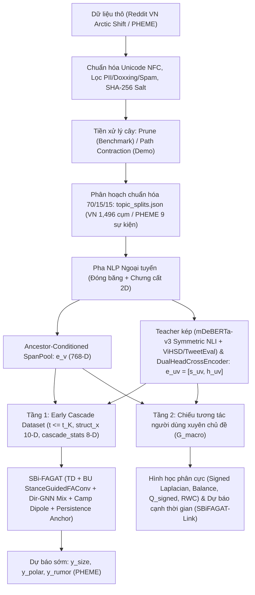
*Hình 2.1: Kiến trúc tổng thể Hai tầng và luồng dữ liệu chống rò rỉ của hệ thống `SBi-FAGAT`.*

Quy trình **Chống rò rỉ dữ liệu 5 lớp (*Zero Data Leakage Contract*)** được kiểm định tự động bằng bộ kiểm thử `pytest` trước khi chạy thực nghiệm:
1. **Chặn nhân quả thời gian ($t \le t_K$):** Mỗi chuỗi được sắp xếp theo khóa từ điển $(t_v, \text{depth}(v), \texttt{node\_id}(v))$ và cắt cứng ở tối đa $K$ bình luận sớm nhất ($K=20, N_{\text{reply}} \ge 25$ cho VN; $K=10, N_{\text{reply}} \ge 15$ cho PHEME). Toàn bộ đặc trưng nút, cấu trúc bậc ra sớm và thống kê nhịp độ $c_{\mathcal{G}}$ chỉ đọc $\mathcal{V}_K$, tuyệt đối cấm truy cập độ sâu toàn cây hay bậc nút tương lai.
2. **Phân hoạch độc lập chủ đề/sự kiện (`topic_splits.json`):** Phân hoạch 70/15/15 được khóa cứng ngay từ giai đoạn chưng cất Cross-Encoder đến huấn luyện/cắt bỏ GNN (`run_experiments.py`, `run_ablation.py`). Trên VN, hàm `cluster_vn_cascade_topics` (`src/data/arctic_shift_vn.py`) gom cụm liên thông các bài gốc có khoảng cách thời gian $\le 30$ ngày và độ tương đồng cosine TF-IDF (1–2 gram trên $300$ ký tự đầu) $\ge 0.30$ (*Heuristic Temporal-Keyword / TF-IDF Grouped Inductive Split* cho $1{,}496$ cụm), kèm kiểm chứng cắt dọc thời gian (*Temporal Holdout*) với cạnh cô lập từ Teacher. Trên PHEME, chia tách theo $9$ sự kiện tin tức và bổ sung giao thức `5-fold LOO` cô lập hoàn toàn cạnh Teacher (`edge_source="teacher"`) để Student không bao giờ nhìn thấy các sự kiện giữ lại.
3. **Cách ly biến mục tiêu:** Nhãn $y_{\text{size}}$ và $y_{\text{polar}}$ (tính trên tập tương tác tương lai $t > t_K$, riêng đường cong $K$-curve cố định cửa sổ tương lai tại $k > 50$) chỉ dùng để tính hàm mất mát.
4. **Giả danh hóa có muối (*Salted SHA-256 Pseudonymization*) & Lọc PII:** Định danh tác giả được băm ngay khi nạp dữ liệu qua `hash_author_sha256` sử dụng biến môi trường `SBIF_HASH_SALT` hoặc tệp bí mật `data/interim/.author_hash_salt.secret` (phát `UserWarning` nếu thiếu salt). Văn bản được lọc qua `redact_pii_text` (ẩn URL trang cá nhân Facebook, số tài khoản ngân hàng, số CCCD/CMND, số điện thoại Việt Nam thành `[REDACTED_PII]`) và loại bỏ bài *doxxing* (`is_doxxing_post`), bot `AutoModerator`, link rác (`shope.ee`, `bit.ly`, `t.me`), spam tiền ảo (`lmgx`).
5. **Cô lập kiểm định mù & Đóng gói an toàn:** Các tệp đáp án máy `*_machine_key.csv`, `*.secret`, `.env` bị chặn tuyệt đối khỏi mọi gói kết quả xuất bản.

### 2.2. Tiền xử lý cây hội thoại và Thuật toán Lọc rác bảo toàn cấu trúc cây (*Path Contraction*)

Trong dữ liệu mạng xã hội thực tế (đặc biệt trên Reddit `r/vozforums`), nhiều bình luận trung gian có nội dung rỗng, bị xóa (`[deleted]`, `[removed]`), do bot sinh ra (`AutoModerator`), spam hoặc chỉ là bình luận giữ chỗ vô nghĩa như `"hóng"`, `"chấm"`, `"lót dép"`, `"đặt gạch"`, `"up"`, `"ok"`. Nếu áp dụng chiến lược cắt bỏ truyền thống (`junk_mode="prune"`), toàn bộ các bình luận trả lời có giá trị thảo luận nằm bên dưới bình luận rác đó sẽ mất liên kết cha–con và bị đứt khỏi cây duyệt BFS.

Để giải quyết vấn đề này tại tầng ứng dụng và Demo mà không làm sai lệch phân phối độ sâu của các bảng thực nghiệm khoa học đã đóng băng, đề tài cài đặt thuật toán **Lọc rác bảo toàn cấu trúc cây 2 lượt (*Two-Pass Path Contraction*)** trong `src/data/arctic_shift_vn.py`:

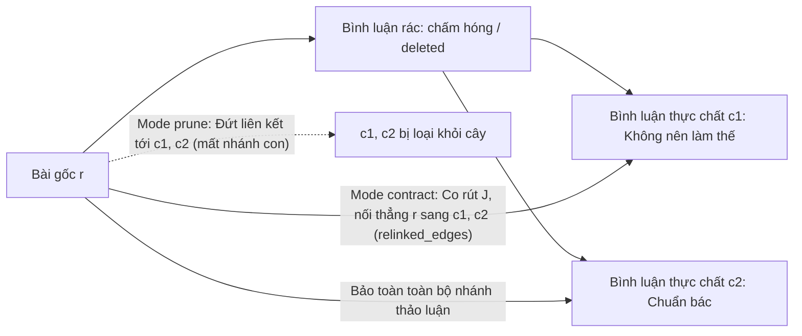
*Hình 2.2: So sánh cơ chế cắt bỏ truyền thống (`prune`) và lọc rác bảo toàn cấu trúc cây (`contract` — Path Contraction).*

Thuật toán hoạt động như sau:
- **Lượt 1 (Ghi nhận cấu trúc thô & Phân loại rác an toàn):** Toàn bộ bình luận `t1_*` thuộc bài gốc `t3_<post_id>` được ánh xạ vào bảng cha thô `raw_parent_map: node_id -> raw_parent_id` trước khi lọc bất kỳ nút nào. Hàm `is_filler_junk_text` phân loại rác dựa trên danh sách điều kiện tường minh:
  1. Thỏa mãn `is_invalid_or_spam_text` (rỗng, `[deleted]`, `[removed]`, `AutoModerator`, spam domain, crypto spam, doxxing, URL không kèm nội dung chữ).
  2. Chuỗi chỉ gồm dấu câu/emoji không chứa bất kỳ ký tự chữ hoặc số nào (`not any(ch.isalnum() for ch in norm)`).
  3. Cụm từ sau khi đưa về chữ thường và bỏ dấu câu rơi vào tập 24 cụm từ giữ chỗ tường minh `_EXPLICIT_FILLER_PHRASES`: `{"hong", "hóng", "cham", "chấm", "up", "bump", "cmt", "ke", "ké", "xin slot", "cham hong", "chấm hóng", "hong ke", "hóng ké", "lot dep", "lót dép", "lot dep hong", "lót dép hóng", "dau chan", "dấu chân", "dat gach", "đặt gạch", "ok", "oke"}`.
  - **Bảo vệ lập trường ngắn 1–2 từ:** Thuật toán cố ý **không** dùng ngưỡng cắt theo số lượng từ, đồng thời giữ lại tường minh `"+1"` và `"-1"`, nhằm bảo vệ trọn vẹn các lập trường ngắn nhưng mang tính phân cực rõ như `"Đồng ý"`, `"Phản đối"`, `"Không nên"`, `"Chuẩn bác"`, `"Đúng rồi"`, `"Sai rồi"`, `"Đồng tình"`, `"Ủng hộ"`, `"Tào lao"`.
- **Lượt 2 (Co rút đường đi có chống chu trình — `resolve_contracted_parent_id`):** Khi `junk_mode == "contract"`, với mỗi nút hợp lệ trong `kept_ids`, thuật toán leo ngược theo `raw_parent_map` qua chuỗi các tổ tiên rác (lưu vào `traversed_junk_out`) cho tới khi gặp nút tổ tiên hợp lệ gần nhất thuộc `kept_ids` hoặc về tới `root_id`. Cơ chế kiểm tra `seen` và `probe_seen` phát hiện và ngắt mọi chu trình tiềm ẩn bằng cách trỏ về `root_id`. Hệ thống xuất thống kê đầy đủ (`raw_comments`, `kept_comments`, `dropped_leaves`, `contracted_nodes`, `relinked_edges`, `relinked_edge_ids`).
- **Quy ước áp dụng:** Toàn bộ kết quả thực nghiệm lõi trong Chương 3 giữ nguyên mặc định `junk_mode="prune"` để bảo toàn tính nhất quán với `topic_splits.json` đã khóa; chế độ `junk_mode="contract"` được kích hoạt trong đường ống suy luận trực tiếp và Demo Web ở Chương 4.

### 2.3. Trích xuất đặc trưng NLP và Chưng cất Cross-Encoder 2D

#### 2.3.1. Đặc trưng nút *Ancestor-Conditioned SpanPool* và Bộ mô tả nhân quả

Với mỗi nút $v \in \mathcal{V}_K$, chuỗi ngữ cảnh tổ tiên nhân quả được dựng theo định dạng:
- Ở độ sâu $1$: `[CLS] root [SEP] reply [SEP]` (bỏ trùng lặp nút cha vì cha chính là gốc).
- Ở độ sâu $\ge 2$: `[CLS] root [SEP] parent [SEP] reply [SEP]` (cắt bài gốc theo tỷ lệ 60% đầu + 40% cuối khi vượt ngân sách $256$ token để giữ cả phần mở đầu lẫn kết luận).

Các mô hình đóng băng (`uitnlp/visobert` cho Tiếng Việt; `cardiffnlp/twitter-roberta-base` cho Tiếng Anh) chỉ gộp trung bình (*mean-pool*) tầng ẩn cuối trên **mặt nạ token thuộc riêng `reply`** để thu được vector ngữ nghĩa $\mathbf{e}_v^{\text{Span}} \in \mathbb{R}^{768}$, ghép cùng thời gian trễ và độ sâu chuẩn hóa tạo thành đặc trưng nút $x_v = [\mathbf{e}_v^{\text{Span}} \Vert t_{\text{norm}}(v) \Vert d_{\text{norm}}(v)] \in \mathbb{R}^{770}$, trong đó:
$$t_{\text{norm}}(v) = \min\!\left(1, \frac{\ln(1 + \Delta t_v)}{\ln(1 + T_{\text{ref}})}\right), \qquad d_{\text{norm}}(v) = \min\!\left(1, \frac{\operatorname{depth}(v)}{K}\right)$$
với $T_{\text{ref}} = 604{,}800\text{ s}$ ($7$ ngày). Ngoài ra, `EarlyCascadeDataset` trích xuất $10$ đặc trưng cấu trúc nhân quả nút $\mathbf{s}_v^{\text{struct}} \in [0, 1]^{10}$ và $8$ đặc trưng nhịp độ lan truyền sớm $c_{\mathcal{G}} \in [0, 1]^8$ (Bảng 2.1). Với mô hình đối chứng phi cấu trúc `TextMLP`, các cột tô-pô `{1, 4, 6, 7}` trong $\mathbf{s}_v^{\text{struct}}$ và `{3, 4, 7}` trong $c_{\mathcal{G}}$ bị khóa bằng $0$.

| Tensor | Chiều | Thành phần đặc trưng (giới hạn trong $[0, 1]$, chỉ tính trên $\mathcal{V}_K$ với $t \le t_K$) |
| :--- | :---: | :--- |
| **$\mathbf{s}_v^{\text{struct}}$** | $10$ | (0) $t_{\text{norm}}$ trễ so với gốc; (1) trễ log so với cha trực tiếp $\Delta t_{\text{par}}$; (2) pha thời gian tương đối $\Delta t_v / t_K$; (3) thứ tự thời gian $i/K$; (4) độ sâu chuẩn hóa $d_{\text{norm}}$; (5) cờ nút gốc `is_root`; (6) bậc ra sớm chuẩn hóa trong $\mathcal{V}_K$; (7) cờ nút lá sớm `is_early_leaf`; (8) cờ tác giả gốc quay lại bình luận `is_op_reentry`; (9) số lần lặp lại trước đó của tác giả $/K$. |
| **$c_{\mathcal{G}}$** | $8$ | (0) tổng khoảng thời gian chuẩn hóa đạt $K$ bình luận; (1) khoảng cách thời gian trung bình giữa các lượt đến; (2) gia tốc bùng nổ $\sigma(\ln(1+\bar{g}_{\text{early}}) - \ln(1+\bar{g}_{\text{late}}))$; (3) tỷ lệ bình luận trả lời thẳng gốc; (4) độ sâu tối đa sớm $/K$; (5) tỷ lệ tác giả duy nhất đã băm; (6) tỷ lệ bình luận thực chất ($\ge 8$ từ); (7) chỉ số kích động một chiều $|\bar{s}_{uv}|\cdot\bar{h}_{uv}$. |

*Bảng 2.1: Đặc tả bộ đặc trưng cấu trúc nhân quả nút và nhịp độ lan truyền sớm.*

#### 2.3.2. Teacher kép và Chưng cất Student `DualHeadCrossEncoder`

Mỗi cạnh trả lời $(u, v)$ được gán thuộc tính 2 chiều $e_{uv} = [s_{uv}, h_{uv}]^\top \in [-1, 1] \times [0, 1]$ thông qua hai nhánh Teacher chạy song song theo lô phân nhóm độ dài (*length-bucketing*, bảo toàn bất biến thứ tự đầu vào):
1. **Nhánh Lập trường NLI Đối xứng ($s_{uv}$):** Sử dụng `MoritzLaurer/mDeBERTa-v3-base-xnli-multilingual-nli-2mil7` với ngân sách $384$ token ưu tiên bảo toàn toàn bộ văn bản `reply` trước khi cắt `parent` (chạy ở FP32/BF16 trên GPU T4 để tránh tràn số logit FP16 của DeBERTa). Với mỗi cặp $(u, v)$, hệ thống đánh giá hai giả thuyết đối xứng: ủng hộ $(e_{\text{sup}}, n_{\text{sup}}, c_{\text{sup}})$ và phản đối $(e_{\text{opp}}, n_{\text{opp}}, c_{\text{opp}})$. Phần **mâu thuẫn kép (*double contradiction*)** $m_{\text{dc}} = \min(c_{\text{sup}}, c_{\text{opp}})$ được khử và cộng về lớp trung lập nhằm tránh thổi phồng đồng thời cả hai cực:
   $$p_{\text{sup}} = \tfrac{1}{2}\bigl(e_{\text{sup}} + (c_{\text{opp}} - m_{\text{dc}})_+\bigr), \quad p_{\text{opp}} = \tfrac{1}{2}\bigl(e_{\text{opp}} + (c_{\text{sup}} - m_{\text{dc}})_+\bigr), \quad p_{\text{neu}} = \tfrac{1}{2}(n_{\text{sup}} + n_{\text{opp}}) + m_{\text{dc}}$$
   từ đó tính $s_{uv} = p_{\text{sup}} - p_{\text{opp}} \in [-1, 1]$. Hệ thống đồng thời chấm điểm các cặp trực tiếp `(root, deep_reply)` cho nút ở độ sâu $\ge 2$ để tránh trôi dấu qua nhiều chặng khi tạo nhãn mục tiêu.
2. **Nhánh Công kích ($h_{uv}$):** Với tiếng Việt, `uitnlp/visobert` được tinh chỉnh trên `UIT-ViHSD` bằng trọng số lớp nghịch đảo căn bậc hai tần suất ($[0.4104, 1.4447, 1.1448]$, đạt `Val Macro-F1 = 0.7390`); với tiếng Anh, dùng mô hình chuẩn `cardiffnlp/twitter-roberta-base-offensive`.
3. **Chưng cất Student `DualHeadCrossEncoder`:** Chỉ huấn luyện trên tập $\mathcal{T}_{\text{train}}$ của `topic_splits.json` (có tăng cường cặp `(root, deep_reply)`). Nhánh lập trường ghép 5 khối tương tác ngữ nghĩa trên mặt nạ ngữ cảnh $\mathbf{h}_{\text{ctx}}$ và mặt nạ phản hồi $\mathbf{h}_{\text{reply}}$:
   $$\mathbf{r}_{\text{rel}} = \bigl[\mathbf{h}_{\text{CLS}} \;\Vert\; \mathbf{h}_{\text{ctx}} \;\Vert\; \mathbf{h}_{\text{reply}} \;\Vert\; (\mathbf{h}_{\text{ctx}} \odot \mathbf{h}_{\text{reply}}) \;\Vert\; |\mathbf{h}_{\text{ctx}} - \mathbf{h}_{\text{reply}}|\bigr] \in \mathbb{R}^{5 d_{\text{PLM}}}$$
   Trong khi đó, nhánh công kích $h_{uv}$ **chỉ đọc vector phân đoạn trả lời $\mathbf{h}_{\text{reply}}$ (*reply-span pooling*)** qua `Dropout(LayerNorm(h_reply))`, loại bỏ hoàn toàn hiện tượng ngôn từ gay gắt ở bình luận cha lây sang đánh giá bình luận con hiền hòa. Hàm mất mát chưng cất kết hợp phân kỳ KL hiệu chỉnh nhiệt độ $T = 2.0$ (trọng số $T^2 = 4.0$), Smooth-L1 ($\beta = 0.1$) và BCE:
   $$\mathcal{L}_{\text{distill}} = T^2 \cdot \operatorname{KL}_T\bigl(\mathbf{p}_{\text{stance}}^{\text{student}}, \mathbf{p}_{\text{stance}}^{\text{teacher}}\bigr) + 0.5\,\operatorname{SmoothL1}_{\beta=0.1}\bigl(\hat{s}_{uv}, s_{uv}\bigr) + \operatorname{BCEWithLogits}\bigl(z_{h_{uv}}, h_{uv}\bigr)$$

| Ngôn ngữ / Bộ dữ liệu | Cặp cạnh (Deep pairs) | Tăng cường gốc (Train) | Val Loss (Epoch 3/3) | Val MAE ($s_{uv} / h_{uv}$) | Val Pearson ($s_{uv} / h_{uv}$) |
| :--- | :---: | :---: | :---: | :---: | :---: |
| **VN** (`uitnlp/visobert`) | $86{,}320$ ($42{,}333$) | $30{,}307$ | $0.2961$ | $0.1147 / 0.0346$ | $0.6601 / 0.8196$ |
| **PHEME** (`twitter-roberta-base`) | $74{,}324$ ($38{,}223$) | $25{,}902$ | $0.5818$ | $0.0710 / 0.0336$ | $0.8104 / 0.9834$ |

*Bảng 2.2: Telemetry chưng cất `DualHeadCrossEncoder` 2D cô lập phân đoạn trên tập Train/Val chuẩn hóa (`"best_epoch": 2` trong `distill_report.json` theo chỉ số 0-indexed `0, 1, 2`, tức kỷ nguyên cuối Epoch 3/3).*

### 2.4. Mô hình Tầng 1 `SBi-FAGAT`

Tất cả 8 mô hình Tầng 1 sử dụng đồng nhất bộ mã hóa đầu vào `TwoStreamNodeStem`, chiếu riêng phần ngữ nghĩa $\mathbb{R}^{768} \to \mathbb{R}^{48}$ và phần cấu trúc $\mathbb{R}^{10} \to \mathbb{R}^{16}$ qua `Linear + GELU + LayerNorm` trước khi ghép nối thành biểu diễn khởi đầu $\mathbf{h}_v^{(0)} \in \mathbb{R}^{d}$ ($d = 64$, $L = 2$ tầng truyền thông điệp). Với `SBi-FAGAT`, trạng thái hai luồng có hướng $\xi \in \{\text{TD}, \text{BU}\}$ (luồng đối nghịch $\bar{\xi}$) cùng khởi tạo bằng $\mathbf{h}_v^{(0)}$; các cạnh đảo chiều ở luồng Bottom-Up $(v \to u)$ giữ nguyên thuộc tính diễn ngôn cha–con $e_{uv}$.

#### 2.4.1. Tầng tích chập `StanceGuidedFAConv` (Hai kênh & Dir-GNN Cross-Mixing)

Tại mỗi tầng $l \in \{1, \dots, L\}$, vector nút được biến đổi tuyến tính $\mathbf{z}_u^{\xi,(l)} = \mathbf{W}^{\xi,(l)} \mathbf{h}_u^{\xi,(l-1)}$ và chuẩn hóa $\mathbf{z}_u^{\xi,\text{norm},(l)} = \operatorname{LN}(\mathbf{z}_u^{\xi,(l)})$. Khối chú ý tách vector $\mathbf{z}_u^{\xi,(l)}$ thành hai nửa kênh bằng nhau thuộc $\mathbb{R}^{d/2}$: $\mathbf{z}_u^{\xi,(l)} = [(\mathbf{z}_u^{\xi,\text{pol},(l)})^\top, (\mathbf{z}_u^{\xi,\text{exc},(l)})^\top]^\top$, chịu sự điều phối của hai cổng:

- **Kênh phân cực có dấu ($\gamma_{uv}^{\xi,(l)} \in (-1, 1)$):** Cho phép lọc thông thấp ($\gamma > 0$) trên các cạnh đồng thuận và lọc thông cao ($\gamma < 0$) để khuếch đại đối lập trên các cạnh phản bác:
  $$\gamma_{uv}^{\xi,(l)} = \tanh\!\left(\frac{(\mathbf{a}_{\text{node}}^{\xi,(l)})^\top \bigl[\mathbf{z}_u^{\xi,\text{norm},(l)} \Vert \mathbf{z}_v^{\xi,\text{norm},(l)}\bigr]}{\sqrt{2d}} + \omega^{\xi,(l)} \cos\bigl(\mathbf{z}_u^{\xi,\text{norm},(l)}, \mathbf{z}_v^{\xi,\text{norm},(l)}\bigr) + (\mathbf{a}_{\text{edge}}^{\xi,(l)})^\top e_{uv} + \delta_{\gamma}^{\xi,(l)}(e_{uv})\right)$$
  trong đó trọng số nút khởi tạo Xavier gain $0.2$, trọng số cosine $\omega^{(0)} = 0.10$, trọng số cạnh khởi tạo $[0.6, -0.4]$ (với $e_{uv}$ 2D), và $\delta_\gamma$ là đầu ra thứ nhất của mạng cơ sở 2 tầng GELU trên $[s_{uv}, h_{uv}, s_{uv}h_{uv}, |s_{uv}|]^\top$.
- **Kênh kích thích không dấu ($\alpha_{uv}^{\text{exc},(l)} \in (0, 1)$):** Bảo toàn cường độ tranh luận bất kể dấu tán thành hay phản đối (hữu ích cho dự báo quy mô lan truyền $y_{\text{size}}$):
  $$\alpha_{uv}^{\text{exc},(l)} = \sigma\bigl(0.8|s_{uv}| + 0.8 h_{uv} + \delta_{\alpha}^{\xi,(l)}(e_{uv})\bigr), \qquad \phi_{uv}^{\xi,(l)}(\mathbf{z}_u^{\xi,(l)}) = \begin{bmatrix} \gamma_{uv}^{\xi,(l)}\, \mathbf{z}_u^{\xi,\text{pol},(l)} \\ \alpha_{uv}^{\text{exc},(l)}\, \mathbf{z}_u^{\xi,\text{exc},(l)} \end{bmatrix}$$

Dưới chuẩn hóa bậc đối xứng $c_{uv}^{\xi} = \sqrt{(d_{\text{out}}^{\xi}(u)+1)(d_{\text{in}}^{\xi}(v)+1)}$, thông điệp tổng hợp $\mathbf{m}_v^{\xi,(l)} = \sum_{u \in \mathcal{N}^{\xi}(v)} \frac{1}{c_{uv}^{\xi}}\phi_{uv}^{\xi,(l)}(\mathbf{z}_u^{\xi,(l)})$ được cộng với phần dư trạng thái trước, neo ban đầu $\varepsilon = 0.5$, quảng bá nút gốc $\mathbf{h}_{\text{root}}^{(0)}$, hàm kích hoạt ổn định lẻ, `Dropout(LN(...))`, và phép trộn chéo hai hướng **Dir-GNN** ($\eta_l^{(0)} = 0.10$) [18]:
$$\mathbf{r}_v^{\xi,(l)} = 0.5\,\mathbf{h}_v^{\xi,(l-1)} + \varepsilon \mathbf{h}_v^{(0)} + \mathbf{m}_v^{\xi,(l)} + \mathbf{W}_{\text{root}}^{\xi,(l)} \mathbf{h}_{\text{root}}^{(0)} + \mathbf{b}_{\text{root}}^{\xi,(l)}$$
$$\tilde{\mathbf{h}}_v^{\xi,(l)} = \operatorname{Dropout}\!\Bigl(\operatorname{LN}\!\bigl(\mathbf{r}_v^{\xi,(l)} + 0.2\tanh(\mathbf{r}_v^{\xi,(l)})\bigr)\Bigr), \qquad \mathbf{h}_v^{\xi,(l)} = \tilde{\mathbf{h}}_v^{\xi,(l)} + \tanh(\eta_l) \mathbf{W}_{\text{mix}}^{\xi,(l)} \tilde{\mathbf{h}}_v^{\bar{\xi},(l)}$$

#### 2.4.2. Hợp nhất TD+BU, Readout Camp Dipole và Tối ưu Đa nhiệm

Sau $L=2$ tầng, trạng thái nút hợp nhất $\mathbf{h}_v = \tfrac{1}{2}(\mathbf{h}_v^{\text{TD},(L)} + \mathbf{h}_v^{\text{BU},(L)})$, biểu diễn gốc $\mathbf{z}_{\text{root}} = \tfrac{1}{2}(\mathbf{h}_{\text{root}}^{\text{TD},(L)} + \mathbf{h}_{\text{root}}^{\text{BU},(L)})$ và gộp chú ý toàn cục hai nhánh $\mathbf{z}_{\text{att}} = \tfrac{1}{2}(\operatorname{Attn}_{\text{TD}}(\{\mathbf{h}_v^{\text{TD},(L)}\}) + \operatorname{Attn}_{\text{BU}}(\{\mathbf{h}_v^{\text{BU},(L)}\}))$ ghép thành $\mathbf{z}_{\text{base}} = [\mathbf{z}_{\text{root}} \Vert \mathbf{z}_{\text{att}}] \in \mathbb{R}^{2d}$.

Để đo lường trực tiếp khoảng cách phân cực giữa hai phe quan điểm trong biểu diễn đồ thị, khối thắt cổ chai **Camp Dipole** ($\operatorname{MLP}_{\text{dip}}\!: \mathbb{R}^{3d+6} \to \mathbb{R}^{d/2} \to \mathbb{R}^{2d}$, $\beta_{\text{dip}}^{(0)} = 0.25$) chạy thuật toán BFS tối đa $64$ bước quy chiếu về gốc ($\epsilon_0 = 0.1$, tách gradient $\text{detach}$ của nút cha để tránh bùng nổ Jacobian) trên cổng tầng cuối $\gamma_{uv}^{\text{TD},(L)}$ thu được cổng định hướng $\hat{\gamma}_{uv} \in [-1, 1]$. Từ đó tính trọng số phe $w_\pm(v) = \operatorname{ReLU}(\pm\hat{\gamma}_{uv})$, tỷ phần phe $f_\pm = (\sum_v w_\pm(v))/|\mathcal{E}_K^{\text{TD}}|$, tâm cụm phe $\boldsymbol{\mu}_\pm = \sum_v w_\pm(v)\mathbf{h}_v / \sum_v w_\pm(v)$ và độ cân bằng $b = 2\mathbb{I}[\text{both}]\sqrt{\operatorname{clip}(f_+ f_-, 0, 0.25) + 10^{-8}}$, cho ra:
$$\mathbf{z}_{\text{dipole}}^{\text{polar}} = b\sqrt{(\boldsymbol{\mu}_+ - \boldsymbol{\mu}_-)^2 \mathbb{I}[\text{both}] + 10^{-8}}, \qquad \mathbf{z}_{\text{dipole}}^{\text{signed}} = (\boldsymbol{\mu}_+ - \boldsymbol{\mu}_-)\mathbb{I}[\text{both}]$$
ghép cùng độ phân tán nút $\mathbf{z}_{\text{disp}} = \sqrt{\operatorname{Var}_v(\mathbf{h}_v) + 10^{-6}}$ và $6$ mô-men cổng vô hướng $\mathbf{g}_{\text{mom}}$ (trung bình, độ lệch chuẩn, trung bình trị tuyệt đối của $\gamma_{uv}^{\text{TD},(L)}$ cùng $f_+, f_-, b$) để điều biến $\mathbf{z}_{\text{graph}} = \operatorname{LN}\bigl(\mathbf{z}_{\text{base}} + \tanh(\beta_{\text{dip}})\operatorname{MLP}_{\text{dip}}([\mathbf{z}_{\text{disp}} \Vert \mathbf{z}_{\text{dipole}}^{\text{polar}} \Vert \mathbf{z}_{\text{dipole}}^{\text{signed}} \Vert \mathbf{g}_{\text{mom}}])\bigr)$ (che bằng $0$ các thành phần dipole khi chuỗi chỉ tồn tại một phe).

Bên trong `MultiTaskHead`, vector nhịp độ $c_{\mathcal{G}} \in \mathbb{R}^8$ đi qua phép chiếu $\mathbb{R}^8 \to \mathbb{R}^{32}$ và **chỉ ghép vào `size_head` và `rumor_head`**, còn `polar_head` nhận thuần túy $\mathbf{z}_{\text{graph}}$ để dự báo $\Delta z_{\text{polar}}$. Trên tất cả các mô hình có dùng lập trường cạnh (`SBiFAGAT`, `TemporalStanceMLP`, `EdgeGATv2`, `BiEdgeGATv2`), logit phân cực được neo bằng **Persistence-Residual** chuẩn hóa theo trung bình logit tập Train $\bar{\ell}_{\text{train}}$:
$$z_{\text{polar}} = \tanh(w_p)\Bigl(\operatorname{logit}\bigl(\operatorname{clip}(y_{\text{polar}}^{\text{early}}(\mathcal{G}_K), 0.02, 0.98)\bigr) - \bar{\ell}_{\text{train}}\Bigr) + \Delta z_{\text{polar}}$$
Nhãn mục tiêu phân cực tương lai $y_{\text{polar}}$ tính trên $n \ge 2$ bình luận hậu chân trời ($t > t_K$) theo công thức biên độ tuyến tính khử chệch Bessel $\frac{n}{n-1}$:
$$y_{\text{polar}} = \operatorname{clip}\!\Biggl(0.5\,\min\!\bigl(1, s_{\tilde{s},\text{ddof}=1}\bigr) + 0.5\,\min\!\left(1, 2\sqrt{\frac{n}{n-1} m_+ m_-}\right),\, 0,\, 1\Biggr)$$
và được tối ưu bằng hàm mất mát **KL-calibrated BCE + SmoothL1** (loại bỏ suy giảm đạo hàm ở hai đuôi của sigmoid):
$$\mathcal{L}_{\text{polar}} = \bigl(\operatorname{BCEWithLogits}(z_{\text{polar}}, y_{\text{polar}}) - H(y_{\text{polar}})\bigr)_+ + \operatorname{SmoothL1}_{\beta=0.05}\bigl(\sigma(z_{\text{polar}}), y_{\text{polar}}\bigr)$$
kết hợp Huber loss trên $y_{\text{size}}$, cross-entropy trọng số căn bậc hai nghịch đảo tần suất trên $y_{\text{rumor}}$ (PHEME), tỷ lệ cân bằng đa nhiệm $2:1$ chuẩn hóa theo mất mát đường cơ sở hằng số trên Train ($\frac{1.0}{\mathcal{L}_{\text{size}}^{\text{const}}}\,\mathcal{L}_{\text{size}} + \frac{0.5}{\mathcal{L}_{\text{polar}}^{\text{const}}}\,\mathcal{L}_{\text{polar}}$ với `size_loss_scale` $\in [0.5, 16.0]$, `polar_loss_scale` $\in [0.5, 250.0]$), khởi tạo bias đầu ra theo Train, tối ưu AdamW (`lr = 1e-3`, `weight_decay = 1e-4`, `dropout = 0.1`, gradient clipping `5.0`), batch $32$ ($64$ trên UPFD), tối đa $100$ epoch với $5$ epoch warmup + `ReduceLROnPlateau` (hệ số $0.5$, patience $5$, min LR $2\times 10^{-5}$), EMA (`decay = 0.985`), dừng sớm patience $10$ theo `val task_loss` trên đúng 5 hạt giống `[42, 100, 2024, 777, 999]`.

Các mô hình đối chứng thi đấu công bằng ở cùng độ rộng $d=64, L=2$ gồm: (1) `Early-K Persistence` (phi tham số, dự đoán quy mô bằng trung bình Train và phân cực bằng công thức $y_{\text{polar}}$ tính trực tiếp trên cây sớm không ghi đè gốc), (2) `TextMLP` (che các cột tô-pô), (3) `TemporalStanceMLP` (gộp đặc trưng nút thời gian + thống kê `mean/std/min/max` của $e_{uv}$ không truyền thông điệp đồ thị), (4) `StandardGCN`, (5) `StandardGATv2`, (6) `EdgeGATv2` (vô hướng nhận $e_{uv}$), (7) `FAGCN`, (8) `BiGCN`, và (9) `BiEdgeGATv2 (Matched)` (đối chứng cân xứng hai nhánh TD+BU + $e_{uv}$ + attention readout trong bảng cắt bỏ). Trên UPFD không có văn bản phản hồi, `LatentConflictMLP` tổng hợp thuộc tính cạnh ẩn từ $\operatorname{MLP}([\mathbf{x}_u \Vert \mathbf{x}_v \Vert \mathbf{x}_u - \mathbf{x}_v])$.

### 2.5. Mô hình Tầng 2 Mạng người dùng có dấu và `SBiFAGAT-Link`

Mạng xã hội vĩ mô $\mathcal{G}_{\text{macro}} = (\mathcal{U}, \mathcal{E}_{\text{user}})$ lọc bỏ tài khoản `[deleted]`/`None` và cạnh tự lặp ($u = v$), chỉ giữ lại các tương tác hợp lệ có định danh băm ở cả hai đầu.

1. **Hình học phân cực vĩ mô (`compute_macro_signed_network_stats`):** Các cặp người dùng vô hướng có lập trường trung bình $|\bar{s}_{uv}| \ge 0.1$ hình thành mạng cạnh mạnh với trọng số $w_{uv} = \operatorname{sign}(\bar{s}_{uv})|\bar{s}_{uv}|\ln(1 + c_{uv})$ qua $c_{uv}$ tương tác. Phân đôi quang phổ trên thành phần liên thông yếu lớn nhất (WCC) trả về tỷ lệ tam giác cân bằng và $z$-score ($100$ phép hoán vị dấu cạnh), $Q_{\text{signed}}$, RWC và tỷ lệ đối đầu ($s_{uv} \le -0.1$) / công kích ($h_{uv} \ge 0.5$) nội phe so với liên phe.
2. **Dự báo liên kết có dấu theo thời gian (`build_temporal_signed_link_dataset` & `SBiFAGAT-Link`):** Toàn bộ tương tác có dấu ($|s_{uv}| \ge 0.1$) được sắp xếp theo dấu thời gian UTC và chia tuyến tính $70\%/15\%/15\%$ tại các mốc cắt không chồng lấp $t_{\text{train}} < t_{\text{val}} < t_{\text{test}}$. Đặc trưng người dùng $x_u^{\text{macro}} = [\bar{\mathbf{e}}_u^{\text{Span}} \Vert \mathbf{a}_u^{\text{4D}}] \in \mathbb{R}^{772}$ chỉ tổng hợp vector SpanPool các bài đăng tại $t \le t_{\text{train}}^{\max}$ kèm $4$ chiều hoạt động không dấu ($\ln(1+\text{posts})/5$, $\ln(1+\text{cascades})/5$, $\ln(1+\text{out})/5$, $\ln(1+\text{in})/5$) để loại trừ rò rỉ dấu bậc một (trả về $0$ cho người dùng khởi đầu lạnh hoàn toàn vắng mặt trước $t_{\text{train}}^{\max}$, trong khi người dùng không thuộc tập cạnh Train có dấu vẫn giữ đặc trưng tiền mốc cắt nếu từng đăng bài trung lập $|s_{uv}| < 0.1$ hoặc ở chuỗi dưới ngưỡng). Trong quá trình huấn luyện theo mini-batch, mọi cạnh thuộc cùng cặp vô hướng $\{u, v\}$ trong batch đang xét bị che khỏi đồ thị truyền thông điệp; tại thời điểm đánh giá Val/Test, toàn bộ đồ thị Train được truyền không che (*unmasked*), cho phép các cặp người dùng lặp lại đọc lịch sử Train trước đó. Kiến trúc `SBiFAGAT-Link` biến đổi $x_u^{\text{macro}}$ qua `UserNodeStem` ($d=64$), chạy $L=2$ tầng `StanceGuidedFAConv` hai hướng $(u, v)$ và $(v, u)$ trộn qua khối chiếu dư GELU, rồi dự đoán xác suất cạnh đối đầu ($s_{uv} \le -0.1$) bằng `PairwiseSignedHead` trên $[\mathbf{h}_u \Vert \mathbf{h}_v \Vert \mathbf{h}_u \odot \mathbf{h}_v \Vert |\mathbf{h}_u - \mathbf{h}_v|]$ (AdamW `lr=1e-3`, tối đa $40$ epoch, batch $1{,}024$, early stopping patience $8$ trên `Val ROC-AUC`, ngưỡng Macro-F1 chọn trên Val, `BCEWithLogitsLoss` có trọng số lớp dương). Năm mô hình đối chứng ngang sức ($d=64, L=2$) gồm `UserTextMLP`, `StandardGCN`, `StandardGATv2`, `SGCN` (chỉ đọc dấu rời rạc $\operatorname{sign}(s_{uv})$) và `FAGCN`; chỉ `SBiFAGAT-Link` đọc vector cạnh liên tục 2D $[s_{uv}, h_{uv}]^\top$.

---

## Chương 3 — Thực nghiệm, Đánh giá & Thảo luận Trung thực

Mọi thực nghiệm chính thức được thực thi lặp lại trên đúng 5 hạt giống ngẫu nhiên `[42, 100, 2024, 777, 999]` ở cùng chiều ẩn $d=64$, $L=2$, với việc chọn mô hình đối chứng mạnh nhất (`comparator_model`) hoàn toàn trên tập **Validation** (không nhìn tập Test). Các kiểm định thống kê gồm paired-$t$ test hai phía trên 5 seed, paired bootstrap có hiệu chỉnh cụm chủ đề trên VN (`225` chuỗi qua $>6$ cụm), bootstrap IID cấp cây cố định trên Test PHEME (do chỉ có $2$ sự kiện Test, $<6$ cụm; ký hiệu `**` trên PHEME chỉ phản ánh độ tin cậy nội bộ giữa các cây trong $2$ sự kiện này chứ không thay thế ý nghĩa xuyên sự kiện, nơi paired-$t$ cho $p_{\text{adj}} = 1.00$), và kiểm định hoán vị dấu chính xác $2^5$ (*Exact Sign-Flip Permutation*, giá trị $p$ nhỏ nhất về mặt toán học là $2/2^5 = 0.0625$) cho 5-fold LOO và dự báo liên kết Tầng 2; tất cả đều hiệu chỉnh đa kiểm định Holm–Bonferroni có hướng.

### 3.1. Bộ dữ liệu và Đường cơ sở Persistence

`Bảng 3.1` tổng hợp thống kê khám phá hai bộ dữ liệu sau kiểm tra nhân quả cùng kết quả đường cơ sở phi tham số `Early-K Persistence`.

| Bộ dữ liệu | Chuỗi thô | Đủ điều kiện | Số chủ đề/sự kiện | Train / Val / Test | Trung vị (TB) Replies | Thời lượng trung vị (h) | Persist RMSE $\downarrow$ | Persist $r$ $\uparrow$ |
| :--- | :---: | :---: | :---: | :---: | :---: | :---: | :---: | :---: |
| **PHEME** ($K=10, N_{\text{reply}} \ge 15$) | $6{,}425$ | $2{,}664$ | $9$ | $1{,}786 / 544 / 334$ | $20.0$ ($27.9$) | $5.09$ | $0.0562$ | $0.3310$ |
| **VN** ($K=20, N_{\text{reply}} \ge 25$) | $1{,}500$ | $1{,}500$ | $1{,}496$ | $1{,}050 / 225 / 225$ | $44.0$ ($57.5$) | $95.22$ | $0.0788$ | $0.0217$ |

*Bảng 3.1: Thống kê bộ dữ liệu và đường cơ sở `Early-K Persistence` trên tập Test (`paper/tables_dataset_eda.tex`).*

Trên cả hai kho ngữ liệu, `Early-K Persistence` hoàn toàn sụp đổ về phương sai giải thích phân cực ($R^2_{\text{polar}} = -3.1986$ trên VN và $-0.3022$ trên PHEME), chứng tỏ phân cực quan điểm ở giai đoạn hậu chân trời ($t > t_K$) không thể suy diễn tuyến tính đơn giản bằng phép ngoại suy trực tiếp cây sớm $K$ bình luận đầu tiên.

### 3.2. Kết quả Tầng 1 trên Reddit Việt Nam (Inductive & Temporal Holdout)

`Bảng 3.2` và `Bảng 3.3` trình bày kết quả 5-seed trên tập Test VN ($N=225$ chuỗi) theo giao thức Inductive chuẩn hóa và giao thức Temporal Holdout (sử dụng cạnh cô lập Teacher).

| Mô hình | MSLE $\downarrow$ | MAE $\downarrow$ | $R^2_{\text{size}}$ $\uparrow$ | RMSE $\downarrow$ | $R^2_{\text{polar}}$ $\uparrow$ | Pearson $r$ $\uparrow$ | Spearman $\rho$ $\uparrow$ |
| :--- | :---: | :---: | :---: | :---: | :---: | :---: | :---: |
| `Early-K Persistence` | $0.2285 \pm 0.0000$ | $0.3872 \pm 0.0000$ | $-0.0232 \pm 0.0000$ | $0.0788 \pm 0.0000$ | $-3.1986 \pm 0.0000$ | $0.0217 \pm 0.0000$ | $0.0363 \pm 0.0000$ |
| `TextMLP` | $0.1567 \pm 0.0102$ | **$0.3027 \pm 0.0138$** | $0.2987 \pm 0.0455$ | $0.0370 \pm 0.0004$ | $0.0741 \pm 0.0181$ | **$0.2989 \pm 0.0110$** | **$0.2501 \pm 0.0167$** |
| `TemporalStanceMLP` | $0.1542 \pm 0.0026$ | $0.3046 \pm 0.0036$ | $0.3095 \pm 0.0118$ | $0.0373 \pm 0.0005$ | $0.0608 \pm 0.0239$ | $0.2777 \pm 0.0211$ | $0.2245 \pm 0.0270$ |
| `StandardGCN` | **$0.1542 \pm 0.0048$** | $0.3044 \pm 0.0070$ | **$0.3097 \pm 0.0216$** | $0.0374 \pm 0.0004$ | $0.0538 \pm 0.0182$ | $0.2528 \pm 0.0237$ | $0.2062 \pm 0.0139$ |
| `StandardGATv2` | $0.1579 \pm 0.0074$ | $0.3062 \pm 0.0092$ | $0.2933 \pm 0.0332$ | $0.0373 \pm 0.0003$ | $0.0591 \pm 0.0144$ | $0.2610 \pm 0.0262$ | $0.2051 \pm 0.0343$ |
| `EdgeGATv2` | $0.1550 \pm 0.0065$ | $0.3027 \pm 0.0070$ | $0.3062 \pm 0.0289$ | $0.0371 \pm 0.0004$ | $0.0689 \pm 0.0206$ | $0.2794 \pm 0.0284$ | $0.2136 \pm 0.0273$ |
| `FAGCN` | $0.1554 \pm 0.0079$ | $0.3042 \pm 0.0089$ | $0.3044 \pm 0.0353$ | $0.0374 \pm 0.0001$ | $0.0570 \pm 0.0070$ | $0.2618 \pm 0.0180$ | $0.2152 \pm 0.0055$ |
| `BiGCN` | $0.1638 \pm 0.0059$ | $0.3135 \pm 0.0066$ | $0.2665 \pm 0.0262$ | $0.0374 \pm 0.0002$ | $0.0562 \pm 0.0121$ | $0.2654 \pm 0.0221$ | $0.2237 \pm 0.0212$ |
| `SBiFAGAT` | $0.1580 \pm 0.0066$ | $0.3105 \pm 0.0061$ | $0.2926 \pm 0.0298$ | **$0.0370 \pm 0.0003$** | **$0.0742 \pm 0.0157$** | $0.2899 \pm 0.0278$ | $0.2272 \pm 0.0176$ |
| *Paired-$t$ $p$ (`SBiFAGAT` vs `TemporalStanceMLP`)* | $3.27\text{e-}01$ | $1.65\text{e-}01$ | $3.27\text{e-}01$ | $2.54\text{e-}01$ | $2.55\text{e-}01$ | $4.48\text{e-}01$ | $8.75\text{e-}01$ |
| *Cluster Bootstrap $p$* | $2.46\text{e-}01$ | $8.20\text{e-}02$ | $2.33\text{e-}01$ | $3.00\text{e-}01$ | $3.01\text{e-}01$ | $4.78\text{e-}01$ | $8.82\text{e-}01$ |
| *Holm–Bonferroni $p_{\text{adj}}$ (Paired-$t$ / Boot.)* | $1.00 / 1.00$ | $1.00 / 5.74\text{e-}01$ | $1.00 / 1.00$ | $1.00 / 1.00$ | $1.00 / 1.00$ | $1.00 / 1.00$ | $1.00 / 1.00$ |

*Bảng 3.2: Kết quả dự báo sớm trên Reddit Việt Nam ($K=20, N_{\text{reply}} \ge 25$, Inductive, 5 seeds; `paper/tables_main_vn.tex`).*

| Mô hình | MSLE $\downarrow$ | MAE $\downarrow$ | $R^2_{\text{size}}$ $\uparrow$ | RMSE $\downarrow$ | $R^2_{\text{polar}}$ $\uparrow$ | Pearson $r$ $\uparrow$ | Spearman $\rho$ $\uparrow$ |
| :--- | :---: | :---: | :---: | :---: | :---: | :---: | :---: |
| `Early-K Persistence` | $0.2540 \pm 0.0000$ | $0.4041 \pm 0.0000$ | $-0.0013 \pm 0.0000$ | $0.0874 \pm 0.0000$ | $-5.4386 \pm 0.0000$ | $0.1778 \pm 0.0000$ | $0.1741 \pm 0.0000$ |
| `TextMLP` | $0.2015 \pm 0.0105$ | $0.3448 \pm 0.0101$ | $0.2058 \pm 0.0415$ | $0.0332 \pm 0.0006$ | $0.0702 \pm 0.0333$ | $0.3267 \pm 0.0282$ | $0.2938 \pm 0.0274$ |
| `TemporalStanceMLP` | $0.2003 \pm 0.0059$ | $0.3420 \pm 0.0066$ | $0.2103 \pm 0.0232$ | **$0.0330 \pm 0.0004$** | **$0.0815 \pm 0.0198$** | **$0.3377 \pm 0.0112$** | $0.2875 \pm 0.0276$ |
| `StandardGCN` | $0.1972 \pm 0.0080$ | $0.3353 \pm 0.0064$ | $0.2227 \pm 0.0315$ | $0.0330 \pm 0.0003$ | $0.0815 \pm 0.0167$ | $0.3289 \pm 0.0190$ | $0.3034 \pm 0.0077$ |
| `StandardGATv2` | $0.1996 \pm 0.0053$ | $0.3362 \pm 0.0090$ | $0.2134 \pm 0.0210$ | $0.0334 \pm 0.0008$ | $0.0598 \pm 0.0462$ | $0.3244 \pm 0.0386$ | $0.2983 \pm 0.0303$ |
| `EdgeGATv2` | $0.1971 \pm 0.0065$ | $0.3397 \pm 0.0082$ | $0.2230 \pm 0.0257$ | $0.0331 \pm 0.0003$ | $0.0765 \pm 0.0162$ | $0.3312 \pm 0.0159$ | $0.2846 \pm 0.0165$ |
| `FAGCN` | **$0.1881 \pm 0.0129$** | **$0.3298 \pm 0.0133$** | **$0.2586 \pm 0.0509$** | $0.0333 \pm 0.0003$ | $0.0664 \pm 0.0176$ | $0.3266 \pm 0.0217$ | $0.2887 \pm 0.0231$ |
| `BiGCN` | $0.2021 \pm 0.0079$ | $0.3446 \pm 0.0115$ | $0.2033 \pm 0.0310$ | $0.0336 \pm 0.0002$ | $0.0481 \pm 0.0129$ | $0.2930 \pm 0.0194$ | $0.2675 \pm 0.0282$ |
| `SBiFAGAT` | $0.2051 \pm 0.0126$ | $0.3461 \pm 0.0070$ | $0.1914 \pm 0.0495$ | $0.0334 \pm 0.0009$ | $0.0609 \pm 0.0491$ | $0.3338 \pm 0.0319$ | **$0.3058 \pm 0.0187$** |
| *Paired-$t$ $p$ (`SBiFAGAT` vs `TemporalStanceMLP`)* | $3.11\text{e-}01$ | $1.89\text{e-}01$ | $3.11\text{e-}01$ | $4.36\text{e-}01$ | $4.31\text{e-}01$ | $8.28\text{e-}01$ | $3.10\text{e-}01$ |
| *Bootstrap $p$ (`SBiFAGAT` vs `TemporalStanceMLP`)* | $1.40\text{e-}01$ | $2.16\text{e-}01$ | $1.34\text{e-}01$ | $2.61\text{e-}01$ | $2.42\text{e-}01$ | $8.95\text{e-}01$ | $2.13\text{e-}01$ |
| *Holm–Bonferroni $p_{\text{adj}}$ (Paired-$t$ / Boot.)* | $1.00 / 9.35\text{e-}01$ | $1.00 / 1.00$ | $1.00 / 9.35\text{e-}01$ | $1.00 / 1.00$ | $1.00 / 1.00$ | $1.00 / 1.00$ | $1.00 / 1.00$ |

*Bảng 3.3: Kết quả kiểm chứng Temporal Holdout trên Reddit Việt Nam ($K=20$, cô lập cạnh Teacher; `paper/tables_temporal_vn.tex`).*

Trên tập Inductive VN, tất cả 8 kiến trúc học sâu đều cải thiện mạnh mẽ từ mức $R^2_{\text{polar}} = -3.1986$ của Persistence lên dải dương $[0.0538, 0.0742]$. `SBiFAGAT` đạt $R^2_{\text{polar}}$ cao nhất ($0.0742 \pm 0.0157$, RMSE $= 0.0370$), song kết quả này về mặt thống kê là **tương đương** với `TextMLP` ($0.0741$, thậm chí nhỉnh hơn về $r=0.2989$ và $\rho=0.2501$), `EdgeGATv2` ($0.0689$) và `TemporalStanceMLP` ($0.0608$, $p_{\text{adj}} \ge 0.574$). Ở bài toán quy mô, `StandardGCN` dẫn đầu với MSLE $= 0.1542$ ($R^2_{\text{size}} = 0.3097$) so với $0.1580$ ($0.2926$) của `SBiFAGAT`. Dưới phép thử cắt theo thời gian (*Temporal Holdout*), `Early-K Persistence` tiếp tục sụp xuống $-5.4386$, còn `SBiFAGAT` dẫn đầu về tương quan thứ hạng Spearman ($\rho = 0.3058 \pm 0.0187$), xếp sau `TemporalStanceMLP` ở $R^2_{\text{polar}}$ ($0.0609$ so với $0.0815$) và `FAGCN` ở $R^2_{\text{size}}$ ($0.1914$ so với $0.2586$). Điều này phản ánh một nhận định thực tế: trên các cây hội thoại đơn lẻ dài tối đa $21$ nút với độ tách cụm yếu ($1{,}496 / 1{,}500$), nhúng văn bản SpanPool đã chứa gần như toàn bộ thông tin dự báo khả dụng.

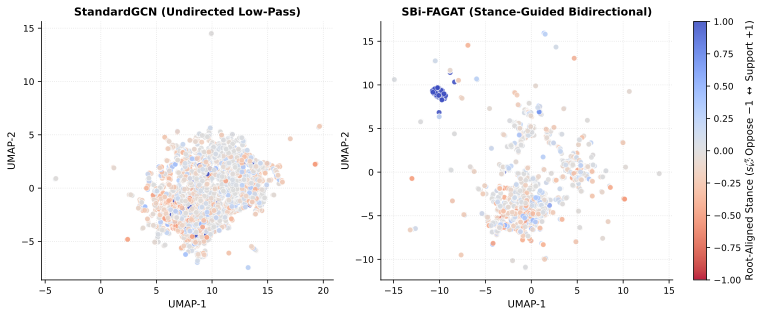

*Hình 3.1: Chiếu UMAP không gian ẩn nút trên tập Test VN (`StandardGCN` bên trái vs `SBiFAGAT` bên phải, tô màu theo lập trường quy chiếu gốc; bản PDF [`fig1_umap_polarization.pdf`](../paper/figures/vn/fig1_umap_polarization.pdf)).*

### 3.3. Kết quả Tầng 1 trên PHEME ($K=10, N_{\text{reply}} \ge 15$): Inductive và 5-Fold LOO

`Bảng 3.4` và `Bảng 3.5` trình bày kết quả trên PHEME ở cửa sổ rút gọn $K=10, N_{\text{reply}} \ge 15$.

| Mô hình | MSLE $\downarrow$ | MAE $\downarrow$ | $R^2_{\text{size}}$ $\uparrow$ | RMSE $\downarrow$ | $R^2_{\text{polar}}$ $\uparrow$ | Pearson $r$ $\uparrow$ | Spearman $\rho$ $\uparrow$ | Macro-F1 $\uparrow$ | Acc $\uparrow$ |
| :--- | :---: | :---: | :---: | :---: | :---: | :---: | :---: | :---: | :---: |
| `Early-K Persistence` | $0.1166$ | $0.2821$ | $-0.0999$ | $0.0562$ | $-0.3022$ | $0.3310$ | $0.3951$ | -- | -- |
| `TextMLP` | $0.1002 \pm 0.0066$ | $0.2486 \pm 0.0236$ | $0.0545 \pm 0.0620$ | **$0.0469 \pm 0.0004$** | **$0.0932 \pm 0.0162$** | $0.3640 \pm 0.0369$ | $0.3893 \pm 0.0657$ | $0.3379 \pm 0.0202$ | $0.6228 \pm 0.0500$ |
| `TemporalStanceMLP` | $0.1006 \pm 0.0055$ | $0.2371 \pm 0.0219$ | $0.0509 \pm 0.0514$ | $0.0470 \pm 0.0012$ | $0.0861 \pm 0.0460$ | $0.3739 \pm 0.0400$ | $0.4091 \pm 0.0419$ | $0.3440 \pm 0.0187$ | **$0.6443 \pm 0.0267$** |
| `StandardGCN` | $0.1003 \pm 0.0038$ | $0.2448 \pm 0.0131$ | $0.0538 \pm 0.0354$ | $0.0478 \pm 0.0004$ | $0.0586 \pm 0.0165$ | $0.3033 \pm 0.0537$ | $0.3326 \pm 0.0749$ | $0.3195 \pm 0.0219$ | $0.5790 \pm 0.0733$ |
| `StandardGATv2` | $0.0998 \pm 0.0068$ | $0.2446 \pm 0.0230$ | $0.0585 \pm 0.0638$ | $0.0475 \pm 0.0003$ | $0.0679 \pm 0.0124$ | $0.3115 \pm 0.0125$ | $0.3210 \pm 0.0418$ | $0.3263 \pm 0.0433$ | $0.6210 \pm 0.0547$ |
| `EdgeGATv2` | $0.0996 \pm 0.0072$ | $0.2410 \pm 0.0220$ | $0.0609 \pm 0.0675$ | $0.0472 \pm 0.0007$ | $0.0803 \pm 0.0260$ | **$0.4008 \pm 0.0472$** | **$0.4451 \pm 0.0307$** | $0.3299 \pm 0.0522$ | $0.5988 \pm 0.0988$ |
| `FAGCN` | **$0.0986 \pm 0.0062$** | **$0.2329 \pm 0.0161$** | **$0.0697 \pm 0.0584$** | $0.0485 \pm 0.0007$ | $0.0301 \pm 0.0268$ | $0.3171 \pm 0.0589$ | $0.3467 \pm 0.0915$ | $0.3238 \pm 0.0262$ | $0.5605 \pm 0.0221$ |
| `BiGCN` | $0.1066 \pm 0.0086$ | $0.2592 \pm 0.0220$ | $-0.0054 \pm 0.0813$ | $0.0482 \pm 0.0008$ | $0.0408 \pm 0.0329$ | $0.2830 \pm 0.0475$ | $0.2833 \pm 0.0633$ | $0.2674 \pm 0.1028$ | $0.5563 \pm 0.0939$ |
| `SBiFAGAT` | $0.1007 \pm 0.0061$ | $0.2424 \pm 0.0210$ | $0.0499 \pm 0.0575$ | $0.0472 \pm 0.0003$ | $0.0793 \pm 0.0135$ | $0.3755 \pm 0.0505$ | $0.3888 \pm 0.0678$ | **$0.3541 \pm 0.0261$** | $0.6359 \pm 0.0355^{**}$ |
| *Paired-$t$ $p$ (`SBiFAGAT` vs `EdgeGATv2`)* | $4.92\text{e-}01$ | $7.93\text{e-}01$ | $4.92\text{e-}01$ | $9.45\text{e-}01$ | $9.50\text{e-}01$ | $4.65\text{e-}01$ | $1.64\text{e-}01$ | $3.82\text{e-}01$ | $3.00\text{e-}01$ |
| *IID Cascade Bootstrap $p$* | $4.34\text{e-}01$ | $4.02\text{e-}01$ | $4.31\text{e-}01$ | $8.32\text{e-}01$ | $8.48\text{e-}01$ | $1.25\text{e-}01$ | $7.20\text{e-}03$ | $1.28\text{e-}02$ | $8.00\text{e-}04$ |
| *Holm–Bonf. $p_{\text{adj}}$ (Paired-$t$ / Boot.)* | $1.00 / 1.00$ | $1.00 / 1.00$ | $1.00 / 1.00$ | $1.00 / 1.00$ | $1.00 / 1.00$ | $1.00 / 7.49\text{e-}01$ | $1.00 / 5.76\text{e-}02$ | $1.00 / 8.96\text{e-}02$ | $1.00 / 7.20\text{e-}03$ |

*Bảng 3.4: Kết quả trên PHEME Inductive ($K=10, N_{\text{reply}} \ge 15$, Test-334; `paper/tables_main_pheme.tex`). Dấu $^{**}$ phản ánh kiểm định bootstrap IID cấp cây trên $2$ sự kiện Test.*

| Mô hình | MSLE $\downarrow$ | MAE $\downarrow$ | $R^2_{\text{size}}$ $\uparrow$ | RMSE $\downarrow$ | $R^2_{\text{polar}}$ $\uparrow$ | Pearson $r$ $\uparrow$ | Spearman $\rho$ $\uparrow$ | Macro-F1 $\uparrow$ | Acc $\uparrow$ |
| :--- | :---: | :---: | :---: | :---: | :---: | :---: | :---: | :---: | :---: |
| `Early-K Persistence` | $0.1767 \pm 0.0919$ | $0.3133 \pm 0.0757$ | $-0.0602 \pm 0.0719$ | $0.0577 \pm 0.0080$ | $-0.6127 \pm 0.3867$ | **$0.3171 \pm 0.0889$** | **$0.3822 \pm 0.0565$** | -- | -- |
| `TextMLP` | $0.1613 \pm 0.0836$ | $0.2836 \pm 0.0746$ | $0.0233 \pm 0.1147$ | $0.0450 \pm 0.0028$ | $0.0316 \pm 0.0183$ | $0.2404 \pm 0.0673$ | $0.2353 \pm 0.0823$ | $0.2910 \pm 0.0479$ | $0.6058 \pm 0.1481$ |
| `TemporalStanceMLP` | $0.1610 \pm 0.0827$ | **$0.2822 \pm 0.0735$** | $0.0294 \pm 0.0899$ | $0.0447 \pm 0.0027$ | $0.0432 \pm 0.0241$ | $0.2795 \pm 0.0606$ | $0.2891 \pm 0.0702$ | $0.2655 \pm 0.0461$ | $0.5719 \pm 0.1531$ |
| `StandardGCN` | $0.1600 \pm 0.0842$ | $0.2830 \pm 0.0753$ | $0.0372 \pm 0.0901$ | $0.0455 \pm 0.0033$ | $0.0103 \pm 0.0285$ | $0.2141 \pm 0.0619$ | $0.2050 \pm 0.0982$ | $0.2740 \pm 0.0551$ | $0.5908 \pm 0.1722$ |
| `StandardGATv2` | $0.1613 \pm 0.0831$ | $0.2854 \pm 0.0732$ | $0.0208 \pm 0.1159$ | $0.0450 \pm 0.0028$ | $0.0305 \pm 0.0257$ | $0.2262 \pm 0.0730$ | $0.2213 \pm 0.0871$ | $0.2852 \pm 0.0655$ | $0.5816 \pm 0.1656$ |
| `EdgeGATv2` | **$0.1594 \pm 0.0837$** | $0.2841 \pm 0.0777$ | **$0.0392 \pm 0.1040$** | $0.0446 \pm 0.0027$ | $0.0456 \pm 0.0362$ | $0.2783 \pm 0.0798$ | $0.2783 \pm 0.0976$ | $0.2751 \pm 0.0674$ | $0.5874 \pm 0.1760$ |
| `FAGCN` | $0.1596 \pm 0.0821$ | $0.2833 \pm 0.0720$ | $0.0236 \pm 0.1522$ | $0.0453 \pm 0.0030$ | $0.0186 \pm 0.0251$ | $0.2292 \pm 0.0706$ | $0.2260 \pm 0.0983$ | $0.2863 \pm 0.0463$ | $0.5820 \pm 0.1322$ |
| `BiGCN` | $0.1627 \pm 0.0845$ | $0.2875 \pm 0.0727$ | $0.0194 \pm 0.0876$ | $0.0454 \pm 0.0025$ | $0.0131 \pm 0.0358$ | $0.2134 \pm 0.0711$ | $0.2027 \pm 0.0950$ | $0.2808 \pm 0.0569$ | $0.5915 \pm 0.1437$ |
| `SBiFAGAT` | $0.1600 \pm 0.0835$ | $0.2824 \pm 0.0761$ | $0.0342 \pm 0.1076$ | **$0.0445 \pm 0.0028$** | **$0.0512 \pm 0.0317$** | $0.2739 \pm 0.0750$ | $0.2737 \pm 0.0945$ | **$0.2978 \pm 0.0596$** | **$0.6203 \pm 0.1443$** |
| *Paired-$t$ $p$ (`SBiFAGAT` vs `EdgeGATv2`)* | $6.04\text{e-}01$ | $5.27\text{e-}01$ | $4.40\text{e-}01$ | $4.69\text{e-}01$ | $4.48\text{e-}01$ | $7.23\text{e-}01$ | $7.90\text{e-}01$ | $1.39\text{e-}01$ | $1.11\text{e-}01$ |
| *Exact Perm. $p$ (`SBiFAGAT` vs `EdgeGATv2`)* | $6.88\text{e-}01$ | $5.00\text{e-}01$ | $4.38\text{e-}01$ | $5.62\text{e-}01$ | $5.62\text{e-}01$ | $8.12\text{e-}01$ | $9.38\text{e-}01$ | $1.25\text{e-}01$ | $6.25\text{e-}02$ |
| *Holm–Bonf. $p_{\text{adj}}$ (Paired-$t$ / Exact Perm.)* | $1.00 / 1.00$ | $1.00 / 1.00$ | $1.00 / 1.00$ | $1.00 / 1.00$ | $1.00 / 1.00$ | $1.00 / 1.00$ | $1.00 / 1.00$ | $1.00 / 1.00$ | $9.95\text{e-}01 / 5.62\text{e-}01$ |

*Bảng 3.5: Kết quả đánh giá 5-Fold LOO trên PHEME ($K=10$, cô lập cạnh Teacher; `paper/tables_loo_pheme.tex`).*

Phân tích đối chiếu trên PHEME cho thấy hai chiều nhận xét quan trọng:
- **Ở chế độ Inductive:** `SBiFAGAT` đạt `Macro-F1` phân loại tin đồn 4 lớp cao nhất ($0.3541 \pm 0.0261$, vượt `EdgeGATv2` ở mức $0.3299$ với bootstrap $p_{\text{adj}} = 8.96\text{e-}02$ và paired-$t$ $p_{\text{adj}} = 1.00$) và `Acc` $= 0.6359 \pm 0.0355^{**}$ (bootstrap $p_{\text{adj}} = 7.20\text{e-}03$ so với `EdgeGATv2` $0.5988$). Mức độ chính xác này vượt $+17.2\text{ pp}$ so với đường cơ sở lớp đa số `non-rumor` trên tập Test-334 ($46.4\% = 155/334$, khác với tỷ lệ $68.2\% = 1{,}818/2{,}664$ trên toàn tập đủ điều kiện), dù vẫn xếp sau `TemporalStanceMLP` ($0.6443 \pm 0.0267$). Ngược lại, ở bài toán hồi quy phân cực, `TextMLP` dẫn đầu $R^2_{\text{polar}} = 0.0932$ (RMSE $= 0.0469$) so với $0.0793$ của `SBiFAGAT`, `EdgeGATv2` dẫn đầu tương quan ($r = 0.4008, \rho = 0.4451$), và `FAGCN` dẫn đầu dự báo quy mô (MSLE $= 0.0986, R^2_{\text{size}} = 0.0697$). Lưu ý sự chênh lệch rất nhỏ giữa `Bảng 3.4` ($R^2_{\text{polar}} = 0.0793$, `Acc` $= 0.6359$) và biến thể `Full` ở `Bảng 3.7` ($0.0791$, `Acc` $= 0.6383$) bắt nguồn từ phép khử phi tất định `scatter_add`/`atomicAdd` của CUDA qua hai phiên Kaggle riêng biệt, tương tự như trên VN (`0.0742` vs `0.0777`).
- **Ở chế độ 5-Fold LOO chuyển dịch sự kiện:** `SBiFAGAT` dẫn đầu về sai số bình phương `RMSE` ($0.0445 \pm 0.0028$), $R^2_{\text{polar}}$ ($0.0512 \pm 0.0317$), `Macro-F1` ($0.2978 \pm 0.0596$) và `Acc` ($0.6203 \pm 0.1443$, Exact Perm. $p = 0.0625$, Holm–Bonferroni $p_{\text{adj}} = 0.5625$), song thua `Early-K Persistence` ($r = 0.3171, \rho = 0.3822$), `TemporalStanceMLP` ($0.2795/0.2891$) và `EdgeGATv2` ($0.2783/0.2783$) về tương quan $r/\rho$ (`SBiFAGAT` đạt $0.2739/0.2737$) và đứng sát sau `EdgeGATv2` ($0.1594$) và `FAGCN` ($0.1596$) ở dự báo quy mô (MSLE $= 0.1600$).

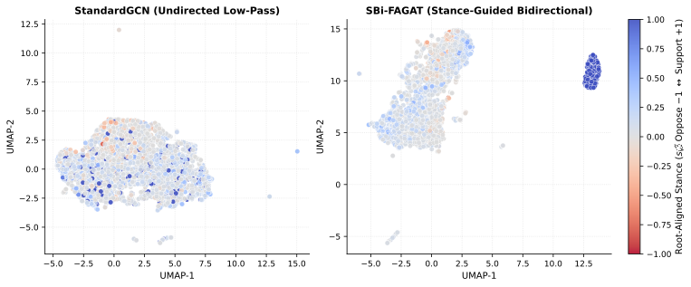

*Hình 3.2: Chiếu UMAP biểu diễn nút trên tập Test PHEME (`StandardGCN` vs `SBiFAGAT`; bản PDF [`fig1_umap_polarization.pdf`](../paper/figures/pheme/fig1_umap_polarization.pdf)).*

### 3.4. Nghiên cứu cắt bỏ thành phần (*Ablation*), Độ nhạy $K$-Curve và Chuyển giao UPFD

`Bảng 3.6` và `Bảng 3.7` trình bày kết quả cắt bỏ từng thành phần trên VN và PHEME so sánh với đối chứng cân xứng hai hướng `BiEdgeGATv2 (Matched)`.

| Biến thể / Mô hình | MSLE $\downarrow$ | MAE $\downarrow$ | $R^2_{\text{size}}$ $\uparrow$ | RMSE $\downarrow$ | $R^2_{\text{polar}}$ $\uparrow$ | Pearson $r$ $\uparrow$ | Spearman $\rho$ $\uparrow$ |
| :--- | :---: | :---: | :---: | :---: | :---: | :---: | :---: |
| `SBiFAGAT (Full)` | $0.1580 \pm 0.0070$ | $0.3092 \pm 0.0060$ | $0.2925 \pm 0.0315$ | $0.0369 \pm 0.0003$ | $0.0777 \pm 0.0141$ | $0.2939 \pm 0.0223$ | $0.2335 \pm 0.0180$ |
| `w/o Stance Score (s_uv=0)` | $0.1609 \pm 0.0051$ | $0.3139 \pm 0.0069$ | $0.2798 \pm 0.0230$ | $0.0372 \pm 0.0004$ | $0.0669 \pm 0.0214$ | $0.2838 \pm 0.0373$ | $0.2236 \pm 0.0155$ |
| `w/o Hostility Score (h_uv=0)` | $0.1611 \pm 0.0080$ | $0.3118 \pm 0.0060$ | $0.2789 \pm 0.0359$ | $0.0370 \pm 0.0005$ | $0.0757 \pm 0.0240$ | $0.2889 \pm 0.0374$ | $0.2328 \pm 0.0212$ |
| `w/o Edge Signals (s_uv=0, h_uv=0)` | $0.1589 \pm 0.0055$ | $0.3121 \pm 0.0045$ | $0.2887 \pm 0.0245$ | $0.0372 \pm 0.0003$ | $0.0650 \pm 0.0175$ | $0.2760 \pm 0.0394$ | $0.2208 \pm 0.0288$ |
| `w/o Conflict Gate (Sigmoid)` | $0.1610 \pm 0.0081$ | $0.3108 \pm 0.0117$ | $0.2792 \pm 0.0364$ | $0.0374 \pm 0.0005$ | $0.0527 \pm 0.0258$ | $0.2567 \pm 0.0476$ | $0.1933 \pm 0.0359$ |
| `w/o Bottom-Up` | $0.1644 \pm 0.0065$ | $0.3104 \pm 0.0093$ | $0.2641 \pm 0.0292$ | $0.0370 \pm 0.0002$ | $0.0741 \pm 0.0093$ | $0.2825 \pm 0.0190$ | $0.2232 \pm 0.0265$ |
| `w/o Attention Readout (Mean)` | $0.1595 \pm 0.0073$ | $0.3084 \pm 0.0090$ | $0.2860 \pm 0.0328$ | $0.0370 \pm 0.0005$ | $0.0742 \pm 0.0235$ | $0.2960 \pm 0.0267$ | $0.2318 \pm 0.0166$ |
| `w/o Camp Dipole & Moments` | $0.1635 \pm 0.0060$ | $0.3105 \pm 0.0056$ | $0.2682 \pm 0.0266$ | $0.0375 \pm 0.0004$ | $0.0503 \pm 0.0208$ | $0.2670 \pm 0.0280$ | $0.2081 \pm 0.0349$ |
| `w/o Dir-GNN Mixing` | $0.1592 \pm 0.0085$ | **$0.3069 \pm 0.0089$** | $0.2873 \pm 0.0379$ | $0.0372 \pm 0.0008$ | $0.0634 \pm 0.0393$ | $0.2814 \pm 0.0425$ | $0.2316 \pm 0.0276$ |
| `w/o Dual-Channel Split` | $0.1598 \pm 0.0077$ | $0.3078 \pm 0.0116$ | $0.2845 \pm 0.0345$ | $0.0371 \pm 0.0005$ | $0.0698 \pm 0.0268$ | $0.2757 \pm 0.0431$ | $0.2153 \pm 0.0260$ |
| `w/o Persistence Anchor` | $0.1598 \pm 0.0071$ | $0.3126 \pm 0.0056$ | $0.2846 \pm 0.0317$ | $0.0370 \pm 0.0004$ | $0.0727 \pm 0.0224$ | $0.2877 \pm 0.0360$ | $0.2337 \pm 0.0185$ |
| `BiEdgeGATv2 (Matched)` | **$0.1572 \pm 0.0062$** | $0.3084 \pm 0.0033$ | **$0.2962 \pm 0.0278$** | **$0.0369 \pm 0.0003$** | **$0.0789 \pm 0.0172$** | $0.3000 \pm 0.0188$ | **$0.2530 \pm 0.0226$** |
| `w/o Burst Stats` | $0.1739 \pm 0.0096$ | $0.3184 \pm 0.0149$ | $0.2215 \pm 0.0429$ | $0.0373 \pm 0.0009$ | $0.0611 \pm 0.0446$ | **$0.3078 \pm 0.0310$** | $0.2519 \pm 0.0248$ |
| *Paired-$t$ / Bootstrap $p$ (`Full` vs `BiEdgeGATv2`)* | $7.80\text{e-}01 / 8.41\text{e-}01$ | $7.70\text{e-}01 / 7.87\text{e-}01$ | $7.80\text{e-}01 / 8.45\text{e-}01$ | $8.87\text{e-}01 / 9.35\text{e-}01$ | $8.89\text{e-}01 / 9.32\text{e-}01$ | $6.72\text{e-}01 / 7.22\text{e-}01$ | $2.89\text{e-}01 / 2.95\text{e-}01$ |
| *Holm–Bonferroni $p_{\text{adj}}$ (Paired-$t$ & Boot.)* | $1.00 / 1.00$ | $1.00 / 1.00$ | $1.00 / 1.00$ | $1.00 / 1.00$ | $1.00 / 1.00$ | $1.00 / 1.00$ | $1.00 / 1.00$ |

*Bảng 3.6: Nghiên cứu cắt bỏ thành phần trên Reddit Việt Nam ($K=20, N_{\text{reply}} \ge 25$; `paper/tables_ablation_vn.tex`).*

| Biến thể / Mô hình | MSLE $\downarrow$ | MAE $\downarrow$ | $R^2_{\text{size}}$ $\uparrow$ | RMSE $\downarrow$ | $R^2_{\text{polar}}$ $\uparrow$ | Pearson $r$ $\uparrow$ | Spearman $\rho$ $\uparrow$ | Macro-F1 $\uparrow$ | Acc $\uparrow$ |
| :--- | :---: | :---: | :---: | :---: | :---: | :---: | :---: | :---: | :---: |
| `SBiFAGAT (Full)` | $0.1008 \pm 0.0061$ | $0.2428 \pm 0.0210$ | $0.0492 \pm 0.0578$ | $0.0472 \pm 0.0004$ | $0.0791 \pm 0.0136$ | $0.3754 \pm 0.0504$ | $0.3892 \pm 0.0674$ | $0.3553 \pm 0.0258^{**}$ | $0.6383 \pm 0.0357^{**}$ |
| `w/o Stance Score (s_uv=0)` | $0.0999 \pm 0.0070$ | $0.2417 \pm 0.0214$ | $0.0582 \pm 0.0656$ | $0.0474 \pm 0.0004$ | $0.0710 \pm 0.0148$ | $0.3433 \pm 0.0286$ | $0.3555 \pm 0.0359$ | $0.3532 \pm 0.0306$ | $0.6359 \pm 0.0436$ |
| `w/o Hostility Score (h_uv=0)` | $0.1004 \pm 0.0061$ | $0.2437 \pm 0.0199$ | $0.0533 \pm 0.0580$ | $0.0470 \pm 0.0004$ | $0.0878 \pm 0.0151$ | $0.3868 \pm 0.0416$ | $0.4115 \pm 0.0480$ | $0.3579 \pm 0.0287$ | $0.6359 \pm 0.0461$ |
| `w/o Edge Signals (s_uv=0, h_uv=0)` | $0.1009 \pm 0.0070$ | $0.2452 \pm 0.0212$ | $0.0486 \pm 0.0656$ | $0.0475 \pm 0.0003$ | $0.0676 \pm 0.0134$ | $0.3416 \pm 0.0330$ | $0.3443 \pm 0.0459$ | **$0.3580 \pm 0.0250$** | $0.6395 \pm 0.0390$ |
| `w/o Conflict Gate (Sigmoid)` | $0.1009 \pm 0.0069$ | $0.2444 \pm 0.0216$ | $0.0488 \pm 0.0649$ | $0.0471 \pm 0.0004$ | $0.0836 \pm 0.0156$ | $0.3829 \pm 0.0417$ | $0.4059 \pm 0.0513$ | $0.3565 \pm 0.0233$ | $0.6323 \pm 0.0328$ |
| `w/o Bottom-Up` | $0.1033 \pm 0.0080$ | $0.2444 \pm 0.0263$ | $0.0261 \pm 0.0757$ | $0.0467 \pm 0.0008$ | $0.1009 \pm 0.0326$ | **$0.4058 \pm 0.0257$** | $0.4286 \pm 0.0312$ | $0.3387 \pm 0.0380$ | $0.6024 \pm 0.0754$ |
| `w/o Attention Readout (Mean)` | $0.1034 \pm 0.0091$ | $0.2455 \pm 0.0285$ | $0.0247 \pm 0.0854$ | $0.0471 \pm 0.0004$ | $0.0845 \pm 0.0144$ | $0.3837 \pm 0.0384$ | $0.4219 \pm 0.0452$ | $0.3406 \pm 0.0248$ | $0.6275 \pm 0.0433$ |
| `w/o Camp Dipole & Moments` | $0.1048 \pm 0.0102$ | $0.2484 \pm 0.0291$ | $0.0114 \pm 0.0966$ | $0.0468 \pm 0.0009$ | $0.0964 \pm 0.0346$ | $0.3891 \pm 0.0518$ | $0.4143 \pm 0.0781$ | $0.3399 \pm 0.0370$ | $0.6006 \pm 0.1120$ |
| `w/o Dir-GNN Mixing` | **$0.0985 \pm 0.0030$** | **$0.2344 \pm 0.0123$** | **$0.0712 \pm 0.0281$** | $0.0467 \pm 0.0005$ | $0.1010 \pm 0.0173$ | $0.4055 \pm 0.0425$ | **$0.4408 \pm 0.0578$** | $0.3343 \pm 0.0260$ | $0.6114 \pm 0.0731$ |
| `w/o Dual-Channel Split` | $0.1009 \pm 0.0059$ | $0.2452 \pm 0.0185$ | $0.0487 \pm 0.0559$ | $0.0470 \pm 0.0004$ | $0.0874 \pm 0.0147$ | $0.3794 \pm 0.0389$ | $0.4037 \pm 0.0403$ | $0.3568 \pm 0.0206$ | **$0.6401 \pm 0.0354$** |
| `w/o Persistence Anchor` | $0.1014 \pm 0.0059$ | $0.2416 \pm 0.0219$ | $0.0432 \pm 0.0553$ | $0.0476 \pm 0.0004$ | $0.0653 \pm 0.0152$ | $0.3331 \pm 0.0283$ | $0.3380 \pm 0.0493$ | $0.3540 \pm 0.0235$ | $0.6401 \pm 0.0347$ |
| `BiEdgeGATv2 (Matched)` | $0.0991 \pm 0.0072$ | $0.2417 \pm 0.0216$ | $0.0653 \pm 0.0679$ | $0.0469 \pm 0.0005$ | $0.0940 \pm 0.0209$ | $0.4026 \pm 0.0305$ | $0.4338 \pm 0.0430$ | $0.3312 \pm 0.0429$ | $0.6138 \pm 0.0618$ |
| `w/o Burst Stats` | $0.1031 \pm 0.0089$ | $0.2521 \pm 0.0249$ | $0.0276 \pm 0.0835$ | **$0.0467 \pm 0.0006$** | **$0.1015 \pm 0.0232$** | $0.3923 \pm 0.0477$ | $0.4180 \pm 0.0692$ | $0.3438 \pm 0.0256$ | $0.6180 \pm 0.0558$ |
| *Paired-$t$ $p$ (`Full` vs `BiEdgeGATv2`)* | $2.17\text{e-}01$ | $7.43\text{e-}01$ | $2.17\text{e-}01$ | $1.90\text{e-}01$ | $1.90\text{e-}01$ | $2.04\text{e-}01$ | $1.23\text{e-}01$ | $1.63\text{e-}01$ | $3.20\text{e-}01$ |
| *IID Bootstrap $p$* | $1.46\text{e-}01$ | $4.38\text{e-}01$ | $1.34\text{e-}01$ | $8.00\text{e-}04$ | $1.60\text{e-}03$ | $7.20\text{e-}03$ | $8.00\text{e-}04$ | $8.00\text{e-}04$ | $8.00\text{e-}04$ |
| *Holm–Bonf. $p_{\text{adj}}$ (Paired-$t$ / Boot.)* | $1.00 / 4.01\text{e-}01$ | $1.00 / 4.38\text{e-}01$ | $1.00 / 4.01\text{e-}01$ | $1.00 / 7.20\text{e-}03$ | $1.00 / 8.00\text{e-}03$ | $1.00 / 2.88\text{e-}02$ | $1.00 / 7.20\text{e-}03$ | $1.00 / 7.20\text{e-}03$ | $1.00 / 7.20\text{e-}03$ |

*Bảng 3.7: Nghiên cứu cắt bỏ thành phần trên PHEME ($K=10, N_{\text{reply}} \ge 15$; `paper/tables_ablation_pheme.tex`).*

Hai nghiên cứu cắt bỏ cung cấp một đối chiếu chẩn đoán cực kỳ có giá trị:
1. **Trên Reddit Việt Nam ($K=20$, tối đa 21 nút):** Cắt bỏ `Camp Dipole & Moments` ($R^2_{\text{polar}}: 0.0777 \to 0.0503$) và thay cổng phân cực có dấu bằng sigmoid (`w/o Conflict Gate`, $0.0527$) gây suy giảm mạnh nhất ở bài toán phân cực; cắt `Burst Stats` $c_{\mathcal{G}}$ làm sụt $R^2_{\text{size}}$ từ $0.2925$ xuống $0.2215$. Đặc biệt, **cắt bỏ `Hostility Score` ($h_{uv}=0$) giữ nguyên gần như hoàn toàn $R^2_{\text{polar}}$ ($0.0757$ so với `Full` $0.0777$)**, chứng minh **3 lớp lập trường ($s_{uv}$)** mới là tín hiệu dẫn đường cốt lõi chứ không phải điểm công kích thô. Tuy nhiên, `BiEdgeGATv2 (Matched)` đạt $0.0789$ ($p_{\text{adj}} = 1.00$), cho thấy lợi thế trước đối chứng hai hướng cùng độ rộng là tương đương thống kê. Sai lệch nhỏ giữa `Bảng 3.2` ($0.0742$) và `Bảng 3.6` ($0.0777$) xuất phát từ phép khử phi tất định `scatter_add`/`atomicAdd` của CUDA qua hai phiên Kaggle riêng biệt (cùng hạt giống khởi tạo).
2. **Trên PHEME ($K=10$, tối đa 11 nút) — Công bố trung thực kết quả âm/hòa:** `SBiFAGAT (Full)` **thắng $0/9$ chỉ số** trong bảng cắt bỏ PHEME: $8/11$ biến thể cắt bỏ cùng `BiEdgeGATv2 (Matched)` ($9/12$ dòng ngoài `Full`) vượt qua `Full` ở $R^2_{\text{polar}}$ ($0.0791$; sai lệch nhỏ so với $0.0793$ / `Acc` $0.6359$ vs $0.6383$ ở `Bảng 3.4` cũng do `scatter_add` CUDA). Dẫn đầu là `w/o Burst Stats` ($0.1015$), `w/o Dir-GNN Mixing` ($0.1010$, đồng thời dẫn `MSLE` $0.0985$, `MAE` $0.2344$, $R^2_{\text{size}}$ $0.0712$, $\rho=0.4408$), `w/o Bottom-Up` ($0.1009$, dẫn $r=0.4058$) và `w/o Camp Dipole & Moments` ($0.0964$). Hơn nữa, `BiEdgeGATv2 (Matched)` vượt có ý nghĩa bootstrap (nội bộ $2$ sự kiện) trước `Full` trên cả 4 thước đo phân cực (`RMSE` $0.0469$ vs $0.0472$, $p_{\text{adj}} = 7.20\text{e-}03$; $R^2_{\text{polar}}$ $0.0940$ vs $0.0791$, $p_{\text{adj}} = 8.00\text{e-}03$; $r = 0.4026$ vs $0.3754$, $p_{\text{adj}} = 2.88\text{e-}02$; $\rho = 0.4338$ vs $0.3892$, $p_{\text{adj}} = 7.20\text{e-}03$; paired-$t$ $p_{\text{adj}} = 1.00$), còn `Full` chỉ giữ ưu thế bootstrap ở `Macro-F1` ($0.3553$ vs $0.3312$) và `Acc` ($0.6383$ vs $0.6138$, $p_{\text{adj}} = 7.20\text{e-}03$). Dù bỏ `Persistence Anchor` ($0.0653$), bỏ toàn bộ `Edge Signals` ($0.0676$) hay bỏ $s_{uv}$ ($0.0710$) vẫn làm giảm $R^2_{\text{polar}}$ so với `Full`, sự kiện này chứng minh **trên cây cực nông 11 nút, việc chồng thêm nhiều tầng trộn hai hướng và cổ chai dipole gây thừa tham số và làm suy giảm hồi quy phân cực**.

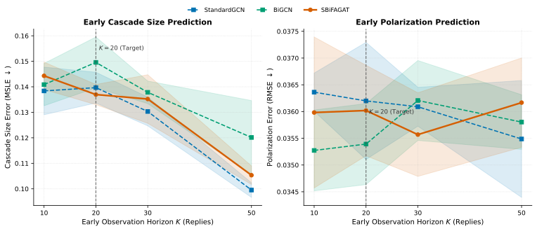

*Hình 3.3: Đường cong độ nhạy chân trời $K \in \{10, 20, 30, 50\}$ trên tập con VN có tương lai cố định ($N_{\text{reply}} \ge 55$, đánh giá ở $k > 50$; [`fig2_early_k_curve.pdf`](../paper/figures/vn/fig2_early_k_curve.pdf)).*

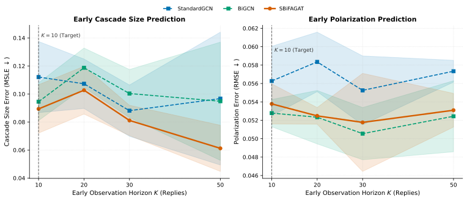

*Hình 3.4: Đường cong độ nhạy chân trời $K \in \{10, 20, 30, 50\}$ trên tập con PHEME ($n=10$ chuỗi Test có $N_{\text{reply}} \ge 55$, đánh giá ở $k > 50$; [`fig2_early_k_curve.pdf`](../paper/figures/pheme/fig2_early_k_curve.pdf)).*

**Độ nhạy chân trời $K \in \{10, 20, 30, 50\}$ ($N_{\text{reply}} \ge 55$, đánh giá trên $k > 50$):** Trên VN (`Hình 3.3`), sai số quy mô MSLE của `SBiFAGAT` giảm đều qua từng mốc: $0.1443$ ($K=10$) $\to 0.1370$ ($K=20$) $\to 0.1352$ ($K=30$) $\to 0.1053$ ($K=50$, so với `StandardGCN` $0.0995$). Trên tập con rất nhỏ của PHEME ($n = 10$ chuỗi Test thỏa $N_{\text{reply}} \ge 55$, `Hình 3.4`), dù `SBiFAGAT` hạ MSLE từ $0.0893$ ($K=10$) xuống $0.0612$ ($K=50$) và nâng Pearson $r$ từ $0.0647$ lên $0.2349$, giá trị $R^2_{\text{size}}$ **vẫn âm ở mọi chân trời** (từ $-0.9883$ ở $K=10$ đến $-0.3621$ ở $K=50$), đồng thời bài toán phân loại 4 lớp tin đồn **sụp đổ hoàn toàn về dự đoán lớp đa số `non-rumor`** trên cả 5 hạt giống (`Acc` $= 0.7000 \pm 0.0000$, `Macro-F1` $= 0.2745 \pm 0.0000$).

**Chuyển giao cấu trúc không văn bản trên `UPFD` [12] (`Bảng 3.8`):** Trên hai tập dữ liệu phát hiện tin giả chỉ có vector BERT nút $768$ chiều (thiếu văn bản bình luận để chấm $e_{uv}$), `LatentConflictMLP` tổng hợp cạnh ẩn từ đặc trưng nút. Trên `GossipCop`, `StandardGATv2` ($0.9684 \pm 0.0032$ `Acc`, `ROC-AUC` $= 0.9929$) và `EdgeGATv2 (Latent)` ($0.9682$, `ROC-AUC` $= 0.9937$) vượt có ý nghĩa trước `SBiFAGAT (Latent)` ($0.9486 \pm 0.0077$, `ROC-AUC` $= 0.9859$; bootstrap $p_{\text{adj}} = 8.00\text{e-}04$, paired-$t$ $p_{\text{adj}} = 1.30\text{e-}02$). Trên `PolitiFact` nhỏ hơn, `EdgeGATv2 (Latent)` ($0.8253 \pm 0.0099$ `Acc`, `Macro-F1` $= 0.8251 \pm 0.0101$, `ROC-AUC` $= 0.8775$) vượt `SBiFAGAT (Latent)` ($0.8090 \pm 0.0240$ `Acc`, `Macro-F1` $= 0.8083 \pm 0.0249$, `ROC-AUC` $= 0.8627$; bootstrap $p_{\text{adj}} = 3.20\text{e-}02$, paired-$t$ $p_{\text{adj}} = 0.2660$), mặc dù cả hai mô hình có cạnh ẩn đều giảm mạnh phương sai giữa các seed so với `StandardGCN` ($\pm 0.1650$) và `StandardGATv2` ($\pm 0.1450$). Kết quả khẳng định rằng cổng phân cực có dấu không phát huy hiệu quả khi thiếu ngữ nghĩa lập trường thực trên từng cặp câu trả lời.

| Mô hình | `GossipCop` Acc $\uparrow$ | `GossipCop` Macro-F1 $\uparrow$ | `GossipCop` ROC-AUC $\uparrow$ | `PolitiFact` Acc $\uparrow$ | `PolitiFact` Macro-F1 $\uparrow$ | `PolitiFact` ROC-AUC $\uparrow$ |
| :--- | :---: | :---: | :---: | :---: | :---: | :---: |
| `StandardGCN` | $0.9631 \pm 0.0032$ | $0.9631 \pm 0.0032$ | $0.9890 \pm 0.0005$ | $0.8063 \pm 0.1650$ | $0.7717 \pm 0.2423$ | $0.8480 \pm 0.1765$ |
| `StandardGATv2` | **$0.9684 \pm 0.0032$** | **$0.9684 \pm 0.0032$** | $0.9929 \pm 0.0012$ | $0.7701 \pm 0.1450$ | $0.7354 \pm 0.2222$ | $0.7906 \pm 0.1821$ |
| `EdgeGATv2 (Latent)` | $0.9682 \pm 0.0037$ | $0.9682 \pm 0.0037$ | **$0.9937 \pm 0.0009$** | **$0.8253 \pm 0.0099$** | **$0.8251 \pm 0.0101$** | **$0.8775 \pm 0.0055$** |
| `FAGCN` | $0.9446 \pm 0.0260$ | $0.9446 \pm 0.0260$ | $0.9838 \pm 0.0108$ | $0.6842 \pm 0.1545$ | $0.6714 \pm 0.1655$ | $0.6922 \pm 0.1736$ |
| `BiGCN` | $0.9235 \pm 0.0043$ | $0.9235 \pm 0.0043$ | $0.9728 \pm 0.0019$ | $0.7900 \pm 0.0245$ | $0.7899 \pm 0.0246$ | $0.8519 \pm 0.0188$ |
| `SBiFAGAT (Latent)` | $0.9486 \pm 0.0077$ | $0.9485 \pm 0.0077$ | $0.9859 \pm 0.0030$ | $0.8090 \pm 0.0240$ | $0.8083 \pm 0.0249$ | $0.8627 \pm 0.0035$ |
| *Holm–Bonf. $p_{\text{adj}}$ (Paired-$t$ / Boot.)* | $1.30\text{e-}02 / 8.00\text{e-}04$ | $1.30\text{e-}02 / 8.00\text{e-}04$ | -- | $2.66\text{e-}01 / 3.20\text{e-}02$ | $2.66\text{e-}01 / 3.20\text{e-}02$ | -- |

*Bảng 3.8: Kết quả chuyển giao không văn bản trên `UPFD` [12] (`GossipCop` đối chứng `StandardGATv2`; `PolitiFact` đối chứng `EdgeGATv2 (Latent)`; `paper/tables_upfd*.tex` & `results_upfd*.json`).*

### 3.5. Kết quả Tầng 2: Mạng xã hội có dấu vĩ mô và Dự báo liên kết theo thời gian

Khi chiếu toàn bộ tương tác trả lời hợp lệ xuyên suốt các chủ đề lên đồ thị người dùng có dấu vĩ mô $\mathcal{G}_{\text{macro}}$, cấu trúc chia rẽ cộng đồng hiện lên sắc nét hơn hẳn cấp chuỗi đơn (`Bảng 3.9`, `Hình 3.5` và `Hình 3.6`).

| Kho ngữ liệu | Tổng người dùng (Hợp lệ / Cặp mạnh) | Tương tác (Cặp vô hướng / Cặp mạnh) | Signed WCC (% Tổng / % Hợp lệ) | Phân bổ 4 loại tam giác `(+++)/(++-)/(+--)/(---)` | Tỷ lệ cân bằng ($z$-score) | $Q_{\text{signed}}$ ($Q^+ / Q^-$) | RWC $\uparrow$ | Đối đầu Nội / Liên phe (Công kích) |
| :--- | :---: | :---: | :---: | :---: | :---: | :---: | :---: | :---: |
| **VN** | $13{,}718$ ($13{,}718$ / $10{,}974$) | $85{,}398$ ($58{,}041$ / $32{,}787$) | $10{,}475$ ($76.4\%$ / $76.4\%$) | $70 / 306 / 1{,}232 / 3{,}535$ ($5{,}143$ $\triangle$) | $25.3\%$ ($-15.17$) | $0.4280$ ($0.2367 / -0.1913$) | $0.0957$ | $37.9\% / 57.0\%$ ($3.95\% / 5.09\%$) |
| **PHEME** | $50{,}062$ ($36{,}606$ / $18{,}985$) | $72{,}858$ ($45{,}698$ / $16{,}028$) | $10{,}364$ ($20.7\%$ / $28.3\%$) | $28 / 26 / 47 / 111$ ($212$ $\triangle$) | $35.4\%$ ($-4.30$) | $0.8232$ ($0.3586 / -0.4646$) | $0.6218$ | $6.0\% / 60.6\%$ ($10.5\% / 28.8\%$) |

*Bảng 3.9: Thống kê hình học phân cực mạng người dùng có dấu vĩ mô Tầng 2 (`paper/tables_macro_network.tex` & `results_macro_network_*.json`).*

**Nhận xét cấu trúc mạng Tầng 2:**
1. **Phân tách rõ quy mô người dùng (`50,062 / 36,606 / 18,985` trên PHEME vs. `13,718 / 10,974` trên VN):** Trên PHEME, tổng số $50{,}062$ tài khoản bao gồm cả các tác giả thuộc chuỗi 0 bình luận hoặc nút rời rạc; chỉ có $36{,}606$ người dùng xuất hiện trong $72{,}858$ cặp trả lời hợp lệ ($45{,}698$ cặp vô hướng) và $18{,}985$ người dùng có ít nhất một cạnh có dấu mạnh ($|\bar{s}_{uv}| \ge 0.1$, tổng $16{,}028$ cặp mạnh). Vì ma trận trọng số $W$ trong phân đôi quang phổ chỉ giữ các cặp có dấu mạnh ($|\bar{s}_{uv}| \ge 0.1$) còn các cặp trung lập không tạo cạnh có dấu, `Bảng 3.9` công bố đồng thời cả ba mốc quy mô người dùng: thành phần liên thông yếu lớn nhất (WCC) của PHEME gồm $10{,}364$ nút (chiếm $20.7\%$ tổng $50{,}062$ người dùng và $28.3\%$ trong $36{,}606$ người dùng hợp lệ, nằm trong nhóm $18{,}985$ người dùng cạnh mạnh; chia hai phe $6{,}639$ vs $3{,}725$) với bậc mạnh trung bình $\le 3.09$ và chỉ $212$ tam giác. Trên VN, toàn bộ $13{,}718$ người dùng đều nằm trong cặp trả lời hợp lệ ($10{,}974$ người dùng thuộc cạnh mạnh $|\bar{s}_{uv}| \ge 0.1$), cho WCC $10{,}475$ nút ($76.4\%$, chia cân bằng $4{,}807$ vs $5{,}668$) và $5{,}143$ tam giác.
2. **Phân tách quang phổ sắc nét nhưng mang tính *phản cân bằng (anti-balanced)*:** Trên WCC, PHEME đạt $Q_{\text{signed}} = 0.8232$, RWC $= 0.6218$, tỷ lệ phản đối liên phe tăng vọt $+54.5\text{ pp}$ ($60.6\%$ so với $6.0\%$ nội phe; trung bình lập trường $-0.1581$ vs $+0.1930$) và tỷ lệ công kích tăng gần gấp ba ($28.8\%$ vs $10.5\%$). VN đạt $Q_{\text{signed}} = 0.4280$, RWC $= 0.0957$, tỷ lệ phản đối liên phe tăng $+19.1\text{ pp}$ ($57.0\%$ vs $37.9\%$; trung bình lập trường $-0.1425$ vs $-0.0538$) và công kích $5.09\%$ vs $3.95\%$. Tuy nhiên, cả hai mạng đều **thấp hơn đáng kể kỳ vọng cân bằng Heiderian ngẫu nhiên** ($25.3\%$ vs $37.0\%$ null, $z = -15.17$ trên VN; $35.4\%$ vs $50.3\%$ null, $z = -4.30$ trên PHEME) vì tỷ trọng áp đảo của các tam giác tranh cãi đa chiều $(---)$ ($68.7\% = 3{,}535/5{,}143$ trên VN và $52.4\% = 111/212$ trên PHEME). Riêng với WCC thưa $212$ tam giác của PHEME, $Q_{\text{signed}} = 0.8232$ phản ánh khả năng của phân đôi quang phổ trong việc cô lập các cạnh âm trên đồ thị dạng gần-cây (*near-tree multi-dispute topology*) hơn là hai buồng vang khép kín truyền thống (và cần lưu ý đây là phép phân hoạch nội mẫu chưa đối chiếu ngưỡng null-graph modularity).

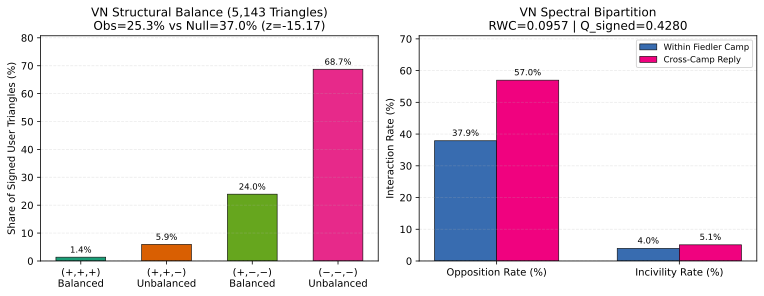

*Hình 3.5: Phân bố tam giác Cân bằng Cấu trúc và đối sánh tỷ lệ đối đầu/công kích nội phe vs liên phe trên mạng người dùng VN Tầng 2 ([`fig5_macro_signed_network.pdf`](../paper/figures/vn/fig5_macro_signed_network.pdf)).*

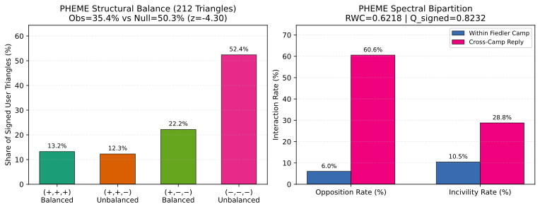

*Hình 3.6: Phân bố tam giác Cân bằng Cấu trúc và đối sánh tách phổ hai phe trên mạng người dùng PHEME Tầng 2 ([`fig5_macro_signed_network.pdf`](../paper/figures/pheme/fig5_macro_signed_network.pdf)).*

**Kết quả dự báo liên kết có dấu theo thời gian (`Bảng 3.10` và `Bảng 3.11`):** Tỷ lệ nền của nhãn `oppose` ($s_{uv} \le -0.1$) đạt $79.5\%$ trên VN ($39{,}499 / 49{,}699$ tương tác, giải thích mức nền `PR-AUC` $\approx 0.85$) và $52.9\%$ trên PHEME ($15{,}097 / 28{,}523$). Các phân hoạch Train/Val/Test theo thời gian gồm $34{,}789 / 7{,}455 / 7{,}455$ cạnh trên VN ($2{,}255$ cạnh Test có cả hai người dùng từng xuất hiện ở Train — *transductive*) và $19{,}966 / 4{,}279 / 4{,}278$ cạnh trên PHEME ($212$ cạnh *transductive*).

| Mô hình | ROC-AUC $\uparrow$ | PR-AUC $\uparrow$ | Macro-F1 $\uparrow$ | Trans. ROC-AUC $\uparrow$ | Trans. PR-AUC $\uparrow$ | Trans. Macro-F1 $\uparrow$ |
| :--- | :---: | :---: | :---: | :---: | :---: | :---: |
| `UserTextMLP` | $0.5847 \pm 0.0136$ | $0.8450 \pm 0.0056$ | $0.5329 \pm 0.0097$ | $0.5915 \pm 0.0149$ | $0.8752 \pm 0.0050$ | $0.5345 \pm 0.0231$ |
| `StandardGCN` | $0.5683 \pm 0.0149$ | $0.8398 \pm 0.0045$ | $0.5089 \pm 0.0473$ | $0.5778 \pm 0.0063$ | $0.8745 \pm 0.0030$ | $0.5288 \pm 0.0054$ |
| `StandardGATv2` | $0.5590 \pm 0.0111$ | $0.8372 \pm 0.0037$ | $0.4863 \pm 0.0589$ | $0.5787 \pm 0.0163$ | $0.8757 \pm 0.0037$ | $0.5160 \pm 0.0386$ |
| `SGCN` | $0.5728 \pm 0.0195$ | $0.8417 \pm 0.0090$ | $0.5136 \pm 0.0592$ | **$0.6149 \pm 0.0058$** | **$0.8848 \pm 0.0030$** | $0.5471 \pm 0.0180$ |
| `FAGCN` | $0.5822 \pm 0.0202$ | $0.8446 \pm 0.0087$ | **$0.5348 \pm 0.0143$** | $0.5891 \pm 0.0135$ | $0.8762 \pm 0.0053$ | $0.5412 \pm 0.0178$ |
| `SBiFAGAT-Link` | **$0.5853 \pm 0.0163$** | **$0.8455 \pm 0.0064$** | $0.5150 \pm 0.0370$ | $0.6001 \pm 0.0165$ | $0.8791 \pm 0.0070$ | **$0.5526 \pm 0.0066$** |
| *Paired-$t$ / Exact Perm. $p$ (vs `UserTextMLP`)* | $9.21\text{e-}01 / 1.00$ | $8.44\text{e-}01 / 8.75\text{e-}01$ | $3.55\text{e-}01 / 5.00\text{e-}01$ | $4.79\text{e-}02 / 6.25\text{e-}02$ | $1.06\text{e-}01 / 1.25\text{e-}01$ | $9.12\text{e-}02 / 1.25\text{e-}01$ |
| *Holm–Bonf. $p_{\text{adj}}$ (Paired-$t$ / Exact Perm.)* | $1.00 / 1.00$ | $1.00 / 1.00$ | $1.00 / 1.00$ | $2.88\text{e-}01 / 3.75\text{e-}01$ | $4.56\text{e-}01 / 6.25\text{e-}01$ | $4.56\text{e-}01 / 6.25\text{e-}01$ |

*Bảng 3.10: Dự báo liên kết có dấu theo thời gian trên Reddit Việt Nam (`paper/tables_signed_link_vn.tex`).*

| Mô hình | ROC-AUC $\uparrow$ | PR-AUC $\uparrow$ | Macro-F1 $\uparrow$ | Trans. ROC-AUC $\uparrow$ | Trans. PR-AUC $\uparrow$ | Trans. Macro-F1 $\uparrow$ |
| :--- | :---: | :---: | :---: | :---: | :---: | :---: |
| `UserTextMLP` | **$0.7331 \pm 0.0048$** | $0.6014 \pm 0.0044$ | $0.5694 \pm 0.0881$ | $0.9081 \pm 0.0055$ | $0.7232 \pm 0.0269$ | $0.7943 \pm 0.0244$ |
| `StandardGCN` | $0.7241 \pm 0.0087$ | $0.5951 \pm 0.0077$ | $0.5568 \pm 0.0723$ | $0.9113 \pm 0.0045$ | $0.7311 \pm 0.0124$ | $0.7772 \pm 0.0105$ |
| `StandardGATv2` | $0.7172 \pm 0.0161$ | $0.5882 \pm 0.0166$ | $0.5748 \pm 0.0656$ | $0.9105 \pm 0.0025$ | $0.7232 \pm 0.0164$ | $0.7804 \pm 0.0221$ |
| `SGCN` | $0.7143 \pm 0.0193$ | $0.5820 \pm 0.0146$ | $0.5315 \pm 0.0747$ | $0.9078 \pm 0.0057$ | $0.7002 \pm 0.0221$ | $0.7782 \pm 0.0276$ |
| `FAGCN` | $0.7123 \pm 0.0242$ | $0.5853 \pm 0.0234$ | **$0.6209 \pm 0.0375$** | $0.9007 \pm 0.0063$ | $0.6882 \pm 0.0303$ | $0.7755 \pm 0.0130$ |
| `SBiFAGAT-Link` | $0.7328 \pm 0.0107$ | **$0.6019 \pm 0.0104$** | $0.5860 \pm 0.0759$ | **$0.9181 \pm 0.0102$** | **$0.7616 \pm 0.0600$** | **$0.8006 \pm 0.0068$** |
| *Paired-$t$ / Exact Perm. $p$ (vs `StandardGCN`)* | $3.03\text{e-}01 / 4.38\text{e-}01$ | $3.12\text{e-}01 / 3.75\text{e-}01$ | $1.71\text{e-}01 / 2.50\text{e-}01$ | $2.25\text{e-}01 / 2.50\text{e-}01$ | $3.50\text{e-}01 / 3.75\text{e-}01$ | $2.70\text{e-}02 / 6.25\text{e-}02$ |
| *Holm–Bonf. $p_{\text{adj}}$ (Paired-$t$ / Exact Perm.)* | $9.08\text{e-}01 / 1.00$ | $9.08\text{e-}01 / 1.00$ | $8.53\text{e-}01 / 1.00$ | $9.01\text{e-}01 / 1.00$ | $9.08\text{e-}01 / 1.00$ | $1.62\text{e-}01 / 3.75\text{e-}01$ |

*Bảng 3.11: Dự báo liên kết có dấu theo thời gian trên PHEME (`paper/tables_signed_link_pheme.tex`).*

Trên PHEME, `SBiFAGAT-Link` dẫn đầu cả 3 chỉ số *transductive* (`Trans. ROC-AUC = 0.9181`, `Trans. PR-AUC = 0.7616`, `Trans. Macro-F1 = 0.8006` so với `StandardGCN` $0.9113 / 0.7311 / 0.7772$ và `UserTextMLP` $0.9081 / 0.7232 / 0.7943$; paired-$t$ chưa hiệu chỉnh $p = 0.0270$ ở `Trans. Macro-F1`, Exact Perm. $p = 0.0625$, Holm–Bonferroni $p_{\text{adj}} = 0.1622 / 0.3750$), đồng thời dẫn đầu toàn tập Test ở `PR-AUC` ($0.6019$) và ngang `UserTextMLP` ở `ROC-AUC` ($0.7328$ vs $0.7331$; `FAGCN` dẫn toàn tập Test ở `Macro-F1` $= 0.6209$). Trên VN, `SBiFAGAT-Link` dẫn toàn tập Test ở `ROC-AUC` ($0.5853$), `PR-AUC` ($0.8455$) và `Trans. Macro-F1` ($0.5526$), nhưng thua `SGCN` ở `Trans. ROC-AUC` ($0.6149$ vs $0.6001$) và `Trans. PR-AUC` ($0.8848$ vs $0.8791$; đối chứng `UserTextMLP` cho $p = 0.0479$, Exact Perm. $0.0625$, $p_{\text{adj}} = 0.2876 / 0.3750$).

Ba phép đo chẩn đoán rò rỉ/bất đối xứng được công bố minh bạch để định khung chính xác những kết quả này:
1. **Tỷ lệ lặp cặp `{u, v}` khi unmasked Val/Test:** Do đồ thị Train không bị che khi đánh giá Val/Test, các cặp người dùng trùng lặp từng tương tác ở Train chiếm $73 / 7{,}455$ ($1.0\%$) toàn bộ tập Test và $73 / 2{,}255$ ($3.2\%$) tập Test transductive trên VN; con số tương ứng trên PHEME là $46 / 4{,}278$ ($1.1\%$) toàn Test và **$46 / 212$ ($21.7\%$) tập Test transductive** (lý giải tại sao ngay cả `UserTextMLP` cũng nhảy từ $0.7331$ lên $0.9081$ trên tập transductive).
2. **Đặc trưng tiền mốc cắt của người dùng unseen:** Trong số người dùng vắng mặt ở tập cạnh Train có dấu, $246 / 2{,}692$ ($9.1\%$) trên VN và $353 / 5{,}330$ ($6.6\%$ đặc trưng ngữ nghĩa) / $536 / 5{,}330$ ($10.1\%$ đặc trưng hoạt động) trên PHEME vẫn mang vector khác không thu từ bài đăng trung lập ($|s_{uv}| < 0.1$) hoặc chuỗi dưới ngưỡng trước mốc $t_{\text{train}}^{\max}$.
3. **Bất đối xứng đầu vào cạnh:** Chỉ `SBiFAGAT-Link` nhận vector cạnh liên tục 2D $[s_{uv}, h_{uv}]^\top$, còn `SGCN` nhận dấu nhị phân $\operatorname{sign}(s_{uv})$ và các mô hình còn lại bỏ qua thuộc tính cạnh. Vì vậy, truyền thông điệp có dấu hai hướng mang lại xu hướng cải thiện hợp lý trên suy luận transductive nhưng chưa đạt ý nghĩa thống kê sau hiệu chỉnh Holm–Bonferroni ($p_{\text{adj}} < 0.05$).

### 3.6. Kiểm định độ tin cậy nhãn bạc, RumourEval-2019 và Phân tích lỗi định lượng

#### 3.6.1. Kiểm định cấu trúc độc lập, RumourEval-2019 SDQC và Kiểm định nhãn VN

- **Tương quan cấu trúc cây sớm:** Tương quan hạng Spearman giữa $y_{\text{polar}}$ và hai thước đo cấu trúc độc lập ở giai đoạn sớm còn yếu: *Sarle's Bimodality Coefficient* là $-0.0152$ (VN) / $0.0800$ (PHEME) và *Signed Newman Assortativity* là $-0.0589$ (VN) / $-0.1136$ (PHEME).
- **Đối chứng chuẩn Tiếng Anh `SemEval-2019 RumourEval SDQC` [19] (`1,675` cặp):** Có $476$ bình luận ($28.4\%$) nằm ở độ sâu $\ge 2$ nơi ngữ cảnh cha trực tiếp dễ trái chiều ngữ cảnh bài gốc. Chấm bằng chế độ ngữ cảnh gốc (`--context-mode root`) đạt `Macro-F1 = 0.3311`, `Acc = 0.8179`, $\kappa = -0.0149$, $\rho = 0.0917$ (nhỉnh hơn chế độ `parent`: `0.3270`, `0.8185`, $\kappa = -0.0172$, $\rho = 0.0864$). Tuy nhiên, zero-shot `mDeBERTa-v3-xnli` đẩy tới **$93.0\%$ ($1{,}557 / 1{,}675$)** câu trả lời về `neutral`, khiến độ chính xác ($81.8\%$) thấp hơn baseline dự đoán toàn bộ là `neutral` (`query+comment` chiếm $87.8\% = 1{,}471 / 1{,}675$) và recall trên hai lớp thiểu số chỉ đạt **$3.8\%$ (`4/104` support)** và **$3.0\%$ (`3/100` root) / $2.0\%$ (`2/100` parent) oppose**.
- **Kiểm định nhãn mù VN (`20` pilot + `120` cặp Test + `30` cây Test):** Quy trình sử dụng AI tiền chú thích (`Gemini Flash-Lite`) và được một tác giả kiểm tra đối chiếu độc lập (`single_verified_gold`, $\text{IAA} = \text{--}$; `Bảng 3.12`):
  - **Trên `20` cặp pilot:** Stance đạt `Macro-F1 = 0.6640`, `Acc = 70.0%` (weighted accuracy $64.78\%$, $\kappa = 0.5420$, $\rho = 0.5856$); Hostility đạt `ROC-AUC = 1.0000`, `Acc = 75.0%`.
  - **Trên `120` cặp Test VN:** Độ khớp lập trường 3 lớp không trọng số giảm xuống `Macro-F1 = 0.3760`, `Acc = 40.0%`, $\kappa = 0.1000$, $\rho = 0.2726$; khi quy đổi về tổng thể bằng trọng số nghịch đảo tần suất lấy mẫu, weighted accuracy tụt xuống **$24.79\%$** và weighted `Macro-F1` xuống **$0.2324$** (thấp hơn mức ngẫu nhiên 3 lớp $33.3\%$). Ngược lại, bộ phân loại công kích `uitnlp/visobert` đạt phân tách hạng `ROC-AUC = 0.9841`, `PR-AUC = 0.2619`, $\rho = 0.3543$, $\kappa = 0.2475$, unweighted `Acc = 69.17%` (weighted `Acc = 96.63%`), overall `Macro-F1 = 0.5743` (weighted `0.6641`); riêng lớp dương (`uncivil`) có precision $0.2128$ (`10/47`), recall $1.00$ (`10/10`) và positive-class `F1 = 0.3509`.
  - **Trên `30` cây Test VN:** Mối tương quan giữa nhãn bạc $y_{\text{polar}} \in [0.0447, 0.2644]$ và thang chia rẽ cảm nhận con người 0–4 gần như bằng không ($r = 0.0284, \rho = 0.0018, \tau_b = 0.0026, \kappa_w = 0.0192$, `ROC-AUC` $@\ge 2 = 0.5402$). Nguyên nhân là các bài xin lời khuyên lựa chọn nhị phân ôn hòa làm tăng tích $m_+ m_-$, trong khi các bài gây phẫn nộ có cùng một đối tượng bị chỉ trích lại kéo toàn bộ bình luận về cùng một phía. Vì vậy, bài toán hồi quy Tầng 1 cần được hiểu chính xác là **mô hình hóa độ phân tán lập trường sinh bởi NLI** chứ không phải mức độ chia rẽ theo cảm nhận chủ quan của con người.

| Nhiệm vụ kiểm định | Cỡ mẫu ($N$) | IAA $\kappa$ / $\kappa_w$ | Machine Macro-F1 (Weighted) | Machine Acc (Weighted) | Spearman $\rho$ (hoặc $\tau_b$) | Ghi chú chẩn đoán |
| :--- | :---: | :---: | :---: | :---: | :---: | :--- |
| **VN Pilot Stance (3 lớp)** | $20$ | `-- / --` | $0.6640$ ($0.4659$) | $70.0\%$ ($64.78\%$) | $0.5856$ | $\kappa = 0.5420$; Hostility ROC-AUC $= 1.0000$ |
| **VN Test Stance (3 lớp)** | $120$ | `-- / --` | $0.3760$ ($0.2324$) | $40.0\%$ ($24.79\%$) | $0.2726$ | $\kappa = 0.1000$; `single_verified_gold` |
| **VN Test Incivility (2 lớp)** | $120$ | `-- / --` | $0.5743$ ($0.6641$) | $69.17\%$ ($96.63\%$) | $0.3543$ | ROC-AUC $= 0.9841$, PR-AUC $= 0.2619$, pos-F1 $= 0.3509$ |
| **RumourEval-2019 SDQC (`root`)** | $1{,}675$ | `-- / --` | $0.3311$ | $81.79\%$ | $0.0917$ | $93.0\%$ dồn về `neutral`; recall $3.8\%$ / $3.0\%$ |
| **VN Thread $y_{\text{polar}}$ (0–4)** | $30$ | `-- / --` | `--` | `--` | $0.0018$ ($\tau_b=0.0026$) | $\kappa_w = 0.0192$, ROC-AUC $@\ge 2 = 0.5402$ |

*Bảng 3.12: Tổng hợp kết quả kiểm định độ tin cậy nhãn bạc và đối chứng nhãn thực (4 hàng chính trích từ `paper/tables_human_audit.tex` gồm đối chứng `RumourEval-2019 SDQC` [19], bổ sung hàng pilot với `weighted_macro_f1 = 0.4659` và `weighted_accuracy = 64.78%` từ `paper/results_pilot_vi_20.json`).*

#### 3.6.2. Phát hiện lỗi *Target-Misattributed Profanity* (Chửi bên thứ 3 để ủng hộ)

Trên toàn bộ $86{,}320$ cạnh của Reddit Việt Nam, điểm công kích tương quan âm với điểm lập trường ($r = -0.1832$); trong $3{,}597$ ($4.17\%$) cạnh có $h_{uv} \ge 0.5$, có tới $62.97\%$ bị gán $s_{uv} < -0.15$, trong khi chỉ $1.14\%$ ($41$ cạnh) được gán $s_{uv} > 0.15$. Khi phân tích chéo toàn bộ $N = 140$ cặp kiểm định VN ($20$ pilot + $120$ Test), nghiên cứu phát hiện hiện tượng **chửi bên thứ 3 để ủng hộ (*Target-Misattributed Profanity*)**: mô hình NLI teacher đảo ngược **$4/7$ ($57.1\%$)** câu bình luận thuộc nhóm `support+uncivil`—những câu chửi bới một nhân vật thứ ba được nhắc tới trong bài đăng nhằm bày tỏ sự đồng tình với tác giả bài cha—thành nhãn phản đối (`oppose`), với trung bình $s_{uv} = -0.2495$ (thậm chí âm hơn cả nhóm `oppose+clean` ở mức $-0.1594$). Đồng thời, ở ngưỡng $0.5$ trên $N=140$ cặp, `uitnlp/visobert` đạt `Acc = 70.0%`, recall $1.00$, precision $0.2075$ ($11/53$) và positive-class `F1 = 0.3438` do phát hiện công kích ở cấp câu mà không gắn đích đối tượng (*target-agnostic*). Phát hiện định lượng này giải thích trực tiếp kết quả cắt bỏ ở Mục 3.4: loại bỏ $h_{uv}$ giữ nguyên $R^2_{\text{polar}}$ trên VN ($0.0777 \to 0.0757$) và làm tăng $R^2_{\text{polar}}$ trên PHEME ($0.0791 \to 0.0878$).

#### 3.6.3. Diễn giải cổng chú ý, Độ nhạy cạnh và Chi phí tính toán

`Hình 3.7` minh họa khả năng xếp hạng các bình luận kích hoạt xung đột theo $|\gamma_{uv}|$ của `SBiFAGAT`. Trong phân tích độ nhạy nhiễu đặc trưng cạnh (`Bảng 3.13`, `Hình 3.8`), $225$ chuỗi Test VN phân bố vào $149$ *civil disagreement*, $75$ *low conflict*, và $1$ *hostile conflict*; $334$ chuỗi Test PHEME gồm $204$ *low conflict*, $9$ *civil disagreement*, và $121$ *hostile conflict*. Về mặt tương quan quan sát, độ công kích sớm tương quan thuận với quy mô lan truyền cuối kỳ ở cả hai tập ($\rho = 0.2128, r = 0.2044$ trên VN; $\rho = 0.2024, r = 0.1901$ trên PHEME), còn độ phân tán lập trường sớm tương quan với độ phân cực tương lai ($r = 0.1593$ trên VN; $r = 0.2656, \rho = 0.3198$ trên PHEME). Khi thử nghiệm nhiễu đầu vào hậu huấn luyện (chỉ phản ánh độ nhạy tuyến tính cục bộ của mô hình, không suy diễn nhân quả), việc hạ toàn bộ $h_{uv}$ về $0$ làm dịch dự đoán quy mô nhỏ (VN $\Delta\hat{y}_{\text{size}} = +0.0024$; PHEME $-0.0052$), còn trung hòa top-3 cạnh kích hoạt làm dịch $\Delta\hat{y}_{\text{polar}}$ theo chiều âm (VN $-0.0007$; PHEME $-0.0011$).

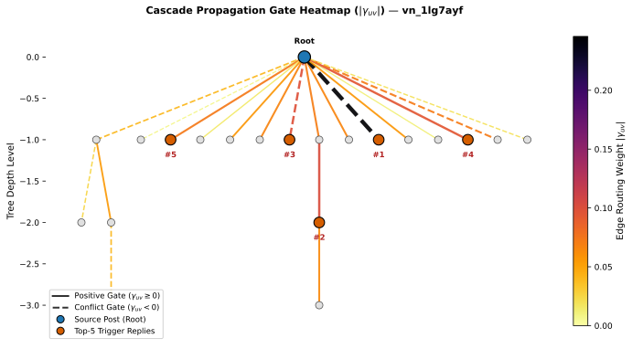

*Hình 3.7: Bản đồ nhiệt trọng số $|\gamma_{uv}|$ xếp hạng top các bình luận kích hoạt trên chuỗi VN mẫu ([`vn/fig3_cascade_heatmap.pdf`](../paper/figures/vn/fig3_cascade_heatmap.pdf) | [`pheme/fig3_cascade_heatmap.pdf`](../paper/figures/pheme/fig3_cascade_heatmap.pdf)).*

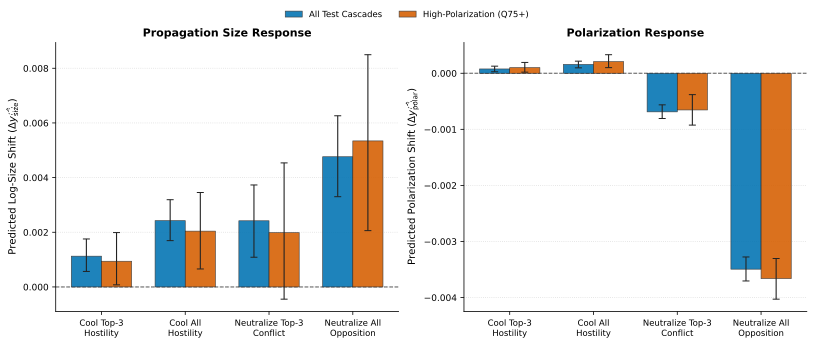

*Hình 3.8: Biểu đồ độ nhạy nhiễu đặc trưng cạnh với khoảng tin cậy bootstrap 95% trên tập Test VN ([`vn/fig4_counterfactual_interventions.pdf`](../paper/figures/vn/fig4_counterfactual_interventions.pdf) | [`pheme/fig4_counterfactual_interventions.pdf`](../paper/figures/pheme/fig4_counterfactual_interventions.pdf)).*

| Nhiễu đầu vào đặc trưng cạnh | VN All Test $\Delta\hat{y}_{\text{size}}$ | VN All Test $\Delta\hat{y}_{\text{polar}}$ | PHEME All Test $\Delta\hat{y}_{\text{size}}$ | PHEME All Test $\Delta\hat{y}_{\text{polar}}$ |
| :--- | :---: | :---: | :---: | :---: |
| Làm mát Top-3 Trigger Hostility | $+0.0011$ $[+0.0006, +0.0018]$ | $+0.0001$ $[+0.0000, +0.0001]$ | $-0.0018$ $[-0.0026, -0.0010]$ | $+0.0002$ $[+0.0001, +0.0002]$ |
| Làm mát toàn bộ Early Hostility | $+0.0024$ $[+0.0017, +0.0032]$ | $+0.0002$ $[+0.0001, +0.0002]$ | $-0.0052$ $[-0.0063, -0.0042]$ | $+0.0005$ $[+0.0005, +0.0006]$ |
| Trung hòa Top-3 Trigger Conflict | $+0.0024$ $[+0.0011, +0.0037]$ | $-0.0007$ $[-0.0008, -0.0006]$ | $+0.0004$ $[-0.0006, +0.0014]$ | $-0.0011$ $[-0.0012, -0.0010]$ |
| Trung hòa toàn bộ Opposition | $+0.0048$ $[+0.0033, +0.0063]$ | $-0.0035$ $[-0.0037, -0.0033]$ | $-0.0041$ $[-0.0051, -0.0032]$ | $-0.0007$ $[-0.0008, -0.0006]$ |

*Bảng 3.13: Kết quả kiểm tra độ nhạy nhiễu đầu vào (không phải can thiệp nhân quả) trên Test VN và Test PHEME (`paper/tables_mechanisms_*.tex`).*

Về chi phí tài nguyên (`Bảng 3.14`), nhờ tách pha trích xuất Transformer ra tệp `.pt`, `SBiFAGAT` chỉ có $137{,}086$ tham số, suy luận $1.1721\text{ ms/chuỗi}$ ($0.03\text{ MB}$ Peak Alloc RAM trên CPU VN; $0.3835\text{ ms/chuỗi}$ và $27.09\text{ MB}$ Peak VRAM trên GPU PHEME), hoàn toàn phù hợp cho triển khai thời gian thực trên máy chủ phổ thông hoặc Demo cục bộ.

| Mô hình | Số tham số | Suy luận CPU VN (ms/chuỗi) | Bước Train CPU VN (ms/batch) | Peak Alloc RAM VN (MB) | Peak VRAM PHEME (MB) |
| :--- | :---: | :---: | :---: | :---: | :---: |
| `TextMLP` | $71{,}110$ | $0.0787$ | $25.76$ | $0.02$ | $21.08$ |
| `TemporalStanceMLP` | $88{,}903$ | $0.1758$ | $28.45$ | $0.01$ | $21.34$ |
| `StandardGCN` | $75{,}398$ | $0.1661$ | $33.95$ | $0.01$ | $21.51$ |
| `StandardGATv2` | $83{,}974$ | $0.3058$ | $45.74$ | $0.01$ | $23.44$ |
| `EdgeGATv2` | $84{,}231$ | $0.4267$ | $73.47$ | $0.01$ | $23.48$ |
| `FAGCN` | $67{,}334$ | $0.3334$ | $55.82$ | $0.01$ | $22.27$ |
| `BiGCN` | $116{,}998$ | $0.4695$ | $80.05$ | $0.02$ | $23.17$ |
| `SBiFAGAT` | $137{,}086$ | $1.1721$ | $155.54$ | $0.03$ | $27.09$ |

*Bảng 3.14: Đánh giá chi phí tham số, độ trễ và bộ nhớ (`paper/tables_efficiency.tex` & `results_efficiency_*.json`).*

### 3.7. Tổng hợp 3 phát hiện khoa học cốt lõi

Từ toàn bộ chuỗi thực nghiệm có đối chứng, nghiên cứu đúc kết ba phát hiện khoa học trung thực sau:
1. **Tín hiệu cốt lõi là 3 lớp lập trường (*Tán thành / Phản đối / Trung lập*), không phải mức công kích thô:** Cắt bỏ $h_{uv}$ hầu như không làm giảm $R^2_{\text{polar}}$ trên VN ($0.0777 \to 0.0757$) và thậm chí giúp cải thiện trên PHEME ($0.0791 \to 0.0878$) do hiện tượng *Target-Misattributed Profanity* ($57.1\%$ bình luận ủng hộ có văng tục bên thứ 3 bị NLI đảo ngược). Ngược lại, bỏ $s_{uv}$ hoặc bỏ cổng phân cực có dấu đều làm suy giảm phương sai giải thích trên VN.
2. **Giới hạn thông tin cấu trúc trên cây đơn nông ($K = 10\text{--}20$, $\le 21$ nút):** Khi quan sát sớm một cây hội thoại nhỏ, nhúng ngữ nghĩa *Ancestor-Conditioned SpanPool* đã hấp thụ phần lớn tín hiệu có thể học được. Do đó, các mô hình GNN phức tạp chỉ đạt lợi thế chọn lọc ở phân loại tin đồn PHEME (`Macro-F1 = 0.3541`) nhưng nhanh chóng tiệm cận hoặc thua mô hình đơn giản (`TextMLP`, `TemporalStanceMLP`, `BiEdgeGATv2`) trong hồi quy phân cực.
3. **Hiệu quả rõ nét khi nâng cấp lên Tầng 2 Mạng người dùng có dấu vĩ mô:** Khắc phục trần cây nhỏ bằng cách chiếu tương tác xuyên chủ đề lên $\mathcal{G}_{\text{macro}}$ bộc lộ tách phổ hai phe rõ rệt ($Q_{\text{signed}} = 0.4280$ VN / $0.8232$ PHEME), phát hiện cấu trúc xã hội phản cân bằng $(---)$ và xu hướng cải thiện dự báo cạnh đối đầu trên người dùng quen thuộc (`Trans. ROC-AUC = 0.9181`, `Trans. Macro-F1 = 0.8006` trên PHEME, đi kèm phân tích trung thực về lặp cặp $21.7\%$ và $p_{\text{adj}}$).

---

## Chương 4 — Xây dựng Hệ thống Ứng dụng Demo & Triển khai Thực tế

Hệ thống Demo Web cục bộ MVP (`scripts/demo_web_app.py`) được xây dựng và kiểm chứng trực tiếp qua quy trình Gate 2 Browser QA tại địa chỉ nội bộ `http://127.0.0.1:8765/`, kết nối trực tiếp trọng số GNN đã huấn luyện (`checkpoints/best_sbifagat_vn.pt`), kho đặc trưng NLP tập kiểm thử VN thật (`data/processed/vn/`) và các kết quả Tầng 2 đã xuất bản trong `paper/`.

### 4.1. Kiến trúc Demo Web cục bộ hai Tab (Offline-First & An toàn bảo mật)

Để phục vụ trình diễn trực tiếp tại buổi bảo vệ đề tài mà không phụ thuộc kết nối mạng công cộng hay API trả phí, hệ thống ứng dụng được thiết kế thành **Demo Web cục bộ hai Tab** trên nền máy chủ HTTP đa luồng thuần thư viện chuẩn Python (`ThreadingHTTPServer` trong `http.server`), tuân thủ bốn nguyên tắc triển khai:
- **Ràng buộc địa chỉ nội bộ (`127.0.0.1`):** Máy chủ từ chối mọi địa chỉ gán ngoài `ALLOWED_LOCAL_HOSTS = {"127.0.0.1", "localhost", "::1"}`, mặc định chạy tại `http://127.0.0.1:8765/`.
- **Danh sách cho phép tĩnh (*Static Allowlist*) & Bảo vệ truy cập:** Chỉ phục vụ đúng $5$ đường dẫn tĩnh hợp lệ (`/`, `/styles.css`, `/app.js`, `/assets/fig5_vn.svg`, `/assets/fig5_pheme.svg`), thiết lập header bảo mật `Cache-Control: no-store`, `X-Content-Type-Options: nosniff`, `Content-Security-Policy` chặn script ngoài, và chặn lỗi `403 Forbidden` mọi nỗ lực duyệt thư mục (`..`, `%2e`, `\`, `/paper`, `/src`, `/data`, `/checkpoints`, `/scripts`, `/.env`, `/.git`) cũng như không bao giờ đọc các tệp khóa máy `*_machine_key.csv` hay `.secret`.
- **Vận hành Offline-First (Zero External CDN):** Toàn bộ mã giao diện HTML/CSS/SVG/JS được đóng gói nội bộ trong `web_demo/`. Ở Tab 1, Chế độ A (`Bài Test VN Thật`) nạp sẵn $10$ chuỗi thảo luận đa dạng từ tập Test VN (`data/processed/vn/`) bằng hàm chọn phân tầng `_select_diverse_indices` (tự động chuyển sang $2$ mẫu tổng hợp ngoại tuyến nếu thiếu dữ liệu cục bộ); Chế độ B (`Sandbox Dọn rác & Nhập hội thoại`) hỗ trợ $2$ kịch bản dựng sẵn (`Preset 1 · Phạt nguội AI`, `Preset 2 · Quy định WFH/Văn phòng`), nhập hội thoại tiếng Việt tự do hoặc truy vấn URL Reddit qua Arctic Shift (`/api/comments/search` với fallback `.json?limit=500`).
- **Bảo vệ suy luận thật (`scripts/predict_live_thread.py`):** Chặn tuyệt đối việc chạy suy luận trên dữ liệu thật khi thiếu tệp trọng số GNN đã huấn luyện (`checkpoints/best_sbifagat_vn.pt`); chỉ cho phép chạy thử không trọng số khi truyền cờ `--allow-untrained` hoặc dùng mẫu `--demo-offline`.

### 4.2. Các mô-đun chức năng cốt lõi và Hiệu chuẩn ngưỡng thực tế

Giao diện Web được tổ chức thành hai không gian phân tích đồng bộ trực tiếp với mô hình Hai tầng:

1. **Tab 1 — Tầng 1: Cây Thảo luận Sớm ($K=20$):**
   - **Minh bạch chế độ Backend NLP:** Trên các chuỗi Test VN thật ở Chế độ A, `DemoBackend` sử dụng trực tiếp vector SpanPool `ViSoBERT` và thuộc tính cạnh 2D $[s_{uv}, h_{uv}]^\top$ từ `DualHeadCrossEncoder` đã trích xuất sẵn trong `data/processed/vn/nlp_features.pt` (`nlp_backend = "preextracted_full_2d_ce"`, `cross_encoder_loaded = true`). Trên luồng suy luận trực tiếp / Sandbox (`_resolve_nlp_backends` trong `scripts/predict_live_thread.py`), hệ thống tự động chọn một trong ba chế độ thực tế (`Bảng 4.1`): `full_2d_cross_encoder`, `visobert_spanpool_heuristic_edges`, hoặc `heuristic_hash_sandbox`. Khi tệp `dual_head_weights.pt` không có mặt cục bộ ở chế độ Sandbox (`cross_encoder_loaded = false`), giao diện hiển thị **banner cảnh báo trung thực hổ phách không thể tắt** giải thích rõ điểm cạnh được chấm bằng luật Heuristic để minh họa *Path Contraction*, trong khi trọng số GNN đầu cuối vẫn nạp từ `checkpoints/best_sbifagat_vn.pt`.
   - **Công tắc Lọc rác bảo toàn cấu trúc cây (`Path Contraction`):** Người dùng chuyển đổi trực tiếp giữa `Contract` (mặc định, co rút nút giữa rác qua `resolve_contracted_parent_id`) và `Prune` (cắt bỏ nhánh sau nút rác), quan sát tức thời thẻ thống kê thay đổi số lượng bình luận (`Bình luận thô -> Giữ lại`, `Cắt lá rác`, `Thu gọn nút giữa`, `Nối lại cạnh`), danh sách lập trường ngắn 1–2 từ được bảo toàn (`"Đồng ý"`, `"Phản đối"`), và các đường cạnh đứt nét màu cam gắn nhãn `[Nối nhánh]` trên cây.
   - **Chuyển đổi góc nhìn `Sơ đồ Cây Hội thoại` $\leftrightarrow$ `Đồ thị Người dùng của Thread`:** Trong cùng một chuỗi, người dùng có thể chuyển từ cây trả lời cha–con (tô màu theo **3 lớp lập trường tách bạch: Xanh lá = Tán thành $s_{uv} > 0.1$, Đỏ = Phản đối $s_{uv} < -0.1$, Xám = Trung lập**) sang đồ thị người dùng cấp thread chia hai cột (`Phe 0 · Gốc / Đồng thuận` vs `Phe 1 · Đối lập / Phản biện`) với định danh giả danh hóa SHA-256 rút gọn (`u_15a83c (OP)`, `u_9621ea`, ...). Nút gạt `#toggle-profanity-badge` (*"Hiện chỉ báo công kích thô tục — Kỹ thuật — cẩn trọng lỗi chửi bên thứ 3"*) **luôn tắt mặc định** để tránh người dùng hiểu nhầm lỗi *Target-Misattributed Profanity*.
   - **Bảng chỉ số nhịp độ 8 chiều, Top-5 cạnh kích hoạt ($|\gamma_{uv}|$) và Ngưỡng phân vùng hiệu chuẩn VN Train:** Các ngưỡng phân loại cục diện phân cực (`_classify_calibrated_regime`) được cố định hoàn toàn theo phân vị của tập **VN Train ($N = 1{,}050$ chuỗi, $K=20, N_{\text{reply}} \ge 25$, 0% rò rỉ Val/Test)** trong `scripts/predict_live_thread.py` (`Bảng 4.1`).

| Thành phần kỹ thuật | Giá trị / Trạng thái thực tế trong mã nguồn | Điều kiện / Diễn giải vận hành |
| :--- | :--- | :--- |
| **Backend Chế độ A (Cached VN)** | `preextracted_full_2d_ce` | Nạp `nlp_features.pt` (`ViSoBERT SpanPool` + `DualHeadCrossEncoder` 2D trích xuất sẵn) + `best_sbifagat_vn.pt` |
| **Backend Live Tầng 1** | `full_2d_cross_encoder` | Nạp đủ `checkpoints/dual_ce_vn` (`dual_head_weights.pt`) + encoder SpanPool đóng băng |
| **Backend Live Tầng 2** | `visobert_spanpool_heuristic_edges` | Đã nạp SpanPool `ViSoBERT`, chấm cạnh qua `_heuristic_behavior_fallback` (`cross_encoder_loaded = false`) |
| **Backend Live Tầng 3** | `heuristic_hash_sandbox` | Băm n-gram 768-D (`_deterministic_text_projection`) + heuristic cạnh (sandbox offline không có mô hình NLP) |
| **Ngưỡng `VN_POLAR_Q50`** | `0.0928` (`0.0927623`) | $\hat{y}_{\text{polar}} < Q_{50}$: *"Tương đối đồng thuận / ít chia rẽ (< Q50 VN Train)"* |
| **Ngưỡng `VN_POLAR_Q75`** | `0.1202` (`0.1201977`) | $Q_{50} \le \hat{y}_{\text{polar}} < Q_{75}$: *"Phân hóa trung bình (Q50-Q75 VN Train)"* |
| **Ngưỡng `VN_POLAR_Q90`** | `0.1504` (`0.1503512`) | $Q_{75} \le \hat{y}_{\text{polar}} < Q_{90}$ (hoặc $\ge 2$ phản biện ôn hòa): *"Tranh luận đa chiều văn minh"*; $\ge Q_{90}$ (hoặc $\ge 3$ xung đột/ngụy biện): *"Phân cực xung đột gay gắt"* |

*Bảng 4.1: Chuẩn trạng thái backend NLP (`scripts/demo_web_app.py`, `scripts/predict_live_thread.py`) và ngưỡng phân vùng cục diện phân cực hiệu chuẩn từ tập Train VN.*

2. **Tab 2 — Tầng 2: Bản đồ Phân cực 2 Phe Cộng đồng (`Macro Signed Social Network Explorer`):**
   - Tải trực tiếp dữ liệu từ `paper/results_macro_network_{vn,pheme}.json`, `paper/results_signed_link_{vn,pheme}.json` và hai hình vector `fig5_macro_signed_network.svg`.
   - Hiển thị bốn thẻ KPI chính (`Signed Modularity Q_signed`, `Garimella Random Walk RWC`, `Cân bằng Cấu trúc z-score`, `Đối đầu Liên phe vs Trong phe`), biểu đồ phân bố tam giác có dấu, bảng so sánh 6 mô hình dự báo liên kết có dấu, và khung **Phân tích Định lượng & Giới hạn Trung thực** (cảnh báo lặp cặp $21.7\%$ trên $n=212$ cạnh Transductive PHEME, $Q_{\text{signed}} = 0.8232$ trên WCC thưa bậc trung bình $\le 3.09$, phản cân bằng $(---)$, và việc `SGCN` dẫn `Trans. ROC-AUC` trên VN).

### 4.3. Tình huống minh họa & Kiểm chứng thực tế (Gate 2 Browser QA)

Quá trình kiểm chứng trình duyệt tại `http://127.0.0.1:8765/` ghi nhận hoạt động ổn định qua hai tình huống đối chứng trọng tâm cùng $5$ ảnh chụp màn hình thực tế (`Bảng 4.2`, `Hình 4.1`–`Hình 4.5`).

#### 4.3.1. Tình huống 1 — Đối chứng Tập Test VN Thật: Chuỗi ít phân cực (`vn_1n0hqn0`) vs. Chuỗi tranh luận hai phe & Cầu nối Đồ thị Người dùng (`vn_1lg7ayf`)

- **Chuỗi đối chứng A (`vn_1n0hqn0` — mức phân cực thấp):** Nội dung bài gốc mang nhãn thay thế ẩn danh `[REDACTED_DOXXING_PII]` từ tập dữ liệu VN đã lọc/ẩn danh trên đĩa (trong mã nguồn `src/data/arctic_shift_vn.py`, hàm `redact_pii_text` thay thông tin cá nhân thành `[REDACTED_PII]`, còn `is_doxxing_post` và `is_invalid_or_spam_text` lọc loại văn bản doxxing/rác trước khi dựng cây). Lát cắt $K=20$ bình luận sớm gồm $12$ tác giả có phân bố lập trường $1$ tán thành, $8$ trung lập và $11$ phản đối. Qua suy luận của checkpoint thật `best_sbifagat_vn.pt` trên đặc trưng trích xuất sẵn (`nlp_backend = preextracted_full_2d_ce`), mô hình dự báo quy mô cuối kỳ `~42.6` bình luận (thực tế toàn cây là `25` bình luận) và chỉ số phân cực tương lai $\hat{y}_{\text{polar}} = 0.1122$ (thực tế tương lai $t > K$ là $y_{\text{polar}} = 0.0290$, độ tin cậy `75.0%`).
- **Chuỗi đối chứng B (`vn_1lg7ayf` — chủ đề *"Hỏi về việc sống chung khi yêu nhau"*, mức phân cực cao nhất nhóm kiểm thử):** Tại $K=20$ bình luận sớm trên $15$ tác giả ($0$ tán thành, $9$ trung lập, $11$ phản đối; `Hình 4.1`), `SBi-FAGAT` dự báo `~41.8` bình luận (thực tế `30` bình luận) và $\hat{y}_{\text{polar}} = 0.1159$ (thuộc cục diện *"Tranh luận đa chiều văn minh (Q75-Q90 VN Train)"*, độ tin cậy `75.0%`), trong khi chỉ số phân cực tương lai thực tế ($t > K$) đạt $y_{\text{polar}} = 0.2644$. Các cạnh kích hoạt mạnh nhất phản ánh đúng trọng tâm phản biện: cạnh kích hoạt số 1 mang cổng xuôi $\gamma_{\text{TD}} = -0.259$ và độ quan trọng hai chiều $\tfrac{1}{2}(|\gamma_{\text{TD}}| + |\gamma_{\text{BU}}|) = 0.246$ (`src/models/sbi_fagat.py`), còn nút `u_9621ea` ở $+278\text{ s}$ mang $s_{uv} = -0.2348, h_{uv} = 0.0136, \gamma_{uv} = -0.0632$ thuộc nhóm `Phản biện ôn hòa`.
- **Cầu nối trực quan Tầng 1 $\to$ Tầng 2 (`Hình 4.2`):** Khi chuyển sang góc nhìn `Đồ thị Người dùng của Thread` trên chuỗi `vn_1lg7ayf`, $15$ tác giả được chiếu trực tiếp thành hai phe tách bạch: **`Phe 0 · Gốc / Đồng thuận (5 người)`** (`u_15a83c (OP)`, `u_7f0c2e`, `u_116563`, `u_17e96b`, `u_39bc61`) và **`Phe 1 · Đối lập / Phản biện (10 người)`** (`u_9621ea`, `u_c02d16`, cùng $8$ tài khoản phản biện/liên kết khác), minh họa trực quan cầu nối giữa tương tác cây ở Tầng 1 và mạng người dùng ở Tầng 2. Chỉ báo công kích thô tục (`#toggle-profanity-badge`) được giữ ở trạng thái tắt mặc định nhằm tránh hiểu nhầm lỗi *Target-Misattributed Profanity*.

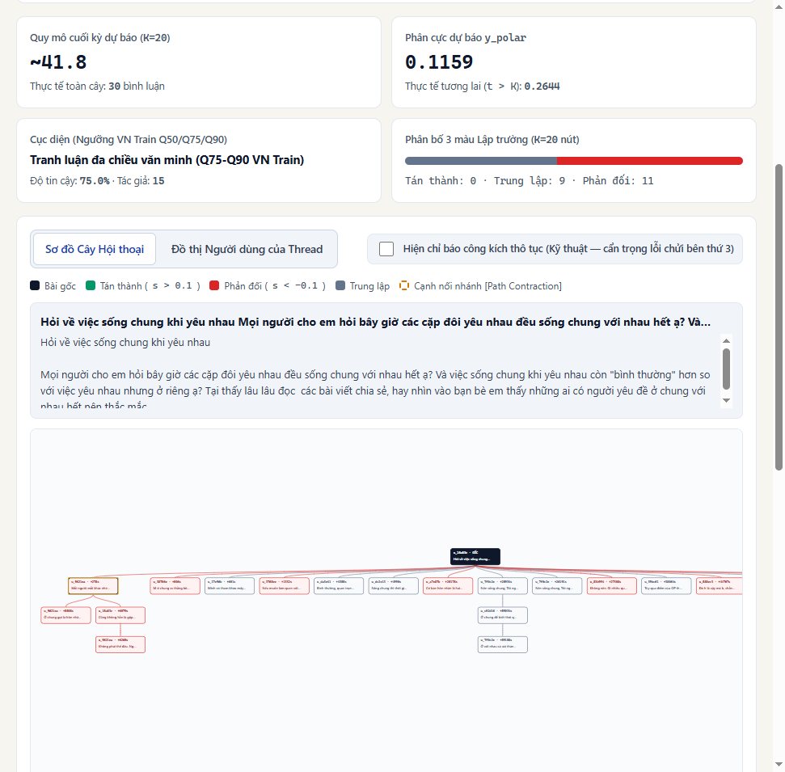

*Hình 4.1: Giao diện Tab 1 Chế độ A (`Bài Test VN Thật`) hiển thị chuỗi `vn_1lg7ayf` ở góc nhìn `Sơ đồ Cây Hội thoại` với dự báo `~41.8` bình luận, $\hat{y}_{\text{polar}} = 0.1159$ (thực tế $0.2644$) và phân bố 3 màu lập trường ($0 / 9 / 11$).*

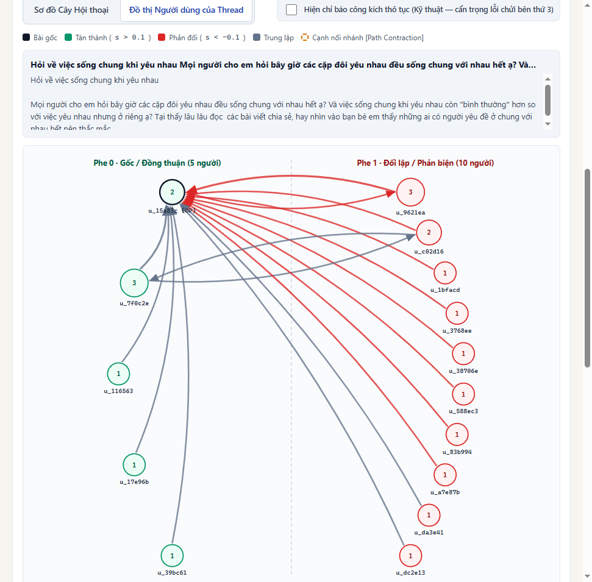

*Hình 4.2: Góc nhìn `Đồ thị Người dùng của Thread` trên chuỗi `vn_1lg7ayf`, phân tách rõ $15$ tác giả giả danh hóa thành `Phe 0 · Gốc / Đồng thuận (5 người)` và `Phe 1 · Đối lập / Phản biện (10 người)`.*

#### 4.3.2. Tình huống 2 — Kiểm chứng *Path Contraction* và Cảnh báo Trung thực Sandbox (`Preset 1 · Phạt nguội AI`)

- **Kịch bản kiểm thử (`Preset 1 · Đề xuất lắp camera AI phạt nguội xe máy vượt đèn đỏ tại ngã tư lớn`):** Chuỗi thô gồm $15$ bình luận có gài có chủ đích $3$ bình luận lá rác (`"hóng"`, `"👍"`, link spam `shope.ee`) và $3$ bình luận rác nằm ở vị trí nút giữa (`[deleted]`, `"hóng ké"`, `"."`) che phía trên các nhánh bình luận hợp lệ, trong đó có cả các lập trường ngắn 2 từ (`"Đồng ý"`, `"Phản đối"`).
- **Kết quả xử lý (`Hình 4.3` & `Hình 4.4`):** Khi kích hoạt `junk_mode="contract"`, thuật toán lọc rác bảo toàn cấu trúc giữ lại **`9` bình luận cốt lõi** ($2$ tán thành, $1$ trung lập, $6$ phản đối; $9$ tác giả), cắt bỏ **`3` lá rác**, thu gọn **`3` nút giữa rác** và nối lại **`3` cạnh** trực tiếp lên tổ tiên hợp lệ (hiển thị bằng nét đứt màu cam có nhãn `Nối nhánh` trên sơ đồ cây), đồng thời bảo toàn nguyên vẹn hai lập trường ngắn `"Đồng ý"` và `"Phản đối"`. Ở đầu ra dự báo, hệ thống ghi nhận `~50.6` bình luận dự kiến và $\hat{y}_{\text{polar}} = 0.1313$; cần lưu ý con số **`0.7031`** hiển thị trên thẻ là **chỉ số phân cực quan sát nội tại cửa sổ (`early_y_polar`) tính bằng Heuristic trên chính $9$ nút giữ lại** (do mẫu Sandbox tổng hợp chỉ có $9$ bình luận trong cửa sổ, không có tập tương lai $t > K$ riêng để đối chiếu như các chuỗi Test VN thật). Kèm theo đó là **banner cảnh báo trung thực màu hổ phách không thể tắt (`cross_encoder_loaded = false`, `nlp_backend = visobert_spanpool_heuristic_edges`)** do không có tệp nhị phân `dual_head_weights.pt` trên máy cục bộ.

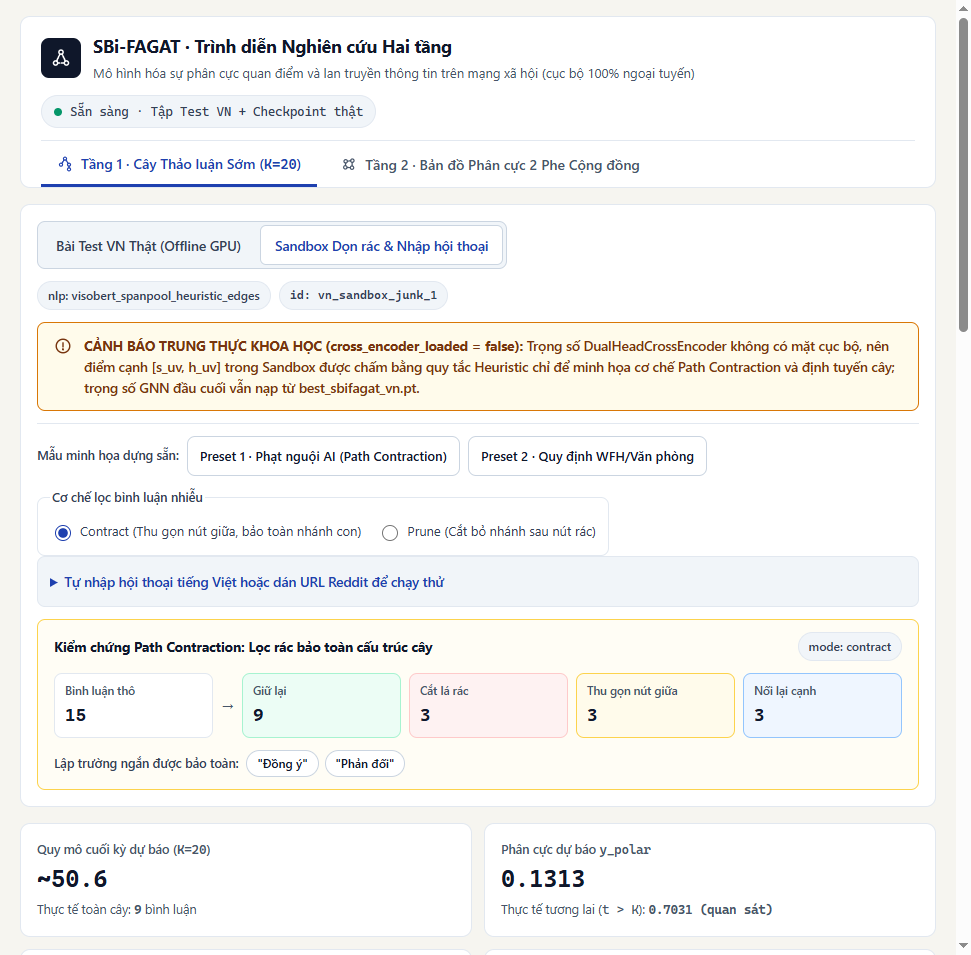

*Hình 4.3: Giao diện Tab 1 Chế độ B (`Sandbox`) hiển thị banner cảnh báo trung thực `cross_encoder_loaded = false` (`nlp: visobert_spanpool_heuristic_edges`) và thẻ đối chứng *Path Contraction* (`15 -> 9 | Cắt lá rác: 3 | Thu gọn nút giữa: 3 | Nối lại cạnh: 3`).*

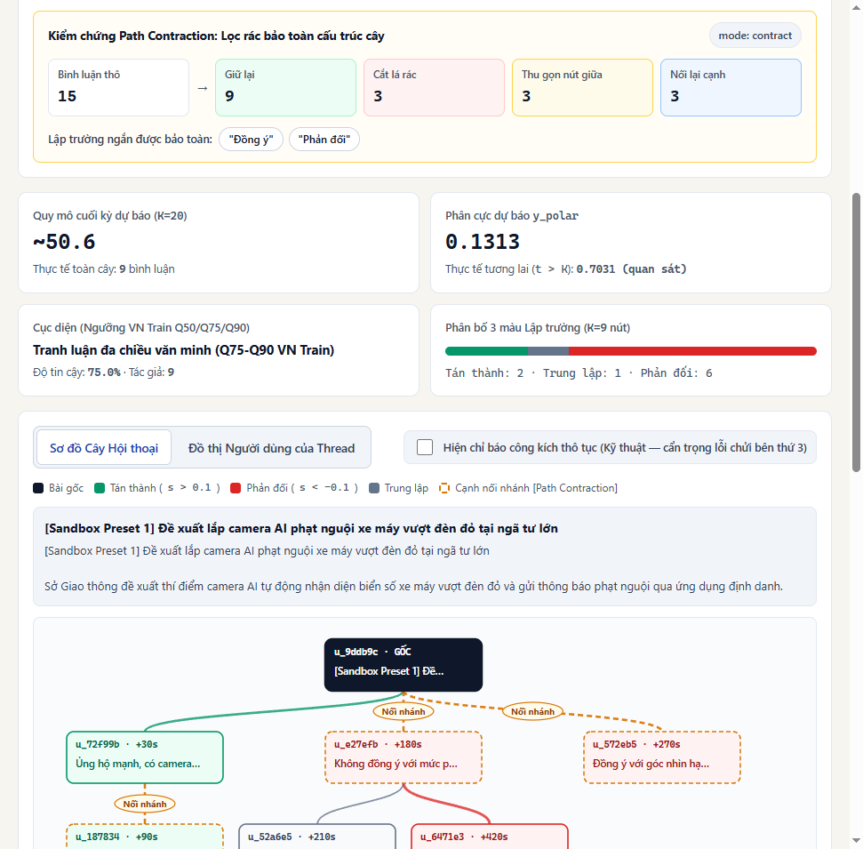

*Hình 4.4: Cây hội thoại `Preset 1 · Phạt nguội AI` sau khi áp dụng `junk_mode="contract"`, bảo toàn các bình luận con phía sau nút rác (3 cạnh đứt nét cam `[Nối nhánh]`) và hai lập trường ngắn `"Đồng ý"`, `"Phản đối"`.*

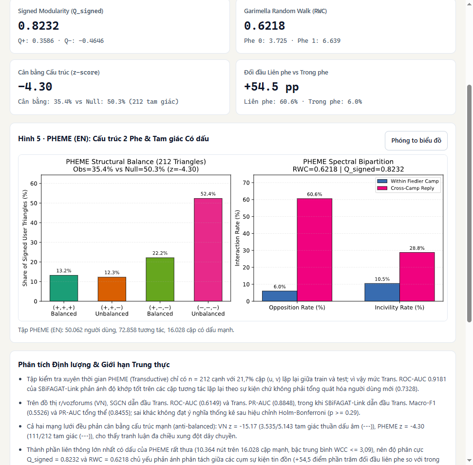

*Hình 4.5: Giao diện Tab 2 (`PHEME EN`) hiển thị các chỉ số Tầng 2 ($Q_{\text{signed}} = 0.8232$, `RWC = 0.6218`, `z = -4.30`, chênh lệch đối đầu liên phe `+54.5 pp`), biểu đồ `fig5` ($50{,}062$ tổng người dùng, $36{,}606$ trong cặp trả lời hợp lệ trên $72{,}858$ tương tác, $18{,}985$ thuộc $16{,}028$ cặp có dấu mạnh; WCC thưa $10{,}364$ nút) và mục phân tích giới hạn định lượng (`n = 212`, `21.7%` cặp lặp, phản cân bằng `(---)`).*

| Tình huống / Chuỗi kiểm thử | Chế độ & Backend NLP | Đầu vào $K$ (Tác giả) | Lập trường (Ủng hộ / Trung lập / Phản đối) | Quy mô dự báo (Thực tế) | Phân cực $\hat{y}_{\text{polar}}$ (Đối chiếu) | Cơ chế / Ghi chú kiểm chứng |
| :--- | :--- | :---: | :---: | :---: | :---: | :--- |
| **TH1-A: `vn_1n0hqn0`** | Chế độ A (`preextracted_full_2d_ce`) | $20$ ($12$) | $1 / 8 / 11$ | `~42.6` (`25`) | `0.1122` (`0.0290` $t>K$) | Bài gốc mang nhãn ẩn danh `[REDACTED_DOXXING_PII]` trên đĩa; độ tin cậy `75.0%` |
| **TH1-B: `vn_1lg7ayf`** | Chế độ A (`preextracted_full_2d_ce`) | $20$ ($15$) | $0 / 9 / 11$ | `~41.8` (`30`) | `0.1159` (`0.2644` $t>K$) | $\gamma_{\text{TD}} = -0.259$ ($|\gamma|_{\text{2dir}} = 0.246$); `u_9621ea` (`-0.2348`); tách `5` vs `10` |
| **TH2: `Preset 1 · Phạt nguội AI`** | Chế độ B (`visobert_spanpool_heuristic_edges`) | $15 \to 9$ ($9$) | $2 / 1 / 6$ | `~50.6` (`9`) | `0.1313` (`0.7031` nội tại 9 nút) | `cross_encoder_loaded = false`; `0.7031` là `early_y_polar` Heuristic (không có $t>K$); `contract` cắt `3` lá, gộp `3` giữa, nối `3` cạnh |

*Bảng 4.2: Tổng hợp số liệu thực nghiệm Gate 2 Browser QA cho hai tình huống minh họa trên Demo Web cục bộ (`http://127.0.0.1:8765/`).*

---

## Kết luận & Hướng phát triển

### 1. Kết luận

Đề tài đã xây dựng hoàn chỉnh và kiểm định nghiêm ngặt khung mô hình đồ thị có dấu **Hai tầng** kết hợp NLP và GNN cho bài toán mô hình hóa lan truyền thông tin và phân cực quan điểm trên cả Reddit Tiếng Việt và Twitter Tiếng Anh (`PHEME`):

1. **Về kiến trúc và kỷ luật thực nghiệm:** Toàn bộ đường ống tách rời hoàn toàn pha trích xuất ngữ nghĩa (`Ancestor-Conditioned SpanPool` + `DualHeadCrossEncoder` 2D cô lập phân đoạn từ Teacher kép NLI đối xứng và bộ phân loại công kích cân bằng lớp) khỏi pha huấn luyện GNN 5 hạt giống dưới chế độ chống rò rỉ nghiêm ngặt (`topic_splits.json`, cô lập cạnh Teacher ở LOO/Temporal Holdout, giả danh hóa SHA-256 có muối, chặn tràn bộ nhớ dưới ngưỡng $16\text{ GB}$ VRAM / dual T4).
2. **Về kết quả thực nghiệm trung thực ở Tầng 1:** `SBiFAGAT` vượt trội rõ rệt so với đường cơ sở phi tham số `Early-K Persistence` ($-3.1986 \to 0.0742$ trên VN; $-0.3022 \to 0.0793$ trên PHEME), dẫn đầu phân loại tin đồn PHEME Inductive về `Macro-F1` ($0.3541$, bootstrap $p_{\text{adj}} = 8.96\text{e-}02$) và `Acc` ($0.6359$, bootstrap $p_{\text{adj}} = 7.20\text{e-}03$ so với `EdgeGATv2`, cao hơn $+17.2\text{ pp}$ so với lớp đa số Test-334 nhưng xếp sau `TemporalStanceMLP` $0.6443$), đồng thời dẫn đầu 5-fold LOO ở `RMSE` ($0.0445$), $R^2_{\text{polar}}$ ($0.0512$), `Macro-F1` ($0.2978$) và `Acc` ($0.6203$). Tuy nhiên, các bảng cắt bỏ và chuyển giao `UPFD` [12] cũng chỉ ra trung thực giới hạn trần trên cây đơn nông $11$–$21$ nút (`SBiFAGAT` hòa `TextMLP`/`BiEdgeGATv2` trên VN và thắng $0/9$ chỉ số cắt bỏ trên PHEME), trong khi kiểm định nhãn bạc với `RumourEval-2019` [19] xác nhận **3 lớp lập trường ($s_{uv}$)** là tín hiệu cốt lõi còn lỗi *Target-Misattributed Profanity* ($57.1\%$) làm nhiễu tín hiệu công kích thô.
3. **Về giá trị mở rộng của Tầng 2 và Demo ứng dụng:** Việc chiếu các cạnh 2D lên mạng tương tác người dùng vĩ mô cho thấy sự phân tách quang phổ hai phe sắc nét ($Q_{\text{signed}} = 0.4280$ trên VN, $+19.1\text{ pp}$ đối đầu liên phe; $Q_{\text{signed}} = 0.8232$ và RWC $= 0.6218$ trên WCC thưa $212$ tam giác của PHEME, $+54.5\text{ pp}$), bộc lộ đặc trưng xã hội phản cân bằng $(---)$, và ghi nhận xu hướng cải thiện của `SBiFAGAT-Link` trên dự báo cạnh *transductive* PHEME (`ROC-AUC = 0.9181`, `Macro-F1 = 0.8006`; $p_{\text{adj}} = 0.1622/0.3750$ với $21.7\%$ lặp cặp). Hệ thống Demo Web cục bộ cùng thuật toán lọc rác bảo toàn cấu trúc cây (*Path Contraction*) sẵn sàng cho kiểm thử trình diễn.

### 2. Hướng phát triển tiếp theo

Dựa trực tiếp trên 5 giới hạn thực nghiệm đã chỉ ra (trần cây nông, sụp đổ nhãn bạc và *Target-Misattributed Profanity*, cụm chủ đề heuristic 1–2 nguồn, mẫu nhỏ $K$-curve/audit, và giới hạn API $500$ bình luận khi suy luận trực tiếp), nghiên cứu định hướng ba nâng cấp trọng tâm ở giai đoạn tiếp theo:

1. **Mô hình hóa lập trường và công kích gắn mục tiêu (*Target-Aware Stance & Toxicity Modeling*):** Thay thế NLI zero-shot và phân loại công kích cấp phát ngôn bằng kiến trúc suy luận gắn đích (*target-conditioned*), phân biệt rõ người nói đang công kích *tác giả bài cha* hay *một bên thứ ba được nhắc tới trong câu chuyện*, nhằm khắc phục trực tiếp tỷ lệ đảo nhãn $57.1\%$ trên các bình luận `support+uncivil`.
2. **Mở rộng ngữ cảnh hội thoại đa lượt ($\ge 5$ lượt *Multi-Turn Thread Context*):** Vượt ra ngoài cửa sổ hai lượt `[CLS] root [SEP] parent [SEP] reply [SEP]` bằng cách mã hóa tối thiểu $5$ lượt tổ tiên liền kề (ông, cha và các lượt xen giữa), giúp giải quyết hiện tượng phủ định đa chặng và mỉa mai châm biếm ở các bình luận sâu ($\text{depth} \ge 2$).
3. **Đồ thị dị thể Reply–Mention (`@mention`) và phân trang thu thập vượt trần `limit=500`:** Tích hợp thêm loại cạnh nhắc tên trực tiếp (`@mention`) song song với cạnh trả lời cây (`reply`) vào đồ thị Tầng 2 để tăng mật độ kết nối giữa các thành phần rời rạc, đồng thời nâng cấp bộ thu thập trực tuyến (`scripts/predict_live_thread.py`) hỗ trợ phân trang liên tiếp vượt giới hạn $500$ bình luận mỗi yêu cầu API đối với các bài đăng lớn.

---

## Tài liệu Tham khảo

*(Đầy đủ 24 tài liệu tham khảo đã xác minh chính xác tác giả, năm công bố, hội nghị/tạp chí, số trang và mã DOI/arXiv khớp 100% với tệp [`paper/references.bib`](../paper/references.bib)).*

1. Kipf, T. N., & Welling, M. (2017). Semi-Supervised Classification with Graph Convolutional Networks. *Proceedings of the 5th International Conference on Learning Representations (ICLR 2017)*. arXiv:1609.02907. https://openreview.net/forum?id=SJU4ayYgl
2. Brody, S., Alon, U., & Yahav, E. (2022). How Attentive are Graph Attention Networks? *Proceedings of the 10th International Conference on Learning Representations (ICLR 2022)*. arXiv:2105.14491. https://openreview.net/forum?id=F72ximsx7C1
3. Derr, T., Ma, Y., & Tang, J. (2018). Signed Graph Convolutional Networks. *2018 IEEE International Conference on Data Mining (ICDM)*, pp. 929–934. DOI: `10.1109/ICDM.2018.00113` | arXiv:1808.06354.
4. Bian, T., Xiao, X., Xu, T., Zhao, P.-L., Huang, W.-B., Rong, Y., & Huang, J.-Z. (2020). Rumor Detection on Social Media with Bi-Directional Graph Convolutional Networks. *Proceedings of the AAAI Conference on Artificial Intelligence (AAAI 2020)*, Vol. 34, No. 01, pp. 549–556. DOI: `10.1609/aaai.v34i01.5393` | arXiv:2001.06362.
5. Bo, D., Wang, X., Shi, C., & Shen, H. (2021). Beyond Low-frequency Information in Graph Convolutional Networks. *Proceedings of the AAAI Conference on Artificial Intelligence (AAAI 2021)*, Vol. 35, No. 5, pp. 3950–3957. DOI: `10.1609/aaai.v35i5.16514` | arXiv:2101.00797.
6. Garimella, K., De Francisci Morales, G., Gionis, A., & Mathioudakis, M. (2018). Quantifying Controversy on Social Media. *ACM Transactions on Social Computing*, Vol. 1, No. 1, pp. 3:1–3:26. DOI: `10.1145/3140565` | arXiv:1507.05224.
7. Garimella, K., De Francisci Morales, G., Gionis, A., & Mathioudakis, M. (2016). Quantifying Controversy in Social Media. *Proceedings of the Ninth ACM International Conference on Web Search and Data Mining (WSDM 2016)*, pp. 33–42. DOI: `10.1145/2835776.2835792`.
8. Nguyen, D. Q., & Nguyen, A. T. (2020). PhoBERT: Pre-trained language models for Vietnamese. *Findings of the Association for Computational Linguistics: EMNLP 2020*, pp. 1037–1042. DOI: `10.18653/v1/2020.findings-emnlp.92` | arXiv:2003.00744.
9. Liu, Y., Ott, M., Goyal, N., Du, J., Joshi, M., Chen, D., Levy, O., Lewis, M., Zettlemoyer, L., & Stoyanov, V. (2019). RoBERTa: A Robustly Optimized BERT Pretraining Approach. *arXiv preprint arXiv:1907.11692*. DOI: `10.48550/arXiv.1907.11692`.
10. Nguyen, N., Phan, T., Nguyen, D.-V., & Nguyen, K. (2023). ViSoBERT: A Pre-Trained Language Model for Vietnamese Social Media Text Processing. *Proceedings of the 2023 Conference on Empirical Methods in Natural Language Processing (EMNLP 2023)*, pp. 5191–5207. DOI: `10.18653/v1/2023.emnlp-main.315` | arXiv:2310.11166.
11. Luu, S. T., Nguyen, K. V., & Nguyen, N. L.-T. (2021). A Large-scale Dataset for Hate Speech Detection on Vietnamese Social Media Texts. *Advances and Trends in Artificial Intelligence. Artificial Intelligence Practices (IEA/AIE 2021)*, pp. 415–426. DOI: `10.1007/978-3-030-79457-6_35` | arXiv:2103.11528.
12. Dou, Y., Shu, K., Xia, C., Yu, P. S., & Sun, L. (2021). User Preference-aware Fake News Detection. *Proceedings of the 44th International ACM SIGIR Conference on Research and Development in Information Retrieval (SIGIR '21)*, pp. 2056–2060. DOI: `10.1145/3404835.3462990` | arXiv:2104.12259.
13. He, P., Gao, J., & Chen, W. (2023). DeBERTaV3: Improving DeBERTa using ELECTRA-Style Pre-Training with Gradient-Disentangled Embedding Sharing. *The Eleventh International Conference on Learning Representations (ICLR 2023)*. arXiv:2111.09543.
14. Laurer, M., van Atteveldt, W., Casas, A., & Welbers, K. (2024). Less Annotating, More Classifying: Addressing the Data Scarcity Issue of Supervised Machine Learning with Deep Transfer Learning and BERT-NLI. *Political Analysis*, Vol. 32, No. 1, pp. 84–100. DOI: `10.1017/pan.2023.20`.
15. Zubiaga, A., Liakata, M., Procter, R., Wong Sak Hoi, G., & Tolmie, P. (2016). Analysing How People Orient to and Spread Rumours in Social Media by Looking at Conversational Threads. *PLOS ONE*, Vol. 11, No. 3, e0150989. DOI: `10.1371/journal.pone.0150989`.
16. Kochkina, E., Liakata, M., & Zubiaga, A. (2018). PHEME dataset for Rumour Detection and Veracity Classification. *Figshare*. DOI: `10.6084/m9.figshare.6392078`.
17. Platonov, O., Kuznedelev, D., Diskin, M., Babenko, A., & Prokhorenkova, L. (2023). A Critical Look at the Evaluation of GNNs under Heterophily: Are We Really Making Progress? *Proceedings of the 11th International Conference on Learning Representations (ICLR 2023)*. arXiv:2302.11640.
18. Rossi, E., Charpentier, B., Di Giovanni, F., Frasca, F., Günnemann, S., & Bronstein, M. M. (2024). Edge Directionality Improves Learning on Heterophilic Graphs. *Proceedings of the Second Learning on Graphs Conference (LoG 2023)*, Proceedings of Machine Learning Research, Vol. 231, pp. 25:1–25:27. arXiv:2305.10498. https://proceedings.mlr.press/v231/rossi24a.html
19. Gorrell, G., Kochkina, E., Liakata, M., Aker, A., Zubiaga, A., Bontcheva, K., & Derczynski, L. (2019). SemEval-2019 Task 7: RumourEval, Determining Rumour Veracity and Support for Rumours. *Proceedings of the 13th International Workshop on Semantic Evaluation (SemEval-2019)*, pp. 845–854. DOI: `10.18653/v1/S19-2147`.
20. Barbieri, F., Camacho-Collados, J., Espinosa Anke, L., & Neves, L. (2020). TweetEval: Unified Benchmark and Comparative Evaluation for Tweet Classification. *Findings of the Association for Computational Linguistics: EMNLP 2020*, pp. 1644–1650. DOI: `10.18653/v1/2020.findings-emnlp.148`.
21. Li, C., Ma, J., Guo, X., & Mei, Q. (2017). DeepCas: An End-to-end Predictor of Information Cascades. *Proceedings of the 26th International Conference on World Wide Web (WWW '17)*, pp. 577–586. DOI: `10.1145/3038912.3052643` | arXiv:1611.05373.
22. Pfister, R., Schwarz, K. A., Janczyk, M., Dale, R., & Freeman, J. B. (2013). Good things peak in pairs: a note on the bimodality coefficient. *Frontiers in Psychology*, Vol. 4, 700. DOI: `10.3389/fpsyg.2013.00700`.
23. Cartwright, D., & Harary, F. (1956). Structural balance: a generalization of Heider's theory. *Psychological Review*, Vol. 63, No. 5, pp. 277–293. DOI: `10.1037/h0046049`.
24. Kunegis, J., Schmidt, S., Lommatzsch, A., Lerner, J., De Luca, E. W., & Albayrak, S. (2010). Spectral Analysis of Signed Graphs for Clustering, Prediction and Visualization. *Proceedings of the 2010 SIAM International Conference on Data Mining (SDM)*, pp. 559–570. DOI: `10.1137/1.9781611972801.49`.
