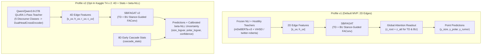

# SBi-FAGAT: Development History & Git Commit Progression

## 1. Verified Git Commit Log

| Commit | Summary | Key Architectural & Engineering Impact |
| :--- | :--- | :--- |
| `471823e` | `Initial commit` | Initial repository scaffold. |
| `46c363f` | `feat: initialize SBi-FAGAT codebase, math specs, unit tests, and team guide` | Core modules (`src/data`, `src/nlp`, `src/models`, `src/training`), `docs/math_spec.md`, `docs/literature_review.md`, `SBiFAGAT`, and 7 fair baselines. |
| `71431cc` | `research: resolve round-2 scientific blockers & add SBi-FAGAT learning lab` | Loss calibration, `docs/huong_dan_nghien_cuu_de_hieu.md`, `demo_research_walkthrough.py`, `benchmark_efficiency.py`, bootstrap/Holm reporting. |
| `5950c65` | `feat(v2): 5-class Qwen3.8-27B QLoRA teacher, 8D burst stats, auto-loop, live predictor & Kaggle T4x2 notebooks` | Profile `v2`: 5-class `Qwen/Qwen3.8-27B` QLoRA 1-pass G-Eval teacher (`[s_uv, h_uv, r_uv, c_uv]`), 8D `cascade_stats`, heteroscedastic $\beta$-NLL uncertainty (`beta_nll=0.5`), `auto_loop.py`, `predict_live_thread.py`, and dual-T4 notebooks. |
| `f4be964` | `fix(kaggle-t4x2): harden Qwen3_5ForConditionalGeneration 4-bit loader, Student CE extraction & teacher budget` | Hardened 4-bit NF4 loading, student CE extraction, and Kaggle `T4 x 2` token budget management. |
| `5820e71` | `feat(audit): implement scientific safeguards, profile gating, and project management suite` *(PR #1 by `thuyenevux`)* | Added salted author pseudonymization + `UserWarning`, live-predictor untrained guard + `test_live_predictor_audit.py`, `PIPELINE_VERSION=v1|v2` shell gating, `tzdata` Windows fix, `math_spec.md` cleanup, and initial `docs/project-management/`. |
| *Reconciliation Release* | *EGM Fixes + PR #1 Reconciliation + GitHub CI & Paper Tooling* | Restored full `v2` modules + 6 EGM fixes (`F1–F6`: shared `node_backbone`, LOO `edge_source="teacher"`, finite validation checks, uniform `min_total_replies=25`), reconciled `PR #1` CLI flags/thresholds/docs, added GitHub CI + PR template, `scripts/export_dataset_stats.py`, efficiency LaTeX export, and `paper/main.tex` (`IEEEtran`). |

---

## 2. Profile Evolution (`v1` MVP vs. `v2` Opt-In Scaling)

