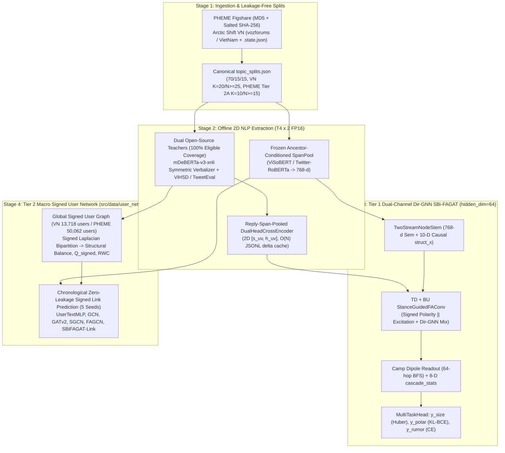

# SBi-FAGAT: Development History & Git Commit Progression

## 1. Verified Git Commit Log

| Commit | Summary | Key Architectural & Engineering Impact |
| :--- | :--- | :--- |
| `471823e` | `Initial commit` | Initial repository scaffold. |
| `46c363f` | `feat: initialize SBi-FAGAT codebase, math specs, unit tests, and team guide` | Core modules (`src/data`, `src/nlp`, `src/models`, `src/training`), `docs/math_spec.md`, `docs/literature_review.md`, `SBiFAGAT`, and 7 fair baselines. |
| `71431cc` | `research: resolve round-2 scientific blockers & add SBi-FAGAT learning lab` | Loss calibration, `docs/huong_dan_nghien_cuu_de_hieu.md`, `demo_research_walkthrough.py`, `benchmark_efficiency.py`, bootstrap/Holm reporting. |
| `5950c65` | `feat(v2): 5-class Qwen3.8-27B QLoRA teacher, 8D burst stats, auto-loop, live predictor & Kaggle T4x2 notebooks` | Profile `v2`: 5-class `Qwen/Qwen3.8-27B` QLoRA 1-pass G-Eval teacher (`[s_uv, h_uv, r_uv, c_uv]`), 8D `cascade_stats`, heteroscedastic $\beta$-NLL uncertainty (`beta_nll=0.5`), `auto_loop.py`, `predict_live_thread.py`, and dual-T4 notebooks. |
| `f4be964` | `fix(kaggle-t4x2): harden Qwen3_5ForConditionalGeneration 4-bit loader, Student CE extraction & teacher budget` | Hardened 4-bit NF4 loading, student CE extraction, and Kaggle `T4 x 2` token budget management. |
| `5820e71` | `feat(audit): implement scientific safeguards, profile gating, and project management suite` *(PR #1 by `thuyenevux`)* | Added salted author pseudonymization + `UserWarning`, live-predictor untrained guard + `test_live_predictor_audit.py`, `tzdata` Windows fix, `math_spec.md` cleanup, and initial `docs/project-management/`. |
| `090d777` | `feat(unified-2d): Steps 1–3 unified 2D SBi-FAGAT, SpanPool, KL-BCE & fair 8-model suite` | Retired `Qwen3.8-27B` QLoRA in favor of 100%-coverage Dual-Teacher (`mDeBERTa-v3-xnli` Symmetric Verbalizer + `ViHSD`/`TweetEval-Offensive`) -> reply-span-pooled 2D `DualHeadCrossEncoder`, Ancestor SpanPool, dual-channel Dir-GNN `SBiFAGAT`, `hidden_dim=64` parity, KL-calibrated BCE, and sealed machine-key zip separation. |
| `3d95581` | *EGM Hardening (`B1–B10`, `M1–M8`)* | Fixed PHEME LOO `min_total_replies` teacher coverage (`B1`), eliminated `edge_source` split-brain (`B2`), replaced $O(N^2)$ teacher JSON checkpointing with $O(N)$ JSONL deltas + multi-GPU AMP (`B3`), added crawl cursor `.state.json` resume + salted PHEME hashing (`B4`), hardened Kaggle stage skip & UPFD fault isolation (`B5`), fixed LaTeX `_` escaping + `table*` + 6 paper figure embeds + `assemble_paper_artifacts.py` (`B6`), fixed NLI double-contradiction neutral attribution + added `audit_vn_50_trees.py` (`B7`), added direction-aware stars + exact small-sample LOO permutation + topic-cluster bootstrap (`B8`), upgraded to continuous finite-sample-unbiased `y_polar` + fixed future $K$-curve window (`B9`), and added Camp Dipole/Dir-GNN/Dual-Channel ablations + matched `BiEdgeGATv2` + `TextMLP` topology masking (`B10`). |
| `2575295` | `feat(model,loss,pheme): CleanRes Camp Dipole & decoupled polar_head` | Added CleanRes Camp Dipole readout, decoupled `polar_head`, balanced 2:1 multi-task loss, and shallow `/kaggle/input` PHEME archive discovery (`3215ede` extended BFS depth to 6). |
| `338651b` | `results(vn): official 5-seed VN benchmark & mechanism artifacts` | Integrated Track 1 Vietnamese 5-seed benchmarks, ablations, `analyze_mechanisms.py` counterfactual results, efficiency stats, and VN vector figures. |
| `11637ed` | `perf(pheme): parallelized GCS-FUSE parsing & unbuffered logs` | Sped up Kaggle PHEME directory parsing with `os.scandir` + `ThreadPoolExecutor` and unbuffered progress logging. |
| `5332750` | `feat(paper,ui): Track 2 PHEME+UPFD artifacts & local blind audit UI` | Integrated Track 2 PHEME + UPFD results/figures, assembled unified tables (`0` missing), added `scripts/human_audit_ui.py` + `tests/test_human_audit_ui.py`, and synced `PROJECT_STATUS.md` / `TEST_REPORT.md`. |
| `fix/egm-audit-hardening` *(v3)* | *EGM v3 Overhaul: ReZero Anchor, Binary Gate 1 & Colab GPU Offload* | Scrubbed PII/spam in VN Parquets; linearized `y_polar`; fixed single-camp Camp Dipole; switched Persistence-Residual anchor to ReZero `tanh(w_p)` centered around train logit; added validation-only comparator selection, `r2_polar`, `beta=0.05`, and `--split-mode temporal`; streamlined blind Gate 1 to `20/120/30` binary `clean`/`uncivil` with `--lock-role` UI & multi-corpus `assemble_paper_artifacts.py`; executed v3 canonical VN + sensitivity + EDA + efficiency (`18` test modules) and added `notebooks/colab_gpu_v3_gnn_benchmarks.ipynb` + Notebook 2 Tier 2A ($K=10, N \ge 15$). |
| `results/kaggle-v5-vn-v3-temporal-ablation` *(v3.1)* | *Kaggle Version #5 Track 1 VN Temporal Holdout, v3 ReZero Ablation & Notebook Guard* | Retrieved all 6 Kaggle Version #5 (`scriptVersionId=373122344`, `1h 32m 24s`, `0%` local CPU) VN outputs: chronological temporal holdout (`SBiFAGAT` $\rho = 0.3058 \pm 0.0187$, `TemporalStanceMLP` $R^2_{\text{polar}} = 0.0815 \pm 0.0198$, `FAGCN` $R^2_{\text{size}} = 0.2586 \pm 0.0509$ vs. Persistence $R^2_{\text{polar}} = -5.4386$) and refreshed v3 ReZero VN ablation + Early-$K$ curve (`SBiFAGAT (Full)` $R^2_{\text{polar}} = 0.0777 \pm 0.0141$, RMSE $= 0.0369 \pm 0.0003$ vs. `w/o Camp Dipole & Moments` $0.0503$, `w/o Conflict Gate` $0.0527$); hardened Cell 5 of `notebooks/colab_gpu_v3_gnn_benchmarks.ipynb` with `_meta.min_total_replies_extracted > 15` guard; assembled `paper/main.tex`. |
| `75d1065` | `feat(paper,en): compile PDF, add RumourEval SDQC eval, upgrade Kaggle Tier 2A notebook` | Compiled `paper/main.pdf`, added `scripts/eval_rumoureval_sdqc.py` + `tests/test_rumoureval_sdqc.py` (`1,675` SemEval-2019 Test pairs), and upgraded `notebooks/kaggle_member2_gnn_and_en_t4x2.ipynb` for PHEME Tier 2A (`K=10, N>=15`). |
| `c02b40d` | `feat(macro+egm): add Tier 2 macro signed network, resolve EGM v2 audit, and compile Two-Tier IEEE paper` | Added Tier 2 Macro Signed User Network (`src/data/user_network.py`, `scripts/run_macro_signed_network.py`, `notebooks/kaggle_macro_signed_gnn_t4.ipynb`, `tests/test_macro_signed_network.py`), executed VN macro analytics (`13,718` users, $Q_{\text{signed}}=0.4280$), resolved EGM v2 audit items (`tests/test_egm_v2_fixes.py`, `--allow-single-gold`, LOO val selection, cohort-aware EDA, RumourEval `--context-mode root`, native `curl`, EN UI allowlist, lazy `umap`), and compiled Two-Tier honest-diagnostic `paper/main.pdf`. |
| `a95537a` | `feat(results): integrate Kaggle V9 PHEME Tier 2A, PHEME macro network, and VN Target-of-Profanity gold audit` | Integrated Kaggle V9 PHEME Tier 2A (`K=10, N>=15`, `2,664` eligible: `SBiFAGAT` Rumor Macro-F1 `0.3541`, Acc `0.6359**`, LOO $R^2_{\text{polar}}=0.0512$) and PHEME Macro CPU analytics (`50,062` users, $Q_{\text{signed}}=0.8232$, RWC `0.6218`, cross-camp opp. `60.6%` vs. `6.0%`); executed VN Verified Gold (`120` pairs + `30` trees -> `tables_human_audit.tex`), `results_profanity_stance_analysis_vn.json`, and RumourEval `parent` baseline (`results_rumoureval_sdqc_parent.json`). |

---

## 2. Unified 2D Two-Tier Architecture Pipeline (`Stage 1`–`Stage 4`)

