# SBi-FAGAT: Development History & Git Commit Analysis

## 1. Commit Log Progression

| Commit Hash | Author Date / Message | Key Architectural Changes & Impact |
| :--- | :--- | :--- |
| `471823e` | *Initial commit* | Project repository initialization. |
| `46c363f` | `feat: initialize SBi-FAGAT codebase, math specs, unit tests, and team guide` | - Established core project layout: `src/data`, `src/nlp`, `src/models`, `src/training`, `tests/`. - Created mathematical specifications (`docs/math_spec.md`) and comprehensive literature review (`docs/literature_review.md`). - Implemented `schema.py`, `pheme_loader.py`, `arctic_shift_vn.py`, `pyg_dataset.py`. - Implemented SBi-FAGAT architecture v1 with 2D edge scores ($s_{uv}, c_{uv}$). - Implemented baselines: GCN, GAT, BiGCN, BiGAT, FAGCN, StanceGCN, StanceGAT. - Introduced unit tests for schema, tree builder, zero-leakage, and overfit verification. |
| `71431cc` | `research: resolve round-2 scientific blockers & add SBi-FAGAT learning lab` | - Refined multi-task loss balance between $y_{\text{size}}$, $y_{\text{polar}}$, and $y_{\text{rumor}}$. - Added `docs/huong_dan_nghien_cuu_de_hieu.md` for team onboarding. - Introduced `scripts/demo_research_walkthrough.py` and `scripts/benchmark_efficiency.py`. - Added bootstrap statistical significance testing (`src/training/reporting.py`). |
| `5950c65` | `feat(v2): 5-class Qwen3.8-27B QLoRA teacher, 8D burst stats, auto-loop, live predictor & Kaggle T4x2 notebooks` | - Expanded teacher pipeline to support Qwen QLoRA (`qwen_teacher.py`) with 5-class stance output (`support, refute, query, comment, toxic`). - Upgraded edge dimension from 2D to 4D. - Added 8D burst statistics extraction in `src/data/pyg_dataset.py`. - Added Monte Carlo Dropout uncertainty estimation in SBi-FAGAT. - Added `scripts/kaggle_parallel_runner.py` and interactive notebooks for Kaggle dual T4. - Added `scripts/predict_live_thread.py` for live URL inference. |
| `f4be964` | `fix(kaggle-t4x2): harden Qwen3_5ForConditionalGeneration 4-bit loader, Student CE extraction & teacher budget` | - Hardened 4-bit NF4 quantized loading for `Qwen3_5ForConditionalGeneration` and `AutoModelForCausalLM`. - Fixed student cross-entropy distillation extraction. - Optimized teacher token budget and VRAM allocation on dual T4 GPUs. |
| *Current Audit* | *Lead ML Researcher & Technical Audit* | - **Dependency & Environment:** Installed isolated `.venv` (Python 3.14 / Torch 2.15 / PyG 2.8.1). Added `tzdata` requirement for Windows PyArrow parsing. - **Documentation Alignment:** Fixed broken local file link in `docs/math_spec.md`. Documented empirical rejection of RWC/Modularity on sparse cascades. Clarified silver-standard nature of $y_{\text{polar}}$ and heuristic temporal-keyword nature of VN split. - **Security & Privacy:** Changed author hashing in `arctic_shift_vn.py` from anonymization to pseudonymization. Added salt support via `SBIF_HASH_SALT` / secret file with warning fallback. - **Execution Safeguards:** Enforced `--allow-untrained` on `predict_live_thread.py` to prevent misleading inference with random weights on real data. Added corrupt checkpoint validation. - **Pipeline Profiling:** Updated `run_all.sh` and `run_phase2.sh` with explicit `PIPELINE_VERSION=v1|v2` support, ensuring v1 remains reproducible default. - **Test Coverage:** Added `tests/test_live_predictor_audit.py` (5 tests). Total passing tests: 79/79. |

---

## 2. Evolution of SBi-FAGAT: v1 to v2

```mermaid
flowchart TD
    subgraph Profile_v1 ["Profile v1 (Baseline & Paper Core)"]
        v1_nlp["Frozen NLI Teacher<br>(RoBERTa-MNLI / mDeBERTa)"]
        v1_edge["2D Edge Features<br>[s_uv, c_uv]"]
        v1_gnn["SBi-FAGAT Core<br>(Low/High-pass Attention)"]
        v1_readout["Standard Graph Pooling<br>(Mean/Max/Sum)"]
        v1_out["Point Predictions<br>(y_size, y_polar, y_rumor)"]
        
        v1_nlp --> v1_edge --> v1_gnn --> v1_readout --> v1_out
    end

    subgraph Profile_v2 ["Profile v2 (Advanced Scaling)"]
        v2_nlp["Fine-Tuned LLM Teacher<br>(Qwen QLoRA 4-bit)"]
        v2_edge["4D Edge Features<br>[polarity, confidence, decay, entropy]"]
        v2_burst["8D Burst Stats<br>[dt_mean, dt_std, vel_ratio, accel...]"]
        v2_gnn["SBi-FAGAT v2<br>(Frequency-Adaptive + Burst Projection)"]
        v2_mc["Monte Carlo Dropout<br>(M=20 Stochastic Passes)"]
        v2_out["Predictions + Epistemic Uncertainty<br>(Mean & Variance)"]
        
        v2_nlp --> v2_edge --> v2_gnn
        v2_burst --> v2_gnn
        v2_gnn --> v2_mc --> v2_out
    end
```

---

## 3. Key Findings from the Codebase Inspection
1. **Separation of Concerns:** Feature extraction (`src/nlp/`) is strictly separated from graph training (`src/models/` and `src/training/`), adhering to Law #4 (GPU 16GB optimization).
2. **Deterministic Reproducibility:** Random seeds `[42, 100, 2024, 777, 999]` are systematically integrated into training configurations and pipelines.
3. **Data State:** The repository structure is intact, but local disk storage contains only directory skeletons (`.gitkeep`); no actual pre-extracted `.parquet` or `.pt` tensors exist on disk.
