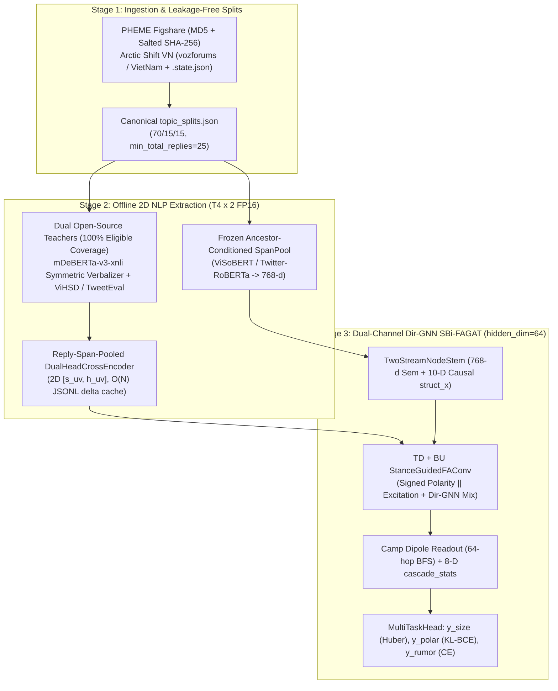

# SBi-FAGAT: Development History & Git Commit Progression

## 1. Verified Git Commit Log

| Commit | Summary | Key Architectural & Engineering Impact |
| :--- | :--- | :--- |
| `471823e` | `Initial commit` | Initial repository scaffold. |
| `46c363f` | `feat: initialize SBi-FAGAT codebase, math specs, unit tests, and team guide` | Core modules (`src/data`, `src/nlp`, `src/models`, `src/training`), `docs/math_spec.md`, `docs/literature_review.md`, `SBiFAGAT`, and 7 fair baselines. |
| `71431cc` | `research: resolve round-2 scientific blockers & add SBi-FAGAT learning lab` | Loss calibration, `docs/huong_dan_nghien_cuu_de_hieu.md`, `demo_research_walkthrough.py`, `benchmark_efficiency.py`, bootstrap/Holm reporting. |
| `5950c65` | `feat(v2): 5-class Qwen3.8-27B QLoRA teacher, 8D burst stats, auto-loop, live predictor & Kaggle T4x2 notebooks` | Profile `v2`: 5-class `Qwen/Qwen3.8-27B` QLoRA 1-pass G-Eval teacher (`[s_uv, h_uv, r_uv, c_uv]`), 8D `cascade_stats`, heteroscedastic $\beta$-NLL uncertainty (`beta_nll=0.5`), `auto_loop.py`, `predict_live_thread.py`, and dual-T4 notebooks. |
| `f4be964` | `fix(kaggle-t4x2): harden Qwen3_5ForConditionalGeneration 4-bit loader, Student CE extraction & teacher budget` | Hardened 4-bit NF4 loading, student CE extraction, and Kaggle `T4 x 2` token budget management. |
| `5820e71` | `feat(audit): implement scientific safeguards, profile gating, and project management suite` *(PR #1 by `thuyenevux`)* | Added salted author pseudonymization + `UserWarning`, live-predictor untrained guard + `test_live_predictor_audit.py`, `tzdata` Windows fix, `math_spec.md` cleanup, and initial `docs/project-management/`. |
| `090d777` | `feat(unified-2d): Steps 1–3 unified 2D SBi-FAGAT, SpanPool, KL-BCE & fair 8-model suite` | Retired `Qwen3.8-27B` QLoRA in favor of 100%-coverage Dual-Teacher (`mDeBERTa-v3-xnli` Symmetric Verbalizer + `ViHSD`/`TweetEval-Offensive`) -> reply-span-pooled 2D `DualHeadCrossEncoder`, Ancestor SpanPool, dual-channel Dir-GNN `SBiFAGAT`, `hidden_dim=64` parity, KL-calibrated BCE, and sealed machine-key zip separation. |
| *EGM Hardening* | *Full EGM 5-Goldfish Audit Remediation (`B1–B10`, `M1–M8`)* | Fixed PHEME LOO `min_total_replies` teacher coverage (`B1`), eliminated `edge_source` split-brain (`B2`), replaced $O(N^2)$ teacher JSON checkpointing with $O(N)$ JSONL deltas + multi-GPU AMP (`B3`), added crawl cursor `.state.json` resume + salted PHEME hashing (`B4`), hardened Kaggle stage skip & UPFD fault isolation (`B5`), fixed LaTeX `_` escaping + `table*` + 6 paper figure embeds + `assemble_paper_artifacts.py` (`B6`), fixed NLI double-contradiction neutral attribution + added `audit_vn_50_trees.py` (`B7`), added direction-aware stars + exact small-sample LOO permutation + topic-cluster bootstrap (`B8`), upgraded to continuous finite-sample-unbiased `y_polar` + fixed future $K$-curve window (`B9`), and added Camp Dipole/Dir-GNN/Dual-Channel ablations + matched `BiEdgeGATv2` + `TextMLP` topology masking (`B10`). |

---

## 2. Unified 2D Architecture Pipeline (Current Production Standard)

